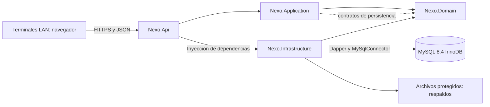

# Arquitectura

Diseño general. Fase 3 implementa la base de las cuatro capas y sondeos técnicos; véanse [[Fase 3]] y [[Verificación Fase 3]]. Los módulos de negocio siguientes siguen propuestos. Vinculada a [[Requisitos]], [[Modelo preliminar]], [[API REST]] y [[Docker local]].

## Decisión base

Monolito modular con frontend separado y una base relacional. Una transacción local permite confirmar venta, pagos e inventario sin coordinación distribuida. Los módulos son límites de responsabilidad dentro de la misma API, no microservicios.

Stack obligatorio: React + TypeScript + Vite, Tailwind CSS; C# y ASP.NET Core 10 Web API; Dapper + MySqlConnector; MySQL 8.4 LTS; JWT Bearer con refresh revocable; PasswordHasher de ASP.NET Core Identity sin proveedor EF; Docker Desktop/Compose y OpenAPI. VS Code para frontend y Visual Studio compatible con .NET 10 para backend. No se comprobaron instalaciones o compatibilidad del equipo en esta fase.



Domain no depende de otras capas. Application depende de Domain. Infrastructure implementa contratos de Domain y, si necesita contratos específicos de casos de uso, de Application. Api compone Application e Infrastructure; no contiene SQL. Las flechas a MySQL representan ejecución; las referencias de proyectos deben respetar estas dependencias.

## Módulos y responsabilidades propuestas

|Módulo|Casos de uso y elementos previstos|
|---|---|
|Seguridad|AuthService.Login/Refresh/Logout; usuarios, roles, permisos y sesiones revocables.|
|Catálogo|ProductService.Create/Update/Deactivate; categorías y proveedores.|
|Inventario|InventoryService.RegisterEntry/RegisterAdjustment; saldos y libro de movimientos.|
|Caja|ShiftService.Open/Close; movimientos y conciliación.|
|Ventas|SaleService.Confirm; CancellationService.Cancel; ReturnService.Register; comprobantes y pagos.|
|Analítica|ReportService.Query/Export; DashboardService.GetSummary; consultas de solo lectura.|
|Operación|BackupService.Create/Restore y AuditWriter.Record; acceso administrativo restringido.|

Estos nombres de módulos explican el diseño futuro; las clases técnicas implementadas se describen en [[Fase 3]]. Application orquesta una conexión/transacción por caso de uso; repositorios reciben esa misma transacción y nunca confirman por su cuenta. Domain valida invariantes, Infrastructure ejecuta SQL parametrizado y Api traduce resultados a HTTP.

## Confirmación de venta y concurrencia

```mermaid
sequenceDiagram
    participant N as Navegador
    participant A as API / Application
    participant M as MySQL
    N->>A: Confirmar (Idempotency-Key, líneas, efectivo)
    A->>A: Validar identidad y permiso
    A->>M: BEGIN; reservar clave única
    A->>M: Bloquear turno y saldos por producto en orden de ID
    A->>A: Validar turno, stock y recalcular importes
    A->>M: Insertar venta, detalle, pago, comprobante y auditoría
    A->>M: Actualizar saldos e insertar movimientos
    A->>M: Guardar resultado idempotente y COMMIT
    A-->>N: 201 y recurso persistido
```

Ante error, rollback de todo. La misma clave con el mismo contenido devuelve el resultado guardado; con distinto contenido produce conflicto. Un fallo de red tras commit permite reintentar sin duplicar. La reserva se guarda en la misma transacción y una restricción única resuelve carreras. Bloqueos de turno coordinan venta/cierre; bloqueos de saldos y actualización condicionada impiden negativos. Mantener orden de bloqueo uniforme; reintentar de forma acotada una transacción completa ante deadlock con la misma clave. Anulación y devolución bloquean la venta y sus detalles para impedir reversiones excesivas. Apertura/cierre bloquean primero la caja.

## Seguridad de sesión propuesta

Access token breve (propuesta: 10 minutos) en memoria del navegador. Refresh aleatorio (propuesta: 8 horas) en cookie HttpOnly, Secure, SameSite=Strict, con hash en base, rotación por uso y revocación de familia ante reutilización. La recarga recupera sesión mediante refresh. Al cerrar sesión se revoca la familia; los access tokens ya emitidos expiran en su plazo, y cambios de estado/permisos críticos invalidan una versión de sesión comprobada en servidor.

Preferir un mismo origen HTTPS para UI y API en operación local. En desarrollo, CORS permite solo el origen exacto de Vite con credenciales, nunca comodín. Login, refresh, logout y demás peticiones con cookies validan Origin y un token CSRF; documentar entrega y rotación al implementar. Tokens y contraseñas no se guardan en localStorage ni se registran. Limitar intentos de login, tamaño de cuerpos y exportaciones; evitar errores con detalles SQL. API valida propiedad de turno además del permiso.

## Estructura de referencia (backend implementado en Fase 3)

```text
NEXO/
├── AGENTS.md                  # normalizar nombre solo tras confirmar
├── README.md
├── compose.yaml
├── .env.example
├── .gitignore
├── docs/{requisitos,arquitectura,base-de-datos,pruebas}/
├── frontend/nexo-web/src/{app,features,components,lib}/
├── backend/
│   ├── Nexo.sln
│   ├── Nexo.Api/              # controllers, middleware, policies, DI
│   ├── Nexo.Application/      # casos de uso, DTO y validaciones
│   ├── Nexo.Domain/           # entidades, reglas y contratos
│   └── Nexo.Infrastructure/   # Dapper, archivos y servicios técnicos
├── database/{migrations,seeds}/
└── tests/{Nexo.UnitTests,Nexo.IntegrationTests}/
```

No se eligen bibliotecas adicionales de componentes, gráficos, Excel o pruebas en esta etapa. La implementación deberá justificar las mínimas necesarias. La configuración fiscal se modelará solo al aprobar reglas; no habrá motor tributario genérico.
