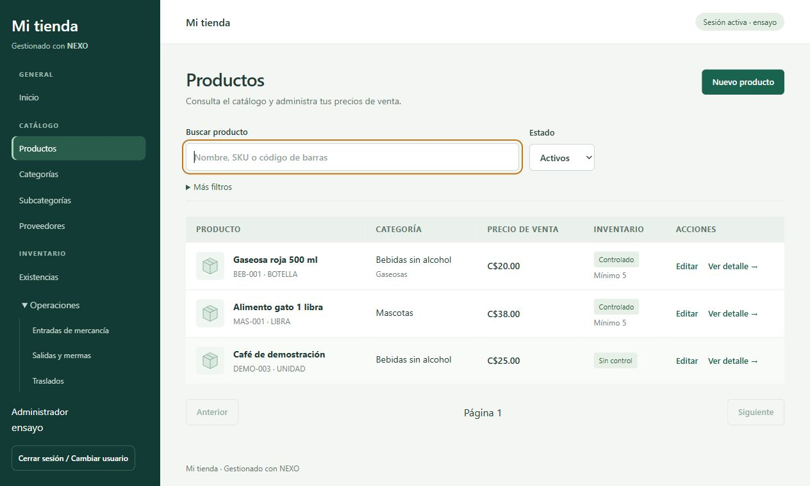
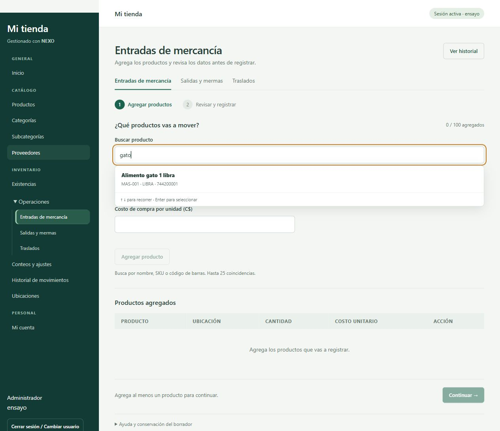
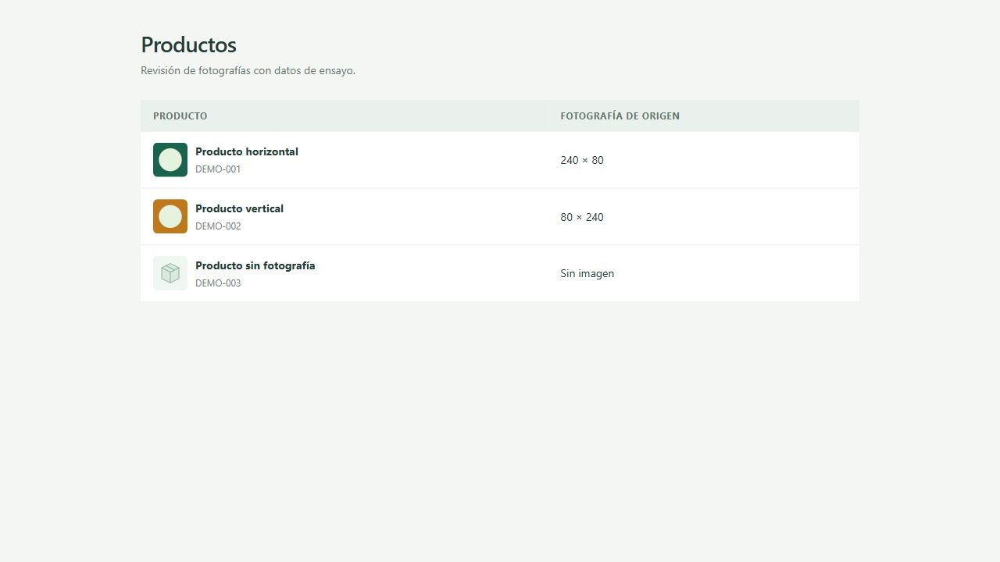

# Diseño del catálogo y búsqueda de productos

Fecha: 27 de octubre de 2026. Relacionado: [[Fase 6]], [[Inventario operativo]], [[Manual catálogo e inventario]] y [[Verificación inventario operativo]].

## Objetivo

Simplificar Catálogo y sustituir la búsqueda seguida de un selector de producto por un único campo con coincidencias desplegadas debajo mientras se escribe.

## Interfaz vigente

- Productos abre una lista con fotografía pequeña, nombre/SKU, categoría, precio de venta y control de inventario. Buscar actualiza resultados después de 200 ms. Estado está visible; categoría, subcategoría y ubicación se despliegan en Más filtros. Se conserva paginación de 25 productos.
- Nuevo producto, Editar y Ver detalle abren un diálogo nativo sobre la lista. Ya no se apilan lista, detalle y formulario en la página. El diálogo se cierra con Cancelar, la X o Escape; durante el guardado se bloquea el cierre.
- El producto se edita en Información del producto y Precios e inventario. Fotografía y Proveedores son secciones opcionales desplegables. Proveedores utiliza casillas; no requiere Ctrl para selección múltiple. Los campos siguen enviándose aunque su sección esté cerrada.
- Categorías, Subcategorías, Proveedores y Ubicaciones abren su lista con búsqueda local. Crear o Editar muestra únicamente el formulario correspondiente en un diálogo. La columna de relación cambia según el maestro; Categorías no muestra una columna vacía de tipo.
- Los permisos existentes controlan acceso y acciones. Consulta no ve creación ni edición. El servidor conserva la autorización y validación vigentes.

## Buscador único de inventario

ProductSearch se utiliza en entradas, salidas, traslados y selección de productos de conteos. No se muestra un segundo select de Producto.

1. Escribir nombre, SKU o código de barras.
2. Esperar las coincidencias (hasta 25 productos activos con control de inventario).
3. Seleccionar con clic o con flechas y Enter. Escribir por sí solo no selecciona un producto ni registra un movimiento.
4. El campo muestra nombre, SKU y unidad del elegido. La X permite cambiarlo. En operaciones se precarga su costo de referencia, editable como Costo de compra por unidad (C$).
5. Indicar ubicación/cantidad y Agregar producto. Al agregar se limpia la selección para continuar. En conteos, seleccionar añade directamente a la lista, limpia la búsqueda y excluye los ya elegidos.

Escape cierra las coincidencias; Tab conserva el orden natural. Se muestran estados de búsqueda, sin coincidencias y error. Las consultas se retardan 200 ms; se ignoran respuestas de una búsqueda que ya cambió. Los resultados desaparecen al cambiar el texto para no seleccionar una coincidencia anterior. Se utilizan combobox/listbox, etiquetas y aria-activedescendant para comunicar la opción recorrida por teclado.

## Código y arquitectura

|Archivo del frontend|Responsabilidad|
|---|---|
|src/catalog.tsx|Products, CatalogMasters y CatalogDialog: lista, filtros, campos y guardado existentes.|
|src/product-search.tsx|ProductSearch: búsqueda remota, selección explícita, teclado y estados del desplegable.|
|src/inventory-operations.tsx|Guarda el objeto seleccionado, precarga costo y conserva validación de líneas/UUID.|
|src/inventory-counts.tsx|Añade productos al conteo mediante el mismo buscador.|
|src/styles.css|Estilos acotados a catálogo, diálogo y menú de coincidencias.|

Se reutilizan React, TypeScript, React Router y Tailwind/CSS. Sin dependencias nuevas. Se mantienen endpoints, tablas y reglas: GET /productos con search/active/pageSize; guardados de productos y maestros existentes; imagen sigue usando su endpoint separado y versión del producto.

No cambian los cálculos ni saldos de inventario, las políticas del servidor ni el POS. El buscador no accede directamente a MySQL. Conserva formularios en memoria dentro de Inventario según [[Inventario operativo]].

## Decisiones e incidencias

- Se eligió diálogo nativo para mantener la lista de contexto y ofrecer comportamiento modal y Escape sin bibliotecas adicionales.
- Fotografía y proveedores se ocultan inicialmente por ser opciones secundarias; no se retiran del formulario ni se borran sus valores al cerrar la sección.
- Al transformar una selección en nueva búsqueda había que conservar el primer carácter escrito. Se separó ese cambio de la limpieza posterior a agregar una línea.
- El borrador de conteo utiliza limpieza tras seleccionar para permitir agregar varios productos sucesivos.
- El primer intento de Vite fue bloqueado al leer su configuración dentro del sandbox. Se repitió con permiso de ejecución, sin cambiar permisos de NEXO.

## Verificación de esta revisión

Recorrido en navegador con main.tsx, rutas, guardas y componentes reales. Un arnés temporal proporciona sesión/API simuladas; no se alteraron productos ni existencias reales.

- Lista de Productos sin formularios abiertos; editar Alimento gato y cambiar precio de 35 a 38; guardar actualiza la tabla simulada.
- Crear categoría Snacks DEMO desde diálogo; cerrar tras guardar y comprobar fila nueva.
- Crear Café de demostración con precio 25, retirar control de inventario y seleccionar proveedor mediante casilla. El detalle muestra precio, proveedor y estado de inventario conservados.
- Buscar gato en Productos filtra automáticamente; vaciar devuelve la lista.
- Inventario: escribir gato despliega Alimento gato debajo; seleccionar con flecha/Enter, cambiar el texto y seleccionar con clic. Agregar 15 unidades conserva costo 25 y limpia el campo.
- Conteos: seleccionar un producto desde el desplegable lo agrega y deja la búsqueda lista para otro.
- Consulta: Productos no ofrece Nuevo ni Editar; Categorías muestra cero botones de creación/edición y ningún diálogo.
- Capturas de escritorio con la dimensión normal del navegador. No se ejecutó una matriz de dispositivos móviles ni recorrido LAN en esta revisión.

Compilación final TypeScript/Vite aprobada (59 módulos) y 11 pruebas Vitest aprobadas. Arnés, servidor temporal y pestañas retirados. No se repitieron pruebas backend porque no se cambió su código en esta revisión. Las pruebas existentes del cliente verifican sesión/errores HTTP; el nuevo flujo visual se comprobó mediante el recorrido descrito, no mediante pruebas automatizadas de componentes.

## Preguntas de defensa

**¿El precio de una entrada cambia el precio del producto?** No. El costo de compra queda en el movimiento. El precio de venta se administra en Editar producto.

**¿Escribir un nombre basta para mover inventario?** No. Debe elegirse una coincidencia válida, completar la línea y confirmar la operación. El servidor mantiene sus validaciones.

**¿Por qué no aparece siempre el formulario?** La tarea principal es consultar; crear o editar se abre cuando la persona lo necesita y conserva el contexto de la lista.

## Ajuste de fotografías en la lista

Se cambió únicamente la presentación de miniaturas de Catálogo: relación 1:1, object-fit: cover y centrado, con display: block. El espacio entre foto y nombre se redujo de 14 a 10 px. Se conserva el cuadro de 44 × 44 px en la lista; las imágenes horizontales o verticales llenan ese cuadro mediante recorte de bordes, sin deformación. El original almacenado y la presentación del POS no cambian.

Verificación visual con ProductImage y estilos reales, en una página temporal con dos gráficos de ensayo (240 × 80 y 80 × 240) y el marcador sin fotografía. Ambos llenan el cuadro y las filas conservan alineación. La página, servidor y pestaña de ensayo se retiraron. Compilación TypeScript/Vite aprobada (59 módulos). No se repitieron pruebas funcionales para este cambio exclusivo de CSS.

