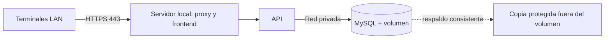

# Docker local

Actualización de Fase 2: existe Compose con MySQL 8.4.11 fijado por digest, volumen y healthcheck. Instalación verificada en 127.0.0.1:13306. Ver [[Fase 2]] y [[Verificación Fase 2]]. El resto de esta nota conserva la estrategia original. Relación: [[Arquitectura]], [[Plan de pruebas]].

## Desarrollo, Fase 2

Solo MySQL 8.4 LTS en Compose; frontend desde VS Code/Vite y API desde Visual Studio compatible con .NET 10. Publicar MySQL únicamente en 127.0.0.1:3306; si está ocupado elegir otro puerto documentado. No publicar en todas las interfaces. API y navegador nunca usan root; usuario de aplicación limitado a la base NEXO y credencial distinta para migraciones/respaldos.

Prever volumen nombrado para /var/lib/mysql, red interna, healthcheck de disponibilidad real y política de reinicio. Fijar una versión de parche o digest verificado al implementar, sin asumir que una etiqueta mutable siempre es idéntica. Migraciones mediante paso explícito, no ejecutar DDL automáticamente al iniciar la API. Scripts init de imagen solo se ejecutan sobre volumen vacío; no sustituyen migraciones.

La futura .env.example contendrá nombres y marcadores sin secretos: MYSQL_DATABASE, MYSQL_USER, MYSQL_PASSWORD, MYSQL_ROOT_PASSWORD y puerto local. .env real ignorado por Git y protegido por permisos. Las variables llegan al contenedor, por lo que no son un almacén secreto; restringir acceso a Docker y al host. No guardar JWT ni contraseñas en variables VITE públicas.

## Operación posterior en la tienda

API/frontend podrán contenerizarse en una fase posterior aprobada; no es condición para desarrollar ahora. Preferir mismo origen y reverse proxy con certificado confiable para nombre LAN estable. En operación MySQL no publica puerto al LAN; firewall permite HTTPS solo a red requerida. Definir DNS local, IP reservada y distribución de confianza del certificado. TLS también se requiere en desarrollo con credenciales; documentar certificados de desarrollo y confianza del navegador.

Servidor, router/switch y terminales necesitan energía y red; prever UPS y apagado ordenado. Sin Internet no hay problema si recursos frontend, fuentes y librerías están servidos localmente. Sin servidor/LAN no se confirma venta: no existe modo POS desconectado.

## Respaldo y recuperación previstos

Backup lógico consistente para InnoDB con herramienta compatible 8.4, metadatos de versión y checksum; credencial limitada y comando con argumentos fijos. Contraseñas no aparecen en línea de comandos/logs. Propuesta: copia diaria, retención 7 diarias y 4 semanales, copia externa cifrada y ensayo mensual; aprobar capacidad, custodia y RPO/RTO.

Volumen no equivale a backup. No copiar archivos de MySQL en caliente como estrategia lógica. No ejecutar eliminación de volumen para actualizar. Restaurar primero en base aislada, validar checksum, versión y datos; en restauración real exigir administrador, confirmación, mantenimiento, respaldo previo y registro externo a la base restaurada. No activar restauración hasta superar ensayo.

## Verificación futura

Comprobar versión, healthcheck, permisos, persistencia tras recrear contenedor, puerto no accesible desde otra terminal, migraciones sobre base limpia y recuperación en entorno aislado. Registrar comandos y resultados reales en Fase 2; nada de esto se ejecutó en Fase 1.

