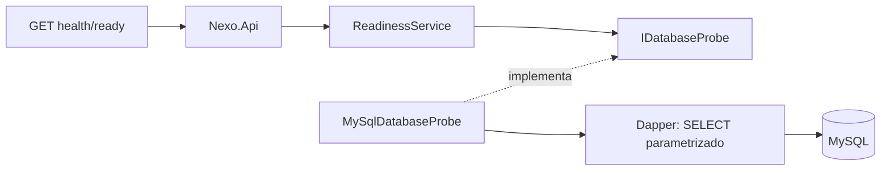

# Fase 3 — Backend base

Fecha: 15 de octubre de 2026. Enlaces: [[Arquitectura]], [[API REST]], [[Fase 2]], [[Verificación Fase 3]].

## Objetivo y tecnologías

Crear la base HTTP y de persistencia sin adelantar seguridad ni módulos de negocio. Solución `backend/Nexo.sln`: ASP.NET Core con destino net10.0, Dapper 2.1.66, MySqlConnector 2.4.0, OpenAPI integrado 10.0.13; xUnit y Microsoft.AspNetCore.Mvc.Testing para pruebas. No se usa Entity Framework.

## Capas y flujo

Domain contiene `IDatabaseProbe.CanConnectAsync`, contrato independiente de MySQL. Application contiene `ReadinessService.CheckAsync` y su DTO `ReadinessResult`: convierte disponibilidad en `ready` o `unavailable`. Infrastructure implementa el contrato mediante `MySqlDatabaseProbe`; `MySqlConnectionFactory.OpenAsync` entrega una conexión abierta que el consumidor libera con `await using`. El pool reutiliza conexiones físicas. Api registra dependencias y traduce el resultado a HTTP.



Las referencias de compilación son Api → Application e Infrastructure; Application → Domain; Infrastructure → Domain. Domain no referencia otros proyectos.

No se consultan ni modifican tablas de negocio en esta fase. El sondeo ejecuta `SELECT @value` con valor 1, parámetro Dapper, límite de consulta de 3 segundos y cancelación propagada. Comprueba acceso a la base configurada; no certifica migraciones ni todos los permisos. El usuario debe ser `nexo_app`, después de completar Migrate en Fase 2.

## Endpoints reales

|Método y ruta|Resultado|
|---|---|
|GET /api/v1/health/live|200 con status alive; no consulta MySQL.|
|GET /api/v1/health/ready|200 con status ready; 503 Problem Details si no hay conexión.|
|GET /openapi/v1.json|Documento OpenAPI; exclusivamente Development.|

`GlobalExceptionHandler` devuelve 500 genérico ante fallos inesperados. Los errores incluyen `code` y `traceId`; no se devuelve excepción, SQL ni credenciales. UseStatusCodePages genera Problem Details para rutas inexistentes. No se agregaron endpoints artificiales de error: las pruebas sustituyen el contrato por uno que falla.

CORS no permite orígenes por defecto; Development permite http://localhost:5173 y GET. No hay cookies ni credenciales CORS en esta fase. Producción activa redirección HTTPS y HSTS; el despliegue LAN requiere certificado confiable y ajustar AllowedHosts y orígenes exactos. Los sondeos son públicos y solo exponen estado mínimo.

## Ejecución desde NEXO

Requisito recomendado: SDK .NET 10 estable, Docker y migraciones aplicadas. Este equipo solo dispone del SDK 11 RC; se mantiene el destino net10.0 y se registra la limitación en la verificación. No se fija global.json a un SDK inexistente.

Configurar la cadena fuera del repositorio, por ejemplo mediante secretos de usuario:

```powershell
dotnet user-secrets set 'ConnectionStrings:MySql' 'Server=127.0.0.1;Port=13306;Database=nexo;User ID=nexo_app;Password=<contraseña local>;Connection Timeout=3;Default Command Timeout=3' --project backend/Nexo.Api
dotnet run --project backend/Nexo.Api --launch-profile http
```

Sustituir el marcador localmente. No pegar secretos en capturas, commits ni documentación. La alternativa para despliegue es la variable `ConnectionStrings__MySql`. No se carga `.env` automáticamente desde la API; ese archivo pertenece a Compose. La ausencia de cadena detiene el arranque con un mensaje de configuración sin secretos.

En Development: http://localhost:5080/api/v1/health/live, http://localhost:5080/api/v1/health/ready y http://localhost:5080/openapi/v1.json. OpenAPI es el contrato JSON; no se instaló una interfaz Swagger adicional.

```powershell
dotnet test backend/Nexo.sln
# Opcional: definir NEXO_TEST_MYSQL con una cadena local de nexo_app.
# Si falta, la prueba MySQL aparece explícitamente omitida.
dotnet test backend/Nexo.sln --filter Category=MySql
```

## Decisiones e incidencias

Se eligió un sondeo técnico de lectura para demostrar todas las capas sin implementar el catálogo antes de Fase 6. La conexión vive por operación y el contrato recibe CancellationToken. Las transacciones de ventas se implementarán en su fase, con una conexión y transacción compartidas por caso de uso.

La primera restauración detectó NU1903 por Microsoft.OpenApi 2.0.0 transitivo de ASP.NET OpenAPI 10.0.0. Se actualizó ASP.NET OpenAPI y Mvc.Testing a 10.0.13; no se deshabilitó la auditoría NuGet. El entorno restringido bloqueó inicialmente la inicialización de dotnet y Docker; se solicitaron permisos para verificarlos.

## Preguntas del jurado

- ¿Por qué cuatro capas? Separan HTTP, coordinación, contratos y persistencia; permite probar la aplicación sin una base de datos.
- ¿Qué aporta Dapper? Ejecuta SQL explícito y mapea resultados; no crea ni migra tablas.
- ¿Por qué live y ready? Un proceso vivo puede no acceder a MySQL; distinguirlos facilita diagnóstico.
- ¿Un doble de prueba demuestra MySQL? No. Las pruebas HTTP usan dobles; la prueba marcada MySql ejecuta Dapper con MySQL real.
- ¿Ya es seguro vender con esta API? Todavía no hay endpoints de venta; autenticación, permisos y transacciones pertenecen a fases siguientes.
Resultados ejecutados: **13 pruebas correctas, 0 fallidas y 0 omitidas**, incluida MySQL real; evidencia y límites en [[Verificación Fase 3]].

## Recuperación de secretos al ejecutar Debug directamente

La comprobación mediante el perfil http no reprodujo el fallo persistente comunicado desde Visual Studio. Se añadió en Program.cs un respaldo exclusivo de compilaciones DEBUG: si no hay ConnectionStrings:MySql, se carga AddUserSecrets<Program>; si aún falta, se busca el archivo del mismo UserSecretsId en AppData/Roaming del perfil de Windows. Esto permite ejecutar el binario Debug sin que launchSettings establezca Development. La configuración existente se conserva cuando ya tiene conexión. Release mantiene la configuración estándar del entorno y no incluye este respaldo. No se introduce ninguna contraseña en el código. El mensaje de configuración ausente ahora incluye entorno y perfil de usuario para facilitar diagnóstico sin mostrar secretos.

## Configuración privada local de Debug

Para evitar diferencias de resolución de secretos entre Visual Studio y la terminal, Debug carga al final appsettings.Local.json desde AppContext.BaseDirectory. Ese archivo local contiene la conexión de nexo_app, se excluye mediante .gitignore, se copia solo en Debug y no se publica. Tiene prioridad local sobre otras fuentes; cambiarlo requiere reiniciar la API porque la fábrica de conexiones conserva la cadena del proceso. Release no incluye ni carga ese archivo. El archivo de esta instalación se generó desde .env sin mostrar las credenciales.

MySqlDatabaseProbe acepta un callback opcional de diagnóstico; Api registra únicamente el código numérico de MySQL (o -1 ante timeout), sin excepción completa, SQL ni contraseña. El cliente HTTP sigue recibiendo 503 genérico. Se restauró además la validación de conexión ausente y la instalación incondicional del middleware de errores.
