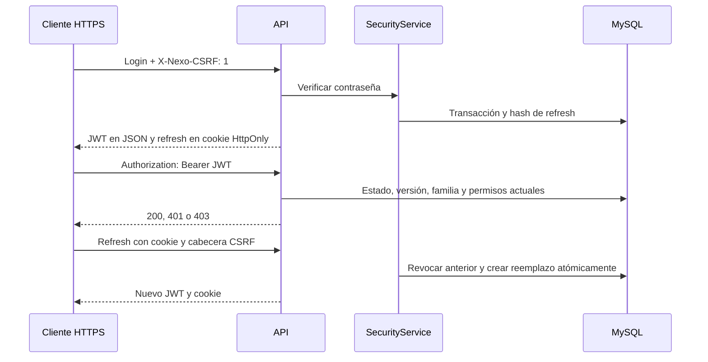

# Fase 4 — Seguridad y usuarios

> Actualización del 16/10/2026: la política vigente es [[Sesiones en terminales compartidas]] (sin restauración automática, cookie de sesión, cinco minutos de inactividad y ocho horas absolutas). Las referencias de esta nota a siete días describen la implementación inicial, sustituida por la migración 004. Para cambios de contraseña rige [[Política de contraseñas]].

Fecha: 15 de octubre de 2026. Véanse [[Fase 3]], [[API REST]], [[Verificación Fase 4]] y [[Requisitos]].

## Objetivo y alcance

Implementar autenticación y administración de identidades en el backend de la tienda. No incluye todavía interfaz React ni módulos de ventas. Tecnologías: ASP.NET Core 10, JWT Bearer 10.0.13, PasswordHasher de Identity sin proveedor EF, Dapper y MySqlConnector. Se mantienen las capas y las tablas creadas en Fase 2.

## Archivos y responsabilidades

- `Nexo.Domain/Security.cs`: registros de usuario, rol, permiso, sesión y contratos `ISecurityStore`/`ISecuritySession`.
- `Nexo.Application/SecurityService.cs`: login, rotación, cierre de sesión, validación de usuarios y contraseñas, roles, permisos y administrador inicial. `SecurityError` lleva código y estado HTTP de un rechazo esperado.
- `Nexo.Infrastructure/MySqlSecurityStore.cs`: SQL parametrizado y transacción compartida; nunca devuelve hashes a HTTP.
- `Nexo.Api/SecurityEndpoints.cs`: endpoints, JWT, políticas, cookies, comprobación de origen y límite de intentos. `Program.cs` instala middleware y comando local de administrador.
- `database/migrations/003_seguridad.sql`: catálogo de permisos administrativos, roles mínimos y fila de bloqueo. No cambia migraciones previas.
- `database/Manage-Database.ps1`: concede DELETE únicamente a `usuario_roles` y `rol_permisos`, necesario para reemplazar relaciones; no concede borrado de usuarios, roles ni historial.

## Flujo y conceptos

La contraseña se verifica con PasswordHasher (PBKDF2, sal individual incorporada en el hash). Debe contener entre 12 y 128 caracteres, al menos una letra y un dígito. No se guarda ni devuelve en texto plano. Las cuentas inexistentes usan un hash ficticio para reducir diferencias de tiempo de verificación. La respuesta de login inválido es siempre 401. El hash se actualiza al iniciar sesión si Identity recomienda recalcularlo.

El access token JWT dura 10 minutos. Se validan firma HMAC-SHA256, emisor, audiencia, expiración y algoritmo; tolerancia de reloj: 15 segundos. Incluye `sub` (usuario), `ver` (versión de sesión), `sid` (familia) y `jti` (identificador aleatorio). Los roles y permisos efectivos se consultan en MySQL en cada petición, por lo que retirar un permiso surte efecto en la siguiente petición. También se exige usuario activo, versión vigente y familia con refresh no revocado ni vencido. No se permite que un JWT firmado mantenga acceso después del cierre de sesión.

El refresh token contiene 48 bytes aleatorios y viaja exclusivamente en cookie `__Secure-nexo-refresh`, `HttpOnly`, `Secure`, `SameSite=Strict`, ruta `/api/v1/auth`. MySQL solo almacena SHA-256 del token. Su vencimiento absoluto es siete días desde el login; rotarlo no extiende ese plazo. Cada refresh revoca el anterior y enlaza su reemplazo. Reutilizar cualquier token revocado revoca toda su familia. El cliente debe coordinar una sola renovación a la vez: dos renovaciones simultáneas causan una detección de reutilización y obligan a iniciar sesión otra vez.



`MySqlSecurityStore.Execute` abre conexión y transacción ReadCommitted; bloquea con `SELECT ... FOR UPDATE` la única fila de `seguridad_bloqueo`. Todas las operaciones del repositorio de seguridad comparten ese bloqueo. Así serializa rotaciones, bootstrap y protección del último administrador, incluso entre procesos API. Si una regla falla, revierte toda la operación. La revocación por reutilización devuelve un resultado inválido sin lanzar una excepción dentro de la transacción, de forma que sí se confirma la revocación.

Esta decisión simplifica la consistencia para una tienda local, a costa de serializar también lecturas y verificación de contraseñas; no es un diseño para alta concurrencia. Una caída de MySQL impide autenticar peticiones: el sistema no continúa con permisos almacenados en memoria.

## Protección HTTP

Todos los endpoints de sesión, usuarios, roles y permisos requieren HTTPS, incluso en Development. HSTS y redirección de producción continúan activos. Los endpoints health conservan su comportamiento.

Login, refresh y logout requieren `X-Nexo-CSRF: 1`. Si viene `Origin`, debe coincidir exactamente con la API o un origen CORS permitido. La cabecera obliga a los navegadores a hacer preflight para peticiones de otro origen; CORS restringe orígenes, métodos y cabeceras, permitiendo credenciales solo a los orígenes configurados. Clientes de terminal pueden omitir Origin, pero deben enviar la cabecera. SameSite Strict añade una barrera a la cookie. La ausencia de la cabecera o un origen ajeno devuelve 403.

Login y refresh admiten conjuntamente hasta 10 solicitudes por minuto por IP y proceso; devuelven 429 al excederlo. No hay bloqueo persistente por cuenta; tras un reinicio el contador se reinicia. No configurar cabeceras de proxy confiables sin definir explícitamente su origen.

El frontend de Fase 5 deberá mantener el JWT en memoria, usar `credentials: include` para sesión y `Authorization: Bearer` para recursos, nunca localStorage. Las terminales y API deben usar HTTPS y pertenecer al mismo sitio para la cookie Strict; en desarrollo se contempla `https://localhost:5173` y API `https://localhost:7080`. No se ha probado todavía esta interacción en un navegador real. Login, refresh y me responden con `Cache-Control: no-store`.

## Endpoints implementados

Todos bajo `/api/v1`. OpenAPI de desarrollo refleja los endpoints y sus DTO. El documento no incluye todavía un esquema OpenAPI personalizado para el botón Authorize; enviar Bearer como cabecera en el cliente HTTP.

| Método y ruta | Regla |
|---|---|
| POST /auth/login | Público, HTTPS, cabecera CSRF, origen y límite de intentos. JSON: username, password. |
| POST /auth/refresh | Cookie, HTTPS, CSRF, origen y límite de intentos. Sin cuerpo. |
| POST /auth/logout | Revoca familia y borra cookie; HTTPS y CSRF. Idempotente. |
| GET /auth/me | Bearer vigente; identidad, roles y permisos. |
| GET /usuarios?page=1&pageSize=25 | usuarios.leer; máximo 100 por página. |
| GET /usuarios/{id}; GET /usuarios/{id}/roles | usuarios.leer; perfil sin hash y nombres de roles activos. |
| POST /usuarios | usuarios.administrar; username, name, password, active. Devuelve 201. |
| PUT /usuarios/{id} | usuarios.administrar; username, name, active. Omitir password. |
| DELETE /usuarios/{id} | usuarios.administrar; desactivación, nunca borrado físico. |
| PUT /usuarios/{id}/roles | roles.asignar; cuerpo `{ "ids": [2] }`, reemplaza roles. |
| POST /usuarios/{id}/cambio-contrasena | Propietario con currentPassword o administrador con usuarios.administrar; newPassword obligatorio. |
| GET /roles; GET /roles/{id} | roles.leer. |
| POST /roles; PUT /roles/{id} | roles.administrar; name y active. |
| DELETE /roles/{id} | roles.leer y roles.administrar; desactiva. |
| GET /permisos; GET /roles/{id}/permisos | roles.leer; catálogo y IDs asignados al rol. |
| PUT /roles/{id}/permisos | roles.administrar y rol Administrador; `{ "ids": [1,2] }`. |

Los códigos técnicos de permiso son un catálogo SQL cerrado; no se crean desde HTTP. Los permisos administrativos de esta fase son `usuarios.leer`, `usuarios.administrar`, `roles.leer`, `roles.administrar` y `roles.asignar`. Administrador recibe el catálogo existente. Vendedor/Cajero y Consulta conservan sus permisos de demostración para catálogo/ventas/reportes, sin acceso a administración de usuarios. Esos módulos de negocio aún no se implementan.

No se puede editar ni desactivar el rol Administrador ni cambiar sus permisos. No se permite cambiar los roles propios. Para asignar una lista no vacía de roles se exige además ser Administrador; la restricción impide delegación de privilegios desde un rol limitado. Desactivar un usuario o quitarle roles no puede dejar al sistema sin un administrador activo: la transacción se revierte con 409. La creación inicial usa un comando local, no una ruta pública de registro.

Cambiar contraseña, editar perfil/estado o asignar roles incrementa `version_sesion` y revoca todas las sesiones del usuario. Editar permisos o estado de un rol se aplica mediante consulta vigente en la siguiente petición. Las acciones críticas exitosas se registran en `auditoria`, sin contraseñas ni tokens. El registro no pretende reemplazar la consulta e interfaz de auditoría de Fase 9.

Errores esperados: 400 validación, 401 sesión, 403 permisos/CSRF, 404 inexistente, 409 conflicto y 429 límite. Se usa Problem Details con `code` y `traceId`, sin SQL ni stack traces.

## Configurar y ejecutar

Desde NEXO, con MySQL disponible:

```powershell
pwsh -File database/Manage-Database.ps1 Migrate
# Ejecutar localmente. La clave generada queda en secretos de usuario, nunca en Git.
$jwtKey = [Convert]::ToBase64String([System.Security.Cryptography.RandomNumberGenerator]::GetBytes(48))
dotnet user-secrets set 'Jwt:SigningKey' $jwtKey --project backend/Nexo.Api
Remove-Variable jwtKey
# Se conserva ConnectionStrings:MySql de Fase 3.
dotnet dev-certs https --trust
dotnet run --project backend/Nexo.Api --launch-profile https -- --bootstrap-admin
# Introducir usuario, nombre y contraseña en la terminal; contraseña oculta.
dotnet run --project backend/Nexo.Api --launch-profile https
```

Si Visual Studio mantiene la API Debug abierta, detener esa ejecución antes de compilar Debug. La verificación de esta fase usó Release para evitar los archivos bloqueados. El comando de bootstrap termina tras crear la cuenta y rechaza la operación si ya existe un administrador activo. No habilita las cuentas demo. El código no genera contraseñas predeterminadas ni imprime secretos. No se ha creado una cuenta permanente durante las pruebas.

La aplicación valida al arrancar que la clave tenga al menos 32 bytes y que emisor y audiencia no estén vacíos. En despliegue Release usar `Jwt__SigningKey`, `Jwt__Issuer`, `Jwt__Audience` y `ConnectionStrings__MySql` del entorno o un proveedor de secretos; no distribuir secretos de desarrollo. Cambiar la clave invalida todos los JWT previos. Un certificado confiable para el nombre LAN de cada terminal sigue siendo requisito de instalación, no lo proporciona el certificado localhost.

Ejemplo desde un cliente HTTP con certificados confiables:

```http
POST https://localhost:7080/api/v1/auth/login
Content-Type: application/json
X-Nexo-CSRF: 1

{"username":"<usuario creado localmente>","password":"<contraseña privada>"}
```

Guardar la cookie en el administrador de cookies del cliente. Para GET /auth/me enviar `Authorization: Bearer <accessToken>`; para refresh y logout enviar cookie y cabecera CSRF. No copiar tokens a capturas ni documentación.

## Pruebas e incidencias

Véase [[Verificación Fase 4]] para los resultados reales. Las pruebas HTTP sustituyen la persistencia por un doble transaccional; `MySqlSecurityTests` verifica el repositorio y los casos de uso contra MySQL real dentro de una transacción que se revierte al terminar. No demuestra concurrencia real entre procesos MySQL; la prueba de dos refresh simultáneos utiliza el doble con exclusión mutua.

La restauración inicial requirió permiso para leer NuGet.Config. La compilación Debug falló por archivos bloqueados por una API abierta y se comprobó Release. MySqlConnector interpretaba familia CHAR(36) como Guid; la consulta convierte expresamente a CHAR(100) para obtener texto. También se corrigió una prueba que intentaba cambiar BaseAddress después de enviar solicitudes. Estas incidencias no se ocultaron ni se deshabilitaron pruebas.

## Preguntas del jurado

- ¿JWT cifra la contraseña? No. JWT representa la sesión y se firma; no lleva contraseña y sus datos pueden leerse. HTTPS protege el transporte.
- ¿Por qué hash para la contraseña y para el refresh? La contraseña requiere un algoritmo lento con sal; el refresh ya tiene alta entropía aleatoria y se compara por SHA-256. Una copia de la tabla no permite usar directamente sus hashes como tokens.
- ¿Por qué consultar permisos si JWT ya está firmado? La firma garantiza origen e integridad, pero no refleja revocaciones ni cambios posteriores. Aquí la BD decide el estado vigente.
- ¿Qué pasa si dos cajas renuevan el mismo token? Una rotación gana; la reutilización revoca la familia. Cada terminal debe tener su propia sesión y coordinar sus renovaciones.
- ¿Ocultar botones protege usuarios? No. Las políticas y las reglas del servicio rechazan las operaciones no autorizadas aunque se invoquen directamente por HTTP.
- ¿Es un proveedor OAuth/OIDC? No. Es autenticación local propia del alcance académico LAN. La guía de Microsoft recomienda proveedores OAuth/OIDC para escenarios generales; una federación futura requeriría un diseño específico.

Referencia técnica consultada: [Validación JWT Bearer de ASP.NET Core 10](https://learn.microsoft.com/en-us/aspnet/core/security/authentication/configure-jwt-bearer-authentication?view=aspnetcore-10.0).

## Instalación local posterior

La configuración local y la cuenta administrativa ya fueron creadas y comprobadas tras la implementación. Véase [[Configuración local de seguridad]] para el estado real, ejecución y consulta local de la credencial cifrada.
