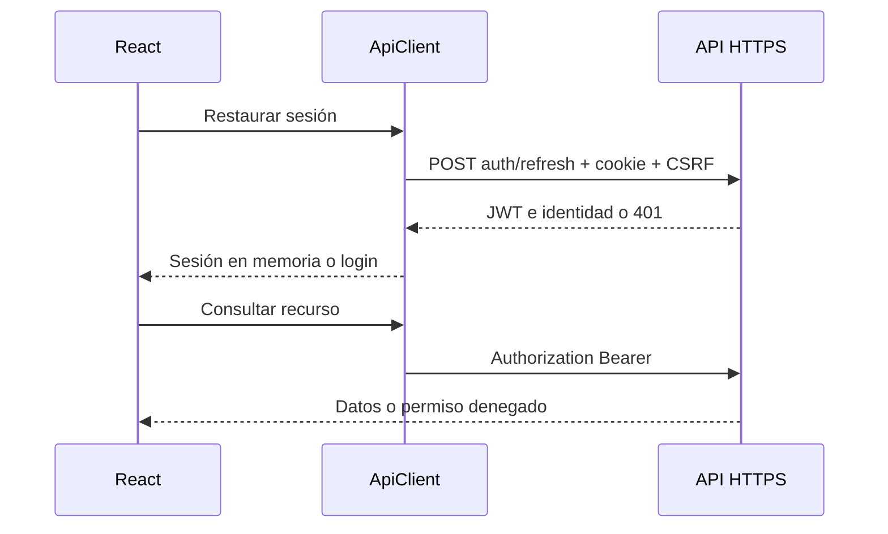

# Fase 5 — Frontend base

> Actualización del 16/10/2026: [[Sesiones en terminales compartidas]] sustituye la restauración automática y el cierre local condicionado al éxito de logout descritos en esta nota histórica. Abrir/recargar exige login; la terminal se bloquea tras cinco minutos incluso si falla la red. Evidencia actual: [[Verificación sesiones compartidas]].

15 de octubre de 2026. Relacionado: [[Fase 4]], [[API REST]], [[Verificación Fase 5]].

## Objetivo y tecnologías

Base web en `frontend/nexo-web`: React, TypeScript estricto, Vite, Tailwind CSS y React Router. Vitest verifica el cliente HTTP. No incorpora módulos de fases 6–9, datos ficticios de operación ni conexión directa con MySQL. No cambia contratos del backend.

## Diseño y archivos

`src/main.tsx` contiene la composición de rutas y pantallas: Login, Layout, Home, Account y Users. Diseño adaptable en verde oscuro, navegación lateral en escritorio y navegación flexible en pantallas pequeñas. Formularios con etiquetas, autocompletado, restricciones HTML, estado de envío y mensajes accesibles. `src/styles.css` aplica Tailwind y componentes compartidos. No hay fuentes ni recursos externos necesarios para operar en LAN.

`src/api.ts` define Identity, Session y User según JSON real de Fase 4. ApiClient centraliza fetch, Bearer, cookie, cabecera CSRF, errores Problem Details, límite de espera de 15 segundos y renovación. ApiError conserva status, code y traceId sin mostrar detalles internos del servidor. `vite.config.ts` lee certificados locales PEM para desarrollo y preview HTTPS. `.env.example` contiene rutas y URL públicas de configuración; nunca introducir secretos en variables VITE.

## Sesión y autorización

Al arrancar, App intenta restaurar mediante POST `/auth/refresh`. Un 401 abre el login; problemas de conexión permiten reintentar. Login envía usuario y contraseña a POST `/auth/login`; el access token y la identidad quedan exclusivamente en memoria. El refresh permanece en cookie HttpOnly del backend. No se usan localStorage, sessionStorage ni IndexedDB.

Protected redirige visitas anónimas al login y conserva la ruta interna de destino. `/usuarios` requiere `usuarios.leer`. Ocultar enlaces y bloquear rutas mejora la interfaz; la autorización efectiva continúa en ASP.NET Core y MySQL. Las peticiones usan los permisos actuales comprobados por el servidor. La identidad mostrada corresponde al último login/refresh y puede quedar desactualizada hasta la siguiente renovación.

Ante 401 del recurso se renueva y se reintenta una sola vez. 403 no provoca renovación. Una promesa compartida evita renovaciones simultáneas dentro de la pestaña; Web Locks serializa login/refresh/logout entre pestañas del mismo origen. Se exige un navegador moderno con HTTPS y Web Locks. Usar siempre el mismo origen frontend para una instalación; distintas aplicaciones/orígenes no comparten ese bloqueo. Cada pestaña conserva su JWT en memoria; cerrar sesión en otra pestaña se refleja al consultar nuevamente el servidor, que rechaza la familia revocada. No hay cierre visual inmediato por difusión entre pestañas.

Logout espera confirmación HTTP antes de borrar la memoria; si falla, muestra error y permite reintentar, sin afirmar que la cookie fue revocada. El cambio de contraseña POST `/usuarios/{id}/cambio-contrasena` valida longitud, letras, números y confirmación. Tras éxito vuelve al login porque la API revoca todas las sesiones. El servidor repite la validación obligatoria. Users usa GET `/usuarios?page=1&pageSize=25`, maneja carga/error/vacío y paginación. La ampliación posterior incorpora creación/edición de usuarios, estado, asignación de roles y edición de permisos: véase [[Administración de usuarios frontend]].



## Ejecución local

Primero iniciar MySQL y API según [[Fase 4]], perfil `https` en puerto 7080. Conservar secretos existentes. Desde `frontend/nexo-web`:

```powershell
npm ci
Copy-Item .env.example .env.local
New-Item -ItemType Directory -Force .certs
dotnet dev-certs https --trust
dotnet dev-certs https --export-path .certs/localhost.pem --format PEM --no-password
npm run dev
```

El certificado exportado y `.key` quedan privados en `.certs`, ignorada por Git. Abrir `https://localhost:5173`; la API ya permite ese origen CORS. Ambas URLs deben ser HTTPS con certificados confiables y mismo sitio para SameSite Strict. HTTP no sirve para probar sesión segura. Para verificar: `npm test` y `npm run build`. `npm run preview` sirve el build con el mismo certificado local. En producción servir dist mediante HTTPS y configurar fallback de rutas a index.html; el servidor Vite de desarrollo no es el despliegue LAN. El certificado localhost no cubre nombres/IP de otras terminales.

## Decisiones e incidencias

Se eligió fetch nativo y estado externo con useSyncExternalStore para evitar bibliotecas de estado/HTTP innecesarias. No hay temporizador automático: se renueva al recibir 401 o al restaurar, evitando solicitudes periódicas sin actividad. Dependencias bloqueadas en package-lock.json. La descarga inicial de npm encontró EACCES de red en el sandbox; se solicitó ejecución autorizada para instalar y verificar. Los resultados reales y pendientes se registran en [[Verificación Fase 5]].

## Defensa ante el jurado

- ¿Por qué no guardar JWT en localStorage? La memoria limita su persistencia; HttpOnly impide leer el refresh desde JavaScript. HTTPS y prevención de XSS siguen siendo necesarios.
- ¿Qué es una ruta protegida? Una condición de navegación; la API decide si una operación está autorizada.
- ¿Por qué coordinar refresh? El backend rota y revoca tokens usados; enviar dos veces el mismo refresh puede invalidar la familia.
- ¿React calcula permisos definitivos? No. Presenta la identidad recibida y maneja 403; el servidor verifica los permisos actuales.
- ¿Qué tablas intervienen? Las mismas de seguridad de Fase 4: usuarios, roles, permisos, relaciones, refresh tokens y auditoría; no se agregan tablas.

Referencia: [integración oficial de Tailwind con Vite](https://tailwindcss.com/docs/installation/using-vite).
