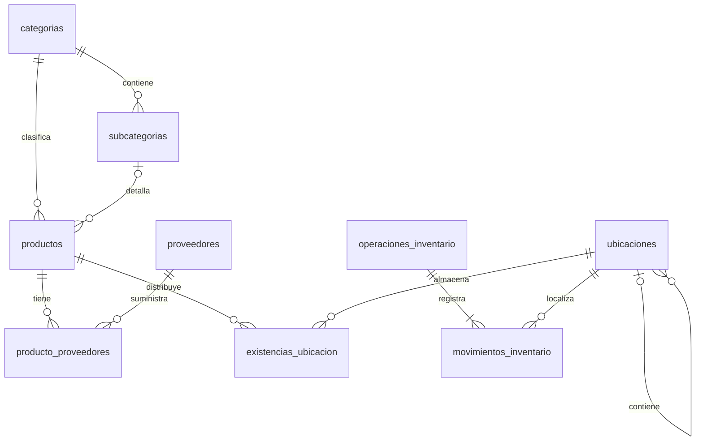
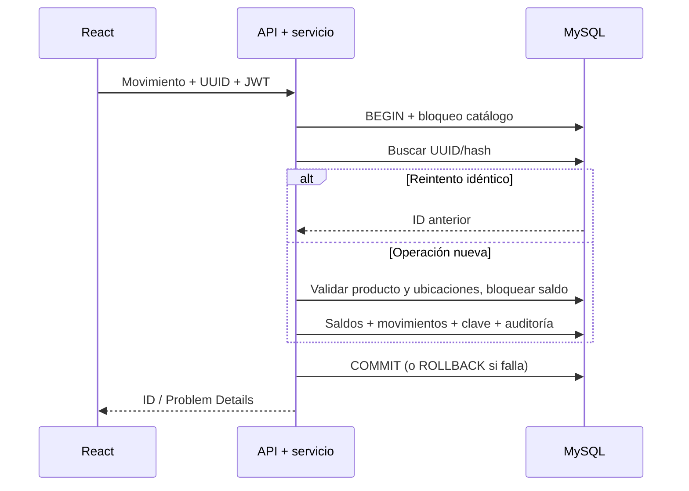

# Fase 6

Fecha: 16 de octubre de 2026. Catálogo e inventario para una tienda con varias ubicaciones, moneda NIO. Vinculada con [[Fase 5]], [[API REST]], [[Modelo preliminar]], [[Verificación Fase 6]] y [[Manual catálogo e inventario]].

## Objetivo y alcance

Administrar productos, categorías, subcategorías, proveedores y distribución física; registrar entradas, salidas, ajustes y traslados sin negativos y consultar alertas. La solicitud de esta fase resuelve D01 respecto a múltiples ubicaciones. Las cantidades admiten hasta tres decimales, conforme al esquema existente; los importes de referencia admiten cuatro. No se define ninguna regla fiscal ni cálculo de ventas en esta fase.

React + TypeScript + Tailwind consume HTTPS/JSON de ASP.NET Core 10. Application valida casos de uso; Domain contiene contratos y reglas de saldo; Infrastructure usa Dapper y MySqlConnector. No se incorporaron paquetes.

## Archivos y responsabilidades

|Archivo|Responsabilidad|
|---|---|
|`backend/Nexo.Domain/Catalog.cs`|DTO de dominio y contratos ICatalogStore/ICatalogSession, InventoryRules y CatalogError.|
|`backend/Nexo.Application/CatalogService.cs`|Validaciones de maestros/productos, relaciones, versiones, filtros, alertas y movimientos.|
|`backend/Nexo.Infrastructure/MySqlCatalogStore.cs`|SQL parametrizado, transacción, lectura y persistencia; traducción de conflictos MySQL.|
|`backend/Nexo.Api/CatalogEndpoints.cs`|Rutas y políticas; identidad responsable desde claim sub.|
|`backend/Nexo.Api/Program.cs`|Registro del módulo y mapeo de endpoints.|
|`backend/Nexo.Api/GlobalExceptionHandler.cs`|Problem Details también para errores del repositorio.|
|`frontend/nexo-web/src/catalog.tsx`|Products, CatalogMasters e Inventory. Formularios, filtros, consultas y permisos visibles.|
|`frontend/nexo-web/src/main.tsx`|Navegación y rutas protegidas.|
|`frontend/nexo-web/src/api.ts`|Mensajes de error; conserva sesión y cliente existentes.|
|`database/migrations/005_catalogo_inventario.sql`|Evolución aditiva del esquema y permisos.|
|`database/seeds/002_catalogo_demo.sql`|55 productos ficticios con saldos e historial.|
|`database/Manage-Database.ps1`|SeedCatalog y permiso DELETE únicamente para tabla puente producto_proveedores.|
|`database/seeds/001_demo.sql`, `database/tests/integridad.sql`|Compatibilidad del dataset anterior con ubicaciones y verificador de integridad.|

Se conservaron cambios locales anteriores de seguridad y terminales compartidas. No se crearon commits.

## Modelo de datos

Se reutilizan `categorias`, `productos`, `proveedores`, `producto_proveedores`, `existencias`, `operaciones_inventario`, `movimientos_inventario`, `operaciones_idempotentes` y `auditoria`. Nuevas tablas: `subcategorias`, `ubicaciones`, `existencias_ubicacion`, `catalogo_bloqueo`.

- Una categoría tiene subcategorías; FK compuesta impide asociar un producto a una subcategoría de otra categoría.
- Ubicaciones forman una jerarquía con tipos AREA, PASILLO, SECCION y ESTANTE. La aplicación impide ciclos y desactivar una ubicación con saldo o hijos activos.
- Un producto tiene varias ubicaciones y varios proveedores. El mínimo corresponde al total de la tienda.
- Se mantienen `existencias` como saldo global compatible y `existencias_ubicacion` como detalle. Toda escritura del módulo actualiza ambos en la misma transacción.
- Los datos anteriores y su historial se asignan a B-01. No se reescriben precios históricos de ventas.
- Los maestros usan `version`; editar/desactivar con versión antigua devuelve 409 `stale_version`. No implementa el ETag propuesto inicialmente: se envía versión explícita en JSON o query de DELETE.
- No se eliminan productos ni movimientos. Las asociaciones producto/proveedor sí permiten retirar una relación.



## Transacción y concurrencia

`MySqlCatalogStore.Execute` abre conexión y transacción READ COMMITTED, toma `catalogo_bloqueo FOR UPDATE`, ejecuta el caso de uso y confirma. Una excepción dispone la transacción y revierte. Este bloqueo conservador serializa todas las operaciones del módulo, incluidas lecturas: facilita consistencia para la tienda académica; no se ha medido su rendimiento a gran escala. Fase 7 deberá compartir el protocolo de bloqueo o sustituirlo por una estrategia común antes de escribir stock desde ventas.

`Move` exige producto activo con control de inventario, ubicación activa, cantidad válida y motivo. ENTRADA suma; SALIDA resta; AJUSTE aplica diferencia con signo; TRASLADO resta origen y suma destino. Un traslado se guarda como operación AJUSTE con `traslado=TRUE`, presentada como TRASLADO en la API: evita modificar la restricción de tipos histórica.

Cada movimiento conserva cantidad, ubicación, fecha UTC y usuario; motivo y tipo están en la cabecera. El servidor calcula el saldo. No se acepta usuario responsable del navegador. Los saldos se bloquean también con FOR UPDATE y la BD impide cantidades negativas.

La clave `key` UUID es obligatoria en JSON. `Previous` compara SHA-256 del contenido: mismo usuario/clave/contenido devuelve el id anterior; contenido distinto devuelve 409. El registro idempotente y auditoría se confirman con el stock. La interfaz conserva la clave al fallar y la cambia al confirmar o iniciar otra operación. No reintentar una operación con datos modificados cuando se desconoce si la anterior se confirmó.



## Endpoints efectivos

Base `/api/v1`, JWT y HTTPS obligatorios, `Cache-Control: no-store`.

|Método/ruta|Permiso|
|---|---|
|GET `/categorias`, `/subcategorias`, `/ubicaciones`|catalogo.leer|
|POST / PUT `/{maestro}` / `/{maestro}/{id}`|catalogo.administrar|
|DELETE `/{maestro}/{id}?version=N`|catalogo.administrar (desactivación)|
|GET `/proveedores`|proveedores.leer|
|POST, PUT, DELETE `/proveedores[/{id}]`|proveedores.administrar|
|GET `/productos`, `/productos/{id}`|catalogo.leer|
|POST, PUT, DELETE `/productos[/{id}]`|catalogo.administrar|
|GET `/inventario/existencias`, `/inventario/stock-bajo`, `/inventario/movimientos`|inventario.leer|
|POST `/inventario/entradas`|inventario.entradas|
|POST `/inventario/salidas`, `/inventario/ajustes`, `/inventario/traslados`|inventario.ajustar|

Los maestros se crean con `id=0`, `version=0`, `name`, `active`; subcategoría añade `parentId`; ubicación añade `code`, `type`, `parentId`; proveedor añade `identification`, `phone`. PUT envía versión leída. DELETE también está disponible; la interfaz desactiva mediante el checkbox Activo y PUT.

Productos: `sku`, `barcode` opcional, `name`, `categoryId`, `subcategoryId` opcional, `price`, `cost`, `unit`, `minimumStock`, `trackInventory`, `active`, `version`, `supplierIds`. Unidades admitidas: UNIDAD, PAQUETE, BOTELLA, LATA, BOLSA, LIBRA, LITRO, VASO, PORCION. `cost` es referencia, no valoración contable ni costo promedio.

Filtros de productos: `search` (nombre/SKU/barras), `categoryId`, `subcategoryId`, `active`, `locationId`, `page`, `pageSize` (1–100). Orden por nombre/id. Existencias filtra por `productId` y `locationId`; incluye saldos de productos inactivos para permitir inspección. Historial manual: `from` inclusivo, `to` exclusivo, UTC, rango máximo 366 días, `productId`, `type`, `page`, `pageSize`. La interfaz muestra fecha local, y etiqueta los filtros como UTC.

Ejemplo de traslado (sustituir IDs por los reales):

```json
{"key":"424bd07b-049f-4499-b597-6f41385eb4b9","type":"TRASLADO","productId":12,"locationId":2,"destinationId":1,"quantity":4,"reason":"Reposición de refrigerador"}
```

La migración asigna todos los permisos nuevos al Administrador. Consulta y Vendedor/Cajero reciben únicamente `catalogo.leer` e `inventario.leer`. Proveedores requieren permiso explícito; los roles personalizables pueden asignarlo desde el módulo de seguridad. Para operar los formularios de inventario se requieren también catálogo.leer e inventario.leer, además del permiso de escritura correspondiente.

## Productos preparados y alertas

Hot dogs, nachos preparados y café caliente son productos de venta con `trackInventory=false` en la demostración. No tienen recetas, ingredientes ni consumo de insumos. Desactivar control exige saldo cero para no ocultar existencias. El módulo rechaza movimientos para ellos y los excluye de alertas.

`LowStock` suma ubicaciones por producto activo con control; cero significa agotado, total <= mínimo significa stock bajo. Se incluyen productos nuevos sin filas de existencias como cero. La venta y comprobante de estos productos deberá respetar el indicador en Fase 7; no existe todavía confirmación de venta funcional en la aplicación.

## Instalación y demostración

```powershell
pwsh -NoProfile -File database/Manage-Database.ps1 Migrate
# Opcional en desarrollo; requiere un usuario ya creado. Ejecutar una vez.
pwsh -NoProfile -File database/Manage-Database.ps1 SeedCatalog
dotnet test backend/Nexo.sln -c Release
npm --prefix frontend/nexo-web test
npm --prefix frontend/nexo-web run build
```

No ejecutar `Seed` sobre una instalación existente. `SeedCatalog` no requiere ejecutar la semilla antigua: usa un usuario existente para responsabilizar la carga. La carga falla y revierte si no existe usuario o si se repiten SKU DEMO-F6. Precios, cantidades, proveedores y teléfonos son ficticios. No equivalen a precios comerciales ni a reglas tributarias.

El catálogo contiene 55 productos (5 por cada categoría solicitada), 11 subcategorías, las 9 áreas de ejemplo y un estante. Hay 5 preparados sin inventario, productos agotados y con stock bajo. DEMO-F6-007 tiene 10 unidades en R-01 y 30 en B-01. `SeedCatalog` es opcional; no incorpora datos demo en migraciones productivas.

## Incidencias y decisiones

1. MySQL rechazó CHECK con la PK autoincremental de ubicaciones. Se retiró la restricción y se mantiene la validación de ciclos en Application. Se inspeccionó DDL parcial y se completó solo el tramo pendiente antes de registrar checksum. La migración definitiva es válida desde cero; no modificar una versión ya registrada.
2. Infrastructure no referencia Application. Sus errores se definen en Domain y el manejador HTTP los traduce sin SQL ni secretos.
3. La API Debug estaba abierta y bloqueaba DLL. Se verificó en Release sin detener el proceso del usuario. Para usar el módulo en el IDE es necesario reiniciar/recompilar la API existente.
4. Vite y EventLog de las pruebas requirieron ejecución fuera del sandbox. Se solicitaron permisos de ejecución; no se cambiaron las reglas de seguridad de la aplicación.
5. Se conservan permisos y sesiones existentes. Los cambios de negocio se aplican en servidor, además de ocultar controles en React.

## Defensa ante el jurado

- **¿Por qué varias tablas de existencias?** El detalle por ubicación permite reponer refrigeradores desde bodega. El total se mantiene por compatibilidad y se verifica contra la suma del detalle.
- **¿Cómo se evita stock negativo entre terminales?** La transacción bloquea escrituras del módulo, valida el saldo bloqueado y confirma todo junto; un segundo retiro ve el saldo ya actualizado.
- **¿Qué pasa si falla un traslado?** Se revierte cabecera, salida, entrada, clave y auditoría; no queda un traslado a medias.
- **¿Cómo se evita duplicar una entrada tras perder la respuesta?** La clave UUID y el hash recuperan el resultado confirmado sin repetir el movimiento.
- **¿Por qué no hay receta de hot dog?** El alcance aprobado registra el producto de venta sin stock obligatorio; no transforma ingredientes.
- **¿Se puede facturar ya?** No: el catálogo deja preparados los datos y el indicador, pero caja, ventas y comprobantes pertenecen a Fase 7.
- **¿Está probada la carga de miles de cajas?** No. La estrategia de bloqueo prioriza integridad para la tienda local; rendimiento y pruebas LAN a escala siguen pendientes.

## Reorganización de la interfaz de Inventario

A solicitud del usuario, la pantalla se organiza como espacio de trabajo: Existencias (inicial), Movimientos y Alertas con contador. Solo una vista se muestra a la vez. Los filtros del historial son desplegables; el historial se consulta al abrir su vista.

`inventory.tsx` contiene Inventory y SidePanel; `catalog.tsx` reexporta Inventory para conservar la ruta existente. `styles.css` incorpora los estilos de tabla, pestañas y paneles adaptables. SidePanel usa dialog nativo: contiene el foco, permite Escape y devuelve el foco al botón de apertura. Registrar movimiento abre un panel lateral; el borrador y su UUID permanecen en memoria al cerrar. Guardar bloquea los campos y el cierre; una respuesta satisfactoria reinicia el borrador, cierra el panel y actualiza saldos. Una respuesta fallida conserva los datos y la clave. Ver detalle muestra total, mínimo y distribución por ubicación en otro panel.

Se mantienen los endpoints, validaciones y permisos del servidor. No se agregaron bibliotecas ni se modificó el esquema. El detalle de ubicación requiere inventario.leer; el botón de movimiento necesita catálogo.leer y el permiso de escritura correspondiente. Las tablas se desplazan horizontalmente en pantallas estrechas.

**Defensa:** ¿Por qué conservar el borrador al cerrar? Cerrar el panel es navegación; no debe descartar datos ni generar otra operación después de una respuesta perdida. ¿Por qué consultar el historial al abrir su pestaña? Evita descargar contenido que el operador todavía no necesita.
