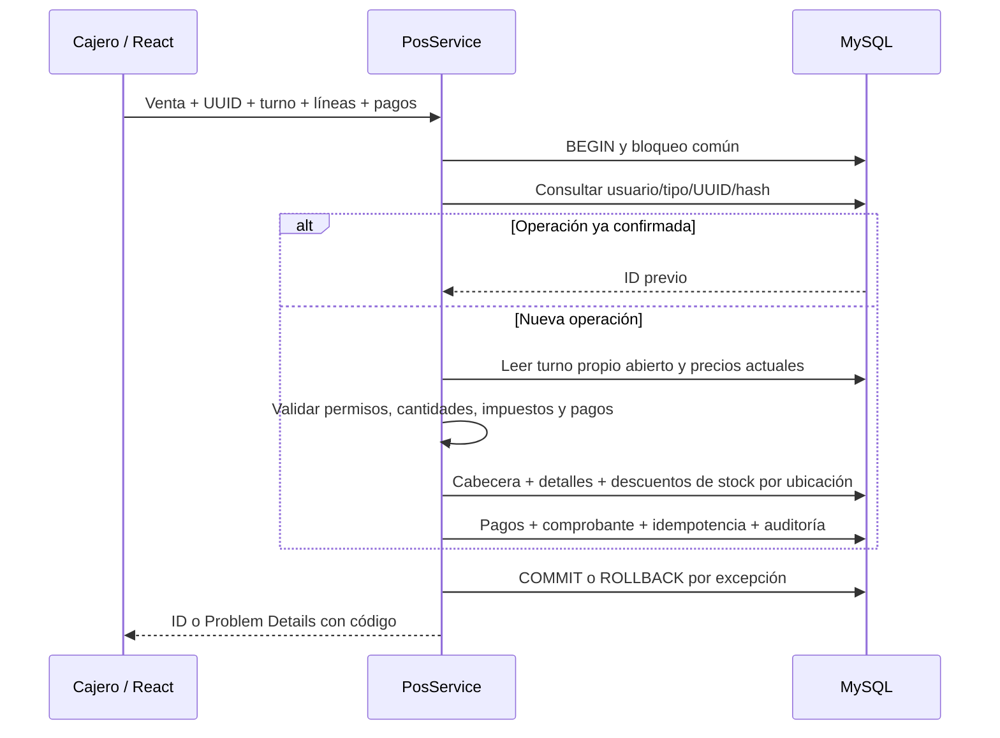

# Fase 7 — Punto de venta y gestión de caja

Fecha: 18 de octubre de 2026. Véanse [[Fase 6]], [[Requisitos POS y caja]], [[Modelo POS y caja]], [[Manual POS y caja]] y [[Verificación Fase 7]].

## Objetivo y revisión previa

Completar apertura → venta → pagos → comprobante → arqueo → cierre en el servidor local de la tienda. Se revisaron AGENTS.md, arquitectura y verificación de Fase 6, scripts 001–007, servicios de catálogo, seguridad e identidad, frontend y pruebas existentes antes de modificar código. Se presentó el plan de integración en el chat. Se conservaron cambios locales previos de documentación.

Se reutilizan ASP.NET Core 10, C#, React/TypeScript, Tailwind, Dapper, MySqlConnector y MySQL 8.4. No se añadieron paquetes. No hay ventas sin servidor ni cobros bancarios reales. La etapa de reportes generales continúa en Fase 8; esta fase entrega consultas de ventas, pagos y arqueos.

## Etapas implementadas

|Etapa|Objetivo y resultado|
|---|---|
|1. Imágenes|Subir desde el equipo en alta/edición, previsualizar, reemplazar o retirar; PNG validado y archivos persistentes.|
|2. Cajas|Código único, nombre, activa/inactiva, fuera de servicio, versión y turno abierto asociado.|
|3. Turnos|Apertura con fondo; propiedad por cajero; movimientos y cierre con arqueo.|
|4. POS|Tarjetas, fotos, filtros, búsqueda y escáner con Enter; carrito conservado al cambiar de pestaña.|
|5. Ventas y pagos|Precios del servidor, descuentos autorizados, cálculo decimal, efectivo/tarjeta/transferencia y pagos combinados.|
|6. Comprobantes|Snapshot del negocio y detalle histórico; vista, reimpresión térmica de 80 mm y A4.|
|7. Anulaciones|Registro único, motivo, responsable, restitución por ubicación y devolución explícita del efectivo.|
|8. Arqueos|Esperado, contado, diferencia, desglose por método, observaciones y resumen imprimible.|
|9. Integridad|Transacciones reales, clave/hash, bloqueo común con catálogo, pruebas concurrentes y rollback.|
|10. Documentación|Notas Markdown en español enlazadas para Obsidian, manual, modelo, requisitos y resultados reales.|

## Archivos y responsabilidades

|Archivo|Responsabilidad|
|---|---|
|`Nexo.Domain/Pos.cs`|Contratos, DTO de ventas, pagos, cajas, turnos, comprobantes y arqueos.|
|`Nexo.Application/PosService.cs`|Validación y orquestación; `Once`, `Confirm`, `Allocate`, `Void`, `Open`, `Close`, `Cash`, `Reconcile`.|
|`Nexo.Infrastructure/MySqlPosStore.cs`|SQL parametrizado, transacciones, snapshots, stock por ubicación, pagos, anulaciones y auditoría.|
|`Nexo.Api/PosEndpoints.cs`|Rutas HTTPS y políticas; toma usuario del claim `sub`, nunca del JSON.|
|`Nexo.Application/ProductImages.cs`|Valida PNG y coordina referencia/versionado con catálogo.|
|`Nexo.Infrastructure/ProductImageFiles.cs`|Escritura, lectura y nombres seguros; no recibe nombres elegidos por el usuario.|
|`Nexo.Domain/Catalog.cs`, `MySqlCatalogStore.cs`|Amplían el producto con `imageRef` y actualizan imágenes bajo el bloqueo existente.|
|`src/pos.tsx`|POS, cajas, turnos, historial, comprobantes y arqueos.|
|`src/product-image.tsx`, `catalog.tsx`|Carga privada de imágenes, fallback, selector, vista previa y edición.|
|`src/api.ts`, `main.tsx`, `styles.css`|Respuesta binaria autenticada, errores claros, navegación y diseño adaptable.|
|`008_pos_caja.sql`|Migración aditiva de esquema y permisos.|
|`database/Test-Phase7.ps1`|Base temporal, migraciones desde cero, semillas, suite y comprobación de invariantes.|
|`compose.api.yaml`, `Nexo.Api/Dockerfile`|Despliegue opcional HTTPS con volumen persistente de imágenes.|

Las rutas de backend de la tabla son relativas a `backend/`; las de React a `frontend/nexo-web/`.

## Transacciones y concurrencia

`MySqlPosStore.Execute` comienza READ COMMITTED y toma `catalogo_bloqueo WHERE id=1 FOR UPDATE`, igual que Fase 6. Se adquiere antes de leer idempotencia, cajas, turnos o stock. Todos los casos de escritura de catálogo y POS comparten el orden, incluso con procesos API diferentes. Los saldos por ubicación también se leen con FOR UPDATE. No basta un bloqueo en memoria del proceso.

El diseño conservador serializa operaciones de la tienda, incluidas lecturas. Prioriza integridad; no se ha medido su rendimiento para grandes cantidades de cajas. Cualquier módulo futuro que escriba stock debe respetar este protocolo. Los bloqueos no deben saltarse mediante SQL administrativo durante la operación normal.

`Once` valida UUID, calcula SHA-256 del DTO completo y consulta `(usuario,tipo,clave)`. Mismo contenido devuelve el ID confirmado; contenido diferente devuelve 409 `idempotency_conflict`. Confirmación y respuesta repetida no consumen stock dos veces. El cliente conserva cuerpo y UUID tras un fallo de transporte. Un error HTTP 4xx permite corregir el borrador; un fallo de red/servidor exige reintentar la misma operación. El borrador vive en memoria; una recarga o cierre de sesión lo descarta. Después de una recarga con resultado desconocido, consultar historial antes de cobrar otra vez.

La venta confirma cabecera, detalle, pagos, comprobante, movimientos de inventario, clave y auditoría en una transacción. Una excepción revierte todo. Se traducen duplicados, FK, CHECK, deadlocks y timeout de bloqueo a conflicto claro; no se devuelven SQL ni credenciales. La numeración puede tener huecos por rollback: es un identificador interno, no una secuencia fiscal autorizada.



## Reglas monetarias y alcance fiscal

Moneda NIO. Cantidades con hasta tres decimales; precios de catálogo con cuatro, importes y pagos con dos. El redondeo del servidor es `AwayFromZero`, a dos decimales, por línea:

```text
subtotal_línea = redondear(precio_actual × cantidad)
impuesto_línea = redondear((subtotal_línea − descuento_línea) × tasa_configurada)
total_línea = subtotal_línea − descuento_línea + impuesto_línea
total_venta = suma(total_línea)
```

El descuento es un importe por línea, no porcentaje; exige `ventas.descuentos`, incluso si se envía directamente por HTTP. No supera el subtotal. El servidor no acepta precios o totales calculados por el navegador. La vista previa es orientativa: un cambio de precios entre selección y cobro se refleja en el resultado confirmado y el comprobante.

`configuracion_ventas` tiene una tasa general de impuesto **inicialmente cero**, identificación y dirección. No se presupone IVA ni una regla tributaria nacional. Antes de aplicar una tasa distinta debe aprobarse su tratamiento y alcance; este módulo no modela exenciones por producto, impuestos múltiples ni precios con impuesto incluido. Si el negocio requiere estos tratamientos, debe ampliarse la configuración antes de usar una tasa general. El administrador de instalación puede configurarla con SQL revisado; no se añadió un editor tributario al perfil visual del negocio.

```sql
-- Ejemplo neutro: completar datos reales autorizados; no fija ninguna tasa legal.
UPDATE configuracion_ventas
SET identificacion='IDENTIFICACION APROBADA', direccion='DIRECCION DEL NEGOCIO', tasa_impuesto=0
WHERE id=1;
```

Se reutiliza `facturas` con tipo `ACADEMICO`, serie `INT` y número igual al ID de venta. Su presentación dice «COMPROBANTE DE VENTA», sin leyendas fiscales en pantalla o impresión, por decisión del usuario para la empresa ficticia. Guarda nombre comercial, identificación, dirección y moneda al emitir, sin alterar comprobantes previos al editar el negocio. Las tablas conservan el nombre histórico `facturas`; no implican autorización fiscal. El cliente se registra como nombre o referencia opcional de hasta 180 caracteres, sin un módulo nuevo de clientes.

## Pagos y anulaciones

Se permite una fila por método, hasta tres. Los importes recibidos deben ser positivos y cubrir el total. Solo el efectivo puede generar cambio; la suma no efectiva no puede exceder el total. `aplicado=recibido−cambio`; suma de aplicados = total de venta. No hay campos para PAN, CVV, cuentas ni credenciales bancarias.

Anular exige `ventas.anular`, motivo y un turno propio abierto para responsabilizar la devolución. Se rechaza una venta con devoluciones históricas parciales para no duplicar restituciones. Se toman los movimientos VENTA originales y se invierten en sus ubicaciones; no se consulta el indicador actual del producto para decidir qué devolver. La venta pasa a ANULADA y permanece con sus detalles, pagos y comprobante.

El efectivo aplicado se devuelve explícitamente desde el turno seleccionado y requiere saldo esperado suficiente. La acción de la interfaz avisa que está confirmando esa devolución. `anulaciones.reembolso` representa solamente efectivo realmente entregado. Tarjeta y transferencia quedan en `pendiente_no_efectivo`, con estado `REEMBOLSO_PENDIENTE`; la aplicación no ejecuta ni certifica un reembolso bancario. Su conciliación externa sigue siendo una tarea administrativa, sin un endpoint para marcarla liquidada en esta fase.

Los cobros originales se conservan al anular. El arqueo resta la devolución del turno donde salió el efectivo, que puede ser distinto del turno original cerrado. Así no reescribe cierres históricos. Las consultas de ventas muestran ANULADA para excluirla de ventas netas; los cobros y devoluciones se presentan separados para conciliación.

## Apertura, movimientos y cierre

Una caja activa y operativa admite un turno abierto; la columna generada `caja_abierta` y su UNIQUE protegen también a nivel de BD. Se limita además a un turno abierto por cajero mediante el protocolo común. No se puede desactivar o poner fuera de servicio una caja abierta. La versión evita sobrescrituras administrativas.

Abrir, mover efectivo, vender, anular con reembolso y cerrar son operaciones idempotentes. Vender, registrar movimientos y cerrar requieren el turno propio abierto. Ni Administrador vende dentro del turno de otro usuario: puede consultar el historial con el permiso correspondiente, pero opera su propio turno. El cierre toma el mismo bloqueo que ventas; o la venta confirma primero y se incluye en el arqueo, o el cierre gana y la venta se rechaza.

```text
efectivo_esperado = fondo_inicial
                  + suma(pagos EFECTIVO.importe_aplicado del turno)
                  + ingresos − egresos
                  − anulaciones.reembolso entregado desde este turno
diferencia = contado − esperado
```

Sobrante: diferencia positiva. Faltante: negativa. Tarjeta, transferencia y reembolsos bancarios pendientes se muestran aparte. Un egreso o devolución no puede superar el efectivo esperado. El cierre conserva esperado, contado, diferencia generada por MySQL, observaciones y fechas; no hay reapertura ni eliminación de turnos.

## Imágenes de productos

El selector admite PNG/JPEG/WebP hasta 2 MB y 4096×4096. El navegador decodifica y normaliza a PNG RGB/RGBA de hasta 256×256 y 128 KiB, reutilizando `prepareBusinessIcon`. El servidor recibe exclusivamente ese PNG normalizado en JSON `dataUrl`, **no confía en MIME, extensión ni validaciones del navegador**: `BusinessIcon.Validate` comprueba firma, estructura, dimensiones, profundidad, CRC, descompresión y longitud exacta de filas. SVG, ejecutables disfrazados, truncados y contenido fuera del límite se rechazan. No se conserva el archivo original ni sus metadatos.

`ProductImageFiles` genera `Guid.NewGuid():N + .png`, usa CreateNew y solo permite ese patrón para leer. La BD guarda `imagen` como referencia relativa; no admite rutas arbitrarias mediante guardar producto. La API autenticada sirve `image/png` y `nosniff`; las fotos no se publican como directorio ejecutable. El cliente obtiene un Blob con JWT y libera las object URLs. `public/product-placeholder.svg` es el recurso predeterminado del sistema.

La edición de fotografía exige `catalogo.administrar` y versión vigente. Alta/edición de producto y fotografía son **dos solicitudes**: primero el producto, luego la imagen. Si falla la segunda, la interfaz conserva el producto ya guardado para reintentar sin crear otro. Seleccionar una foto solo cambia la vista previa; se carga al guardar.

Retirar una imagen elimina la referencia del producto, no físicamente el archivo. Reemplazos y archivos huérfanos se conservan para evitar borrar una foto ante COMMIT de resultado incierto. La depuración física futura debe ejecutarse fuera del flujo y comprobar referencias; no hay un proceso automático en esta fase. Incluir el directorio de fotos en los respaldos: el volumen no es un backup.

En desarrollo se usa `App_Data/product-images` relativo al content root de la API, excluido de Git. `Storage:ProductImages` permite otro directorio del servidor. El Compose opcional monta `product_images:/data/product-images`; al recrear el contenedor el volumen conserva los archivos. No usar `down -v` si se necesitan las imágenes. No hay rutas de una PC concreta en datos o configuración compartida.

## Endpoints implementados

Base `/api/v1`, JSON salvo GET de imagen. Todos exigen HTTPS, JWT y `Cache-Control: no-store`.

|Método y ruta|Permiso|
|---|---|
|PUT `/productos/{id}/imagen`|catalogo.administrar; `{version,dataUrl}` (null retira)|
|GET `/productos/{id}/imagen`|catalogo.leer; PNG o 404|
|GET `/cajas`|cajas.leer|
|POST `/cajas`, PUT `/cajas/{id}`|cajas.administrar|
|GET `/pos/configuracion`|ventas.registrar|
|GET `/turnos?page=1`|cajas.leer; propios, o todos con rol Administrador y cajas.historial|
|POST `/turnos`|cajas.abrir; `{key,registerId,opening}`|
|GET `/turnos/{id}/arqueo`|cajas.arquear; propio, o ajeno con rol Administrador y cajas.historial|
|POST `/turnos/{id}/movimientos`|cajas.movimientos; `{key,type,amount,reason}`|
|POST `/turnos/{id}/cierre`|cajas.cerrar y cajas.arquear; `{key,counted,notes}`|
|GET `/ventas?shiftId=…&page=1`|ventas.leer; propias, o todas con cajas.historial|
|POST `/ventas`|ventas.registrar; descuentos también requieren ventas.descuentos|
|GET `/ventas/{id}/comprobante`|ventas.leer; propia, o todas con cajas.historial|
|POST `/ventas/{id}/anulacion`|ventas.anular; `{key,refundShiftId,reason}`|

Historial paginado de 50 registros. La consulta de productos conserva los filtros y paginación de Fase 6. La pantalla POS usa catálogo de 24 por página y busca coincidencia exacta de SKU/barras al recibir Enter. El lector debe estar configurado como teclado con terminador Enter y el foco en «Buscar o escanear».

```json
{
 "key":"bf41ef14-b008-4c3e-a3d6-f4b225c95662",
 "shiftId":7,
 "customer":null,
 "lines":[{"productId":12,"quantity":2,"discount":0}],
 "payments":[{"method":"EFECTIVO","received":100}]
}
```

Sustituir IDs e importes por datos actuales. POST devuelve `{id}`; obtener el comprobante para los importes definitivos. Los errores incluyen `code` y `traceId`. Claves relevantes: `shift_closed`, `register_open`, `insufficient_stock`, `payment_incomplete`, `invalid_change`, `discount_forbidden`, `sale_already_void`, `cash_insufficient`, `idempotency_conflict`.

## Permisos y auditoría

Administrador recibe los permisos nuevos. Vendedor/Cajero recibe lectura de cajas, abrir/cerrar/arquear turno propio, registrar y consultar ventas. Descuentos, anulaciones y movimientos requieren asignación explícita; Consulta no recibe derechos POS automáticamente. La UI completa de POS necesita también `catalogo.leer`, `inventario.leer`, `cajas.leer` y `ventas.leer`, otorgados al cajero estándar entre Fases 6 y 7.

El backend aplica políticas en cada ruta. El permiso de historial amplía lectura, no autoriza escrituras en turnos ajenos. Usuario y fecha UTC proceden del servidor. Auditoría se confirma junto con la operación, indicando actor, acción, tipo/recurso, ID, fecha y correlación; los motivos e importes están en los registros vinculados. Los reintentos devuelven la operación previa sin una segunda acción financiera.

## Instalación

```powershell
pwsh -NoProfile -File database/Manage-Database.ps1 Migrate
dotnet run --project backend/Nexo.Api --launch-profile https
# En otra terminal, con frontend y certificados existentes configurados:
npm --prefix frontend/nexo-web run dev
```

Reiniciar/recompilar la API del IDE para que cargue el módulo. Volver a iniciar sesión tras asignar permisos. No ejecutar semillas sobre la BD existente. La migración 008 ya se aplicó durante esta implementación en la instalación local.

Para despliegue opcional en contenedor: `docker compose -f compose.yaml -f compose.api.yaml up -d --build`. Requiere `.certs/nexo.pfx`, `NEXO_CERT_PASSWORD`, `JWT_SIGNING_KEY`, `NEXO_WEB_ORIGIN`; si se expone en LAN, configurar `NEXO_API_BIND` y `NEXO_API_ALLOWED_HOSTS` autorizados. La API mantiene HTTPS en Kestrel; no se deshabilita la comprobación HTTPS de los endpoints. Este despliegue se preparó como código; consultar [[Verificación Fase 7]] para distinguirlo de las verificaciones ejecutadas.

## Decisiones, incidencias y límites

- Se reutiliza el validador PNG del icono y el almacenamiento se separa del perfil: las fotos no se guardan como base64 en MySQL.
- El bloqueo global es coherente con Fase 6 y deliberadamente conservador; la optimización por producto queda fuera de esta fase.
- La semilla 001 usaba INSERT sin columnas para ventas/detalles. Se corrigió para que la nueva columna no rompa instalaciones desde cero; no se editan migraciones históricas aplicadas.
- Un error de compilación por `[]` sin tipo destino en una expresión con Dapper dinámico se corrigió usando `Array.Empty<long>()`.
- El preparador inicial de BD temporal omitía DELETE en puentes de seguridad. Se corrigieron los permisos de ensayo; no se ampliaron los de producción.
- Vite/Vitest y Docker necesitaron permisos de ejecución fuera del sandbox. No se deshabilitaron las medidas de seguridad de NEXO.
- Los archivos reemplazados requieren una política futura de depuración y respaldo. La eliminación visible de fotografía funciona retirando su referencia.
- La impresión usa el diálogo del navegador. No hay integración ESC/POS directa, cajón físico, datáfono ni aprobación fiscal. Verificación con impresoras físicas y varias terminales LAN sigue pendiente.

## Preguntas probables del jurado

**¿Cómo evitan que dos vendedores vendan la última unidad?** El bloqueo transaccional común serializa la lectura y el descuento. El segundo ve el saldo confirmado del primero y recibe stock insuficiente. Se probó con conexiones simultáneas y dos cajeros/cajas.

**¿Qué pasa si falla el último paso?** La transacción revierte cabecera, detalles, stock, pagos, comprobante, auditoría y clave. Se inyectó una excepción después de persistir el flujo y se comprobó ausencia de venta y saldo conservado.

**¿Qué ocurre al repetir el botón después de perder la respuesta?** UUID más hash devuelve la misma venta. La misma clave con otro contenido da conflicto; no registra otro cobro.

**¿Por qué no basta deshabilitar el botón?** No protege varias terminales ni peticiones HTTP repetidas. La integridad reside en transacciones, claves únicas y validaciones del servidor.

**¿Cómo se venden preparados sin existencias?** `TrackInventory=false` evita por completo comprobar y mover stock. El producto aparece y se cobra normalmente; no se consumen ingredientes implícitamente.

**¿La anulación reembolsa una tarjeta?** No. Registra pendiente externo. Solo el efectivo se devuelve explícitamente de un turno abierto autorizado y se resta del arqueo de ese turno.

**¿Qué diferencia hay entre cobro y venta neta?** Un cobro histórico permanece aunque la venta se anule. La anulación separa la devolución; evita ocultar efectivo que todavía está en caja o reembolsos pendientes.

**¿Cómo conservan imágenes al reiniciar?** Los datos son referencias relativas y el directorio es persistente. En Docker se monta un volumen externo al ciclo de vida del contenedor. La prueba de almacenamiento reabre los archivos desde una nueva instancia. También se comprobó el hash de un PNG después de reiniciar y recrear un contenedor temporal con volumen; no equivale a desplegar y reiniciar la API completa.

**¿Por qué este comprobante no es una factura legal?** No existe aprobación de serie, reglas tributarias ni validación fiscal del negocio. El tipo interno ACADEMICO delimita el alcance técnico; la presentación usa el título neutral «Comprobante de venta».

**¿Por qué dos pasos al guardar una foto?** MySQL y el sistema de archivos no comparten transacción. Se escribe el archivo antes de referenciarlo, se controla versión y se conserva ante resultado incierto de COMMIT; un fallo de imagen no duplica el producto creado.

## Ampliación: referencias de tarjeta y transferencia

[[Referencias de pagos]] documenta la migración 009: referencia obligatoria por cada pago no efectivo nuevo, terminal NFC independiente simulada, conservación en comprobantes/anulaciones y compatibilidad de solicitudes históricas. La referencia no demuestra una aprobación o depósito bancario y no ejecuta cobros reales.

## Organización vigente de pantallas

[[Navegación por secciones]] sustituye las pestañas combinadas: POS en /pos, Caja y turnos en /pos/caja y Ventas y comprobantes en /pos/ventas. El menú se agrupa por secciones con opciones derivadas y permisos. No hay cambios de reglas transaccionales ni de esquema.

## Título de comprobantes para la empresa ficticia

Por solicitud del usuario, ReceiptView presenta «COMPROBANTE DE VENTA» y elimina la nota fiscal del pie. El título fijo de presentación también cubre respuestas de versiones anteriores de la API y comprobantes históricos sin modificar sus datos. MySqlPosStore.Receipt devuelve el mismo título neutral para todos los comprobantes consultados. La semilla demostrativa usa esa denominación. Se conservan el tipo interno ACADEMICO, numeración y snapshot del emisor; no se cambian importes ni movimientos. React imprime una copia del mismo artículo, por lo que la presentación térmica y A4 comparten el cambio.

**¿Cambia el alcance del proyecto?** Es una decisión visual para la empresa ficticia; no incorpora integración fiscal ni modifica el modelo de datos. No requiere migración de ventas históricas: la leyenda se generaba al consultar, no estaba almacenada en cada venta.

## Privacidad del arqueo por cajero

Cada cajero consulta solamente sus turnos y arqueos. Para consultar turnos ajenos, PosEndpoints exige el rol Administrador junto con cajas.historial; el endpoint de arqueo exige además cajas.arquear. Tener cajas.historial en otro rol no habilita esa consulta. Se mantienen los permisos existentes y no se modifican tablas ni asignaciones de roles.

La restricción se aplica tanto a GET /turnos como a GET /turnos/{id}/arqueo: la lista también devuelve fondo, efectivo esperado, contado, diferencias y observaciones de cierres. PosService valida el propietario y responde 403 con shift_owner si se solicita un arqueo ajeno sin autorización. CashDesk filtra el historial y sus botones con la misma regla como refuerzo visual. La lectura de ventas mantiene sus reglas existentes.

**¿Basta con ocultar Ver arqueo?** No. La API valida el acceso aunque el cajero escriba directamente el ID de otro turno. El rol se obtiene mediante la autenticación existente, que recarga roles y permisos activos desde la base de datos.

## Ajuste de fotografías en las tarjetas del POS

El selector button.pos-product .product-photo en styles.css utiliza object-fit: cover y object-position: center. La fotografía llena todo el recuadro de 100 px de alto y el ancho disponible, conserva su proporción y recorta los bordes excedentes. Así se eliminan las franjas producidas por contain. El ajuste queda limitado al POS. Los márgenes blancos que formen parte de la propia fotografía se conservan; este cambio no procesa el archivo original. No modifica componentes, permisos, endpoints ni almacenamiento.
