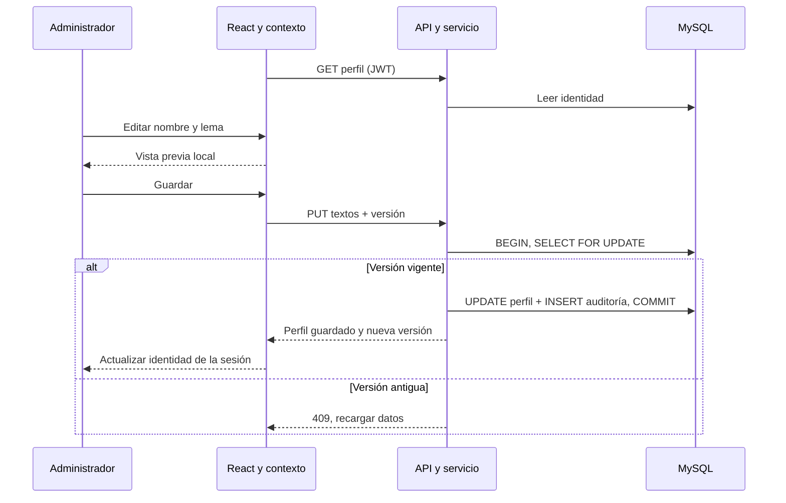

# Identidad y configuración del negocio

Etapa complementaria autorizada después de [[Fase 6]], antes de Fase 7. Fecha: 16 de octubre de 2026. Relacionada con [[Fase 5]], [[API REST]], [[Sesiones en terminales compartidas]] y [[Verificación identidad del negocio]].

## Objetivo

Distinguir la marca del software (NEXO) de la identidad de la tienda que lo utiliza. Cada instalación sigue correspondiendo a un solo negocio. El nombre pertenece a la tienda; NEXO aparece como «Gestionado con NEXO».

## Funcionamiento para el usuario

1. Iniciar sesión como Administrador y abrir Configuración.
2. Escribir el nombre comercial (obligatorio, hasta 120 caracteres) y un lema opcional (hasta 160).
3. Revisar la vista previa. Esta cambia mientras se escribe, pero no modifica la identidad guardada.
4. Guardar cambios. El menú lateral, encabezado, inicio y pie de la sesión actual reciben inmediatamente el nombre guardado. El inicio muestra también el lema y accesos de trabajo según permisos.
5. Otras terminales cargan el perfil compartido al iniciar sesión o recargar; no hay sincronización en tiempo real entre pestañas ya abiertas.

El nombre inicial es «Mi tienda», para que el cliente lo sustituya por el suyo. No se estableció un nombre de cliente real durante la implementación. El login conserva la marca NEXO y no publica la identidad del negocio sin autenticación.

## Tecnologías y archivos

Se mantienen React/TypeScript, Tailwind, ASP.NET Core 10, Dapper, MySqlConnector y MySQL 8.4. No se agregaron bibliotecas.

|Archivo|Responsabilidad|
|---|---|
|`database/migrations/006_identidad_negocio.sql`|Perfil único persistente y permiso configuracion.administrar.|
|`Nexo.Domain/BusinessProfile.cs`|BusinessProfile (Name, Tagline, Version) e IBusinessProfileStore.|
|`Nexo.Application/BusinessProfileService.cs`|Read/Save, validación, recorte de espacios y conflicto de versión.|
|`Nexo.Infrastructure/MySqlBusinessProfileStore.cs`|Consultas parametrizadas; actualización y auditoría en una transacción.|
|`Nexo.Api/BusinessProfileEndpoints.cs`|Inyección, rutas, HTTPS, políticas y actor del JWT.|
|`Nexo.Api/Program.cs`|AddBusinessProfile y MapBusinessProfile.|
|`src/business-settings.tsx`|Provider de perfil compartido, hook useBusinessProfile y formulario BusinessSettings con vista previa.|
|`src/main.tsx`|Workspace, Layout e inicio con identidad del negocio, navegación a Configuración y guardia de rol/permisos.|
|`src/api.ts`, `src/styles.css`|Mensaje de validación y estilos adaptables.|

Las rutas backend de esta tabla son relativas a `backend/`; las de interfaz, a `frontend/nexo-web/`.

## Tabla y persistencia

`configuracion_negocio`: id TINYINT fijo en 1, nombre VARCHAR(120), lema VARCHAR(160), version INT UNSIGNED, actualizado_por FK a usuarios y actualizado_en UTC. La restricción id=1 limita el perfil a un registro. La base impide un nombre vacío; Application añade validación de longitudes y rechaza caracteres de control (saltos de línea incluidos).

El perfil es información de presentación. No configura impuestos, numeración, credenciales, políticas de acceso ni datos fiscales de comprobantes. No es una arquitectura multicliente: cada instalación tiene una tienda.

## API y seguridad

|Método/ruta|Acceso|
|---|---|
|GET `/api/v1/configuracion/negocio`|Toda sesión autenticada mediante HTTPS, para mostrar la identidad a los operadores.|
|PUT `/api/v1/configuracion/negocio`|Rol Administrador **y** permiso configuracion.administrar, con HTTPS.|

La migración asigna el permiso al Administrador. Aunque se otorgara ese permiso a otro rol, el backend continúa exigiendo Administrador para editar. La navegación y la ruta de React aplican ambos requisitos. No se confía en ocultar el botón.

Ejemplo de PUT, utilizando la versión de GET:

```json
{"name":"Tienda El Encuentro","tagline":"Siempre cerca de vos","version":1}
```

La respuesta devuelve los textos normalizados y la versión incrementada. Respuestas: 400 invalid_business_profile, 401 sin sesión, 403 sin privilegios, 409 stale_version. Cache-Control: no-store. No hay ruta pública ni acceso desde el login.

## Concurrencia y auditoría

El repositorio inicia una transacción, lee id=1 con FOR UPDATE y compara la versión. Si quedó obsoleta no escribe: Application responde 409. Si coincide, actualiza el perfil e inserta CONFIGURACION_NEGOCIO_GUARDAR en auditoria; confirma ambas escrituras juntas. Una excepción revierte todo. El actor se obtiene de sub del JWT, no del JSON del cliente.



BusinessProfileProvider vive dentro de la sesión, con clave por usuario; al salir o cambiar de operador se desmonta. El perfil no se almacena en localStorage. Una falla al leerlo muestra un aviso con Reintentar y permite seguir con el resto del sistema. Los textos se renderizan con React como contenido, sin insertar HTML.

## Instalación

```powershell
pwsh -NoProfile -File database/Manage-Database.ps1 Migrate
# Detener la API anterior antes de recompilar para no bloquear sus DLL.
dotnet run --project backend/Nexo.Api --launch-profile https
```

Reingresar o recargar después de reiniciar los servicios. El backend utiliza los permisos vigentes de la base, manteniendo la política de sesiones existente. En la instalación local ya se aplicó 006; Migrate la omite al repetir y valida el checksum.

## Decisiones y límites

- Perfil único y tipado, con nombre y lema: cubre la identidad solicitada sin crear un motor genérico de ajustes.
- Separar software y negocio: el cliente ve su tienda al entrar; NEXO permanece como marca del producto.
- Edición administrativa y lectura autenticada: los operadores necesitan ver el nombre, no modificarlo.
- Icono de imagen configurable mediante la ampliación descrita abajo; cuando no hay imagen se muestra una inicial en la vista previa. Los colores configurables siguen fuera de esta entrega.
- Facturación y sus datos legales siguen perteneciendo a Fase 7 y a sus decisiones pendientes. Este cambio no afirma validez fiscal.

## Preguntas del jurado

- **¿Por qué guardar en MySQL en lugar del navegador?** Todas las terminales de la instalación deben usar el mismo perfil y conservarlo tras reiniciar.
- **¿Cómo se evita que un cajero cambie el nombre?** PUT exige el rol Administrador y el permiso específico, comprobados por el servidor.
- **¿Qué ocurre si dos administradores editan lo mismo?** El primero guarda e incrementa versión; el segundo recibe conflicto y debe recargar antes de decidir qué conservar.
- **¿Por qué NEXO sigue visible?** Es el proveedor de la herramienta; el nombre comercial identifica el negocio que opera con ella.
- **¿Puede alojar varios clientes juntos?** No. El alcance continúa siendo una instalación local por negocio.

Resultados y límites de las pruebas: [[Verificación identidad del negocio]].

## Icono de imagen del negocio

Ampliación solicitada por el usuario. Configuración incluye Icono de la tienda, un selector de archivos y Quitar imagen. La vista previa cambia al elegir el archivo; el cambio en el menú, encabezado e inicio se aplica con Guardar cambios. Para quitarlo se pulsa Quitar imagen y después Guardar cambios. Mantiene la autorización exclusiva de Administrador y el control de versión del perfil.

`business-icon.ts / prepareBusinessIcon` acepta PNG, JPG y WebP de hasta 2 MB y 4096 × 4096 píxeles. El navegador decodifica y normaliza con canvas a PNG de hasta 256 × 256 manteniendo proporciones y transparencia. El original y su nombre no se envían al servidor; las URL temporales se liberan. El resultado debe pesar hasta 128 KiB; una imagen muy compleja puede exigir elegir otra más sencilla.

`BusinessProfile.IconDataUrl` es nullable. PUT envía iconDataUrl con el PNG normalizado como data URL; null significa quitar la imagen. Al editar el nombre se debe enviar también la imagen actual, ya que PUT reemplaza el perfil completo. La migración 007 añade icono_data_url MEDIUMTEXT a configuracion_negocio. El icono se confirma junto a nombre, lema, versión y auditoría; queda incluido en los respaldos MySQL.

`BusinessIcon.Validate` aplica los límites en servidor, independientemente del navegador: prefijo PNG, base64, tamaño, firma, dimensiones, color RGB/RGBA de 8 bits sin entrelazado, estructura y CRC de bloques, terminación y datos zlib/filas de longitud acotada. No admite SVG, URL externas ni archivos arbitrarios. Una imagen inválida devuelve 400 invalid_business_icon. No requiere librerías nuevas ni acceso público a archivos.

**Defensa:** ¿Por qué convertir la imagen? Un único formato pequeño simplifica validación y transferencia por LAN. ¿Por qué guardarla en MySQL? Es un único icono pequeño por instalación; se conserva y respalda junto a su identidad. ¿Se confía en el navegador? No: el servidor valida nuevamente el contenido recibido.

La opción está probada con PNG normalizado y su eliminación. Los formatos JPG y WebP de origen dependen de la decodificación del navegador; fueron incorporados al selector, pero no se ejecutó un recorrido visual separado con cada uno.
