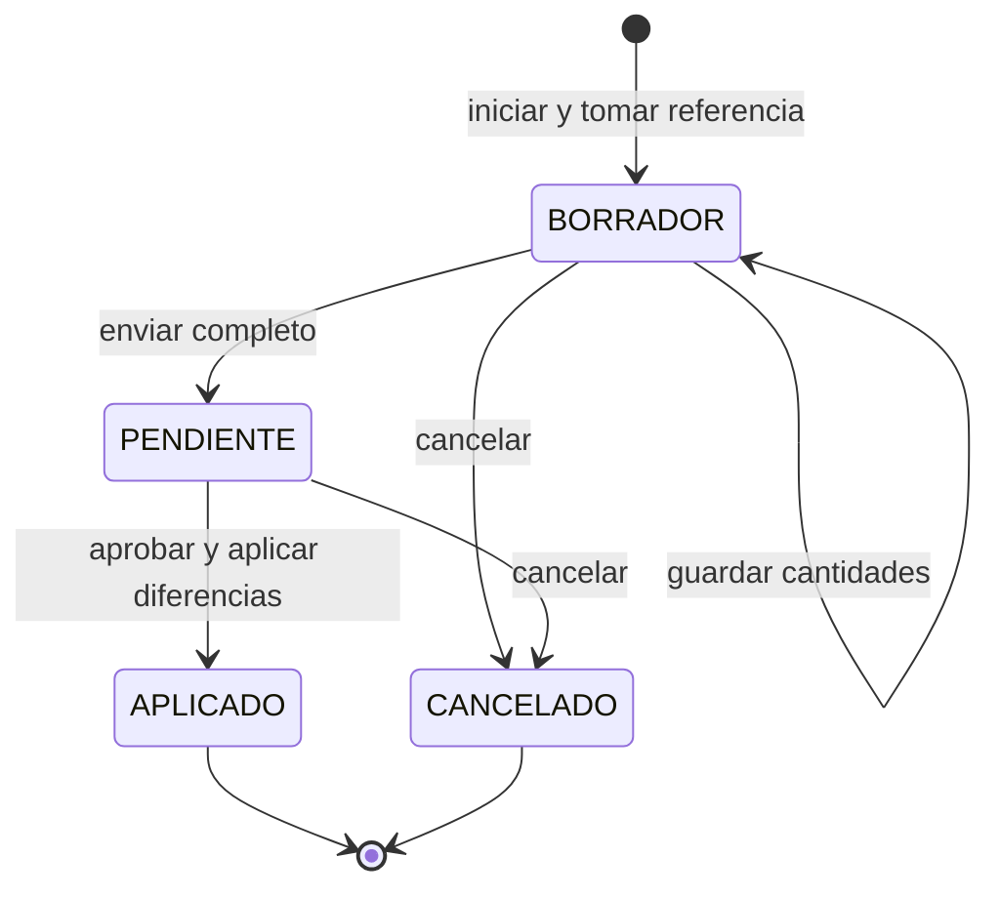
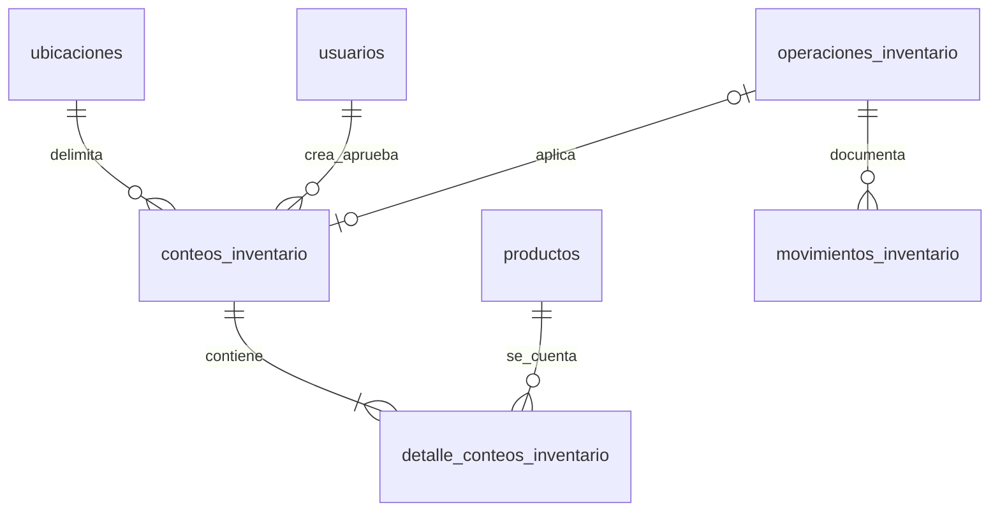

# Inventario operativo

Fecha: 27 de octubre de 2026. Ampliación solicitada por el usuario de [[Fase 6]] y [[Navegación por secciones]], integrada con el POS de [[Fase 7]]. Resultados: [[Verificación inventario operativo]].

## Objetivo y alcance

Organizar Inventario por tareas, sin acumular todas las funciones en una pantalla. Completar la recepción de varios productos, clasificar salidas y mermas, y conciliar conteos físicos con autorización. Se reutilizan productos, proveedores, ubicaciones, existencias, operaciones, movimientos, auditoría e idempotencia existentes. No se implementaron lotes, fechas de vencimiento por lote ni conversiones caja/unidad; registrar una merma por vencimiento no equivale a controlar vencimientos automáticamente.

## Menú efectivo

```text
INVENTARIO
├── Existencias
│   └── Alertas (pestaña con contador)
├── Operaciones (desplegable)
│   ├── Entradas de mercancía
│   ├── Salidas y mermas
│   └── Traslados
├── Conteos y ajustes
├── Historial de movimientos
└── Ubicaciones
```

|Ruta de interfaz|Función|
|---|---|
|`/inventario`|Existencias y alertas.|
|`/inventario/operaciones/entradas`|Recepción de hasta 100 líneas, proveedor, documento, motivo y costo recibido.|
|`/inventario/operaciones/salidas`|Retiro de varias líneas y motivo clasificado.|
|`/inventario/operaciones/traslados`|Traslado de varias líneas entre ubicaciones distintas.|
|`/inventario/conteos`|Crear, capturar, enviar, aprobar o cancelar conteos.|
|`/inventario/historial`|Movimientos manuales, ventas y anulaciones, filtros y saldos.|
|`/inventario/ubicaciones`|Administración existente de áreas, pasillos y estantes.|

Se conserva `/ubicaciones` como acceso compatible con catálogo.leer, incluidos perfiles sin inventario.leer. El menú utiliza la ruta interna cuando el usuario tiene acceso a Inventario. Las demás opciones exigen inventario.leer; operaciones requieren además catálogo.leer y su permiso de escritura. Grupos y opciones se filtran por permisos.

## Reglas de operaciones

- Una recepción requiere proveedor activo, referencia de documento, observación y al menos una línea. Cada línea tiene producto, ubicación, cantidad y costo unitario recibido.
- El costo se conserva en el movimiento; no actualiza automáticamente el costo de referencia ni el precio del catálogo, ni calcula valoración promedio.
- Salidas clasificadas: DANO, VENCIMIENTO, PERDIDA, CONSUMO_INTERNO u OTRO. El motivo libre sigue siendo obligatorio.
- Traslados exigen origen y destino activos y distintos; generan salida y entrada vinculadas a una misma operación, manteniendo el total.
- Cantidades positivas con hasta tres decimales; costos no negativos con hasta cuatro. No se repite la misma combinación producto/origen/destino en el documento; debe corregirse su línea.
- Hasta 100 líneas por documento. La búsqueda muestra 25 coincidencias; se puede acotar por nombre, SKU o barras.
- Productos preparados o sin control de inventario no aparecen en la selección ni se admiten por API.
- La transacción confirma todo el documento o revierte todas sus líneas. No puede quedar una recepción, salida o traslado parcial.
- Cada documento usa un UUID y hash de su contenido. Reintentar con el mismo usuario, UUID y cuerpo recupera el resultado; otro contenido devuelve conflicto.

## Conteos físicos

El conteo es parcial: una ubicación y los productos seleccionados (hasta 100). No modifica productos que no figuran en sus líneas. Al crearlo se guarda cantidad_sistema y ultimo_movimiento por producto/ubicación. Se admite iniciar un conteo para productos con saldo cero sin una fila previa de existencias.



1. **Borrador:** capturar cantidades contadas; cero es un conteo válido, vacío significa no contado. Guardar cantidades antes de enviar. La versión evita sobrescribir una captura de otra terminal.
2. **Pendiente:** todas las cantidades están completas y quedan bloqueadas para edición. Una persona con inventario.aprobar puede aplicar las diferencias. No se impone que sea distinta del capturador: un Administrador puede realizar ambos pasos.
3. **Aplicado:** se registra una operación AJUSTE con código CONTEO; solo las diferencias distintas de cero generan movimientos. Un conteo sin diferencias también queda aplicado y auditado, sin inventar movimientos de cantidad cero.
4. **Cancelado:** conserva sus datos y no afecta existencias. Un conteo aplicado no puede cancelarse ni editarse; cualquier corrección exige otro conteo u operación autorizada.

El stock no se bloquea durante toda la captura física: las ventas continúan. Al aprobar se compara tanto la cantidad como el último movimiento. Si hubo una venta, entrada, salida, traslado o anulación posterior en una línea, se rechaza la aprobación con count_stock_changed, incluso si la cantidad regresó al mismo valor. El operador debe cancelar e iniciar un nuevo conteo físico, evitando aplicar una referencia antigua.

Ejemplo: referencia de sistema 20, conteo físico 18; diferencia −2. Si la referencia sigue vigente, la aprobación retira 2 y deja 18. Si se vendió una unidad durante el conteo, se exige repetirlo; no se fuerza el saldo a 18.

La creación admite reintentos por UUID. Enviar, cancelar y aprobar recuperan el estado ya alcanzado al repetir la misma transición. La aprobación concurrente aplica una sola vez porque comprueba el estado y escribe dentro de la misma transacción.

## Arquitectura y archivos

Se mantiene React/TypeScript, Tailwind, ASP.NET Core 10, Dapper, MySqlConnector y MySQL 8.4. No se agregaron dependencias.

|Archivo|Responsabilidad|
|---|---|
|`backend/Nexo.Domain/InventoryOperations.cs`|DTO de documento, líneas y conteos.|
|`backend/Nexo.Domain/Catalog.cs`|Contratos de sesión e historial ampliados.|
|`backend/Nexo.Application/InventoryOperationsService.cs`|Validaciones, referencias activas, idempotencia y estados del conteo.|
|`backend/Nexo.Infrastructure/MySqlInventoryOperations.cs`|Parte del repositorio existente: SQL de lotes de líneas, conteos e historial. Aquí «lote de líneas» significa documento múltiple, no lote de vencimiento.|
|`backend/Nexo.Infrastructure/MySqlCatalogStore.cs`|Transacción compartida y saldos del movimiento individual compatible.|
|`backend/Nexo.Infrastructure/MySqlPosStore.cs`|Registro de saldo anterior/posterior al vender y anular.|
|`backend/Nexo.Api/InventoryOperationsEndpoints.cs`|Endpoints, HTTPS y políticas del módulo.|
|`frontend/nexo-web/src/inventory-workspace.tsx`|Contenedor de rutas y conservación de borradores.|
|`frontend/nexo-web/src/inventory-operations.tsx`|Recepciones, salidas y traslados con varias líneas.|
|`frontend/nexo-web/src/inventory-counts.tsx`|Captura y aprobación de conteos.|
|`frontend/nexo-web/src/inventory.tsx`|Existencias, alertas e historial independiente.|
|`frontend/nexo-web/src/navigation.tsx`, `main.tsx`|Menú jerárquico y rutas protegidas.|
|`database/migrations/010_inventario_operativo.sql`|Evolución aditiva y permisos nuevos.|
|`database/Test-InventoryOperations.ps1`|Ensayo aislado de la solución y consultas de invariantes.|

## Modelo de datos

Se añade motivo_codigo a operaciones_inventario. Proveedor, referencia y costo del movimiento ya existían y ahora se utilizan desde los formularios de recepción.

Movimientos incorpora cantidad_anterior y cantidad_posterior, opcionales para respetar el historial anterior. Las restricciones impiden saldos negativos y exigen posterior = anterior + delta cuando ambos están registrados. No se inventaron saldos históricos: se muestran como «—». Las escrituras manuales nuevas y el POS registran ambos valores.

Nuevas tablas:

- **conteos_inventario:** ubicación, estado, motivo, creador/fecha, aprobador/fecha, versión y operación de ajuste asociada. La operación asociada es única.
- **detalle_conteos_inventario:** producto, saldo de referencia, último movimiento de referencia y cantidad contada nullable. PK por conteo/producto.



## Consistencia y relación con ventas

Se reutiliza MySqlCatalogStore.Execute: conexión, transacción READ COMMITTED y catalogo_bloqueo FOR UPDATE. POS ya toma ese mismo bloqueo en el mismo orden. La aprobación lee la referencia, comprueba los movimientos y aplica el ajuste sin que una venta se interponga. El bloqueo dura únicamente durante cada solicitud, no durante todo el conteo físico.

Saldo por ubicación, saldo global, movimientos, operación, estado del conteo, idempotencia y auditoría se confirman o revierten juntos. No se modificaron fórmulas de venta ni políticas fiscales.

## API y permisos

Base `/api/v1/inventario`, JWT, HTTPS y no-store.

|Método / ruta|Permiso|
|---|---|
|POST `/recepciones`|inventario.entradas|
|POST `/salidas-mercancia`, `/traslados-mercancia`|inventario.ajustar|
|GET `/conteos`, `/conteos/{id}`|inventario.leer|
|POST `/conteos`|inventario.conteos|
|PUT `/conteos/{id}`|inventario.conteos|
|POST `/conteos/{id}/enviar`, `/conteos/{id}/cancelar`|inventario.conteos|
|POST `/conteos/{id}/aprobar`|inventario.aprobar|
|GET `/movimientos`|inventario.leer; agrega filtro locationId y tipos VENTA/ANULACION/DEVOLUCION.|

Los permisos nuevos se asignan al Administrador. Otros roles conservan sus accesos; pueden delegarse permisos desde Roles y permisos. La UI de recepción necesita proveedores.leer para seleccionar proveedor; la captura requiere catálogo.leer para seleccionar productos y ubicación. La autorización del backend se aplica por operación; ocultar botones no la sustituye.

Las rutas individuales anteriores (`entradas`, `salidas`, `ajustes`, `traslados`) continúan disponibles con sus permisos originales para compatibilidad. Los nuevos formularios usan documentos con varias líneas; los ajustes físicos del nuevo módulo siguen el flujo de conteo aprobado.

Ejemplo de recepción:

```json
{
  "key":"ef6d6821-f384-4a4d-b0ef-9e6fbb48ccbb",
  "type":"ENTRADA",
  "reasonCode":"RECEPCION",
  "reason":"Entrega recibida y revisada",
  "supplierId":1,
  "reference":"DOC-001",
  "lines":[
    {"productId":1,"locationId":1,"destinationId":null,"quantity":10,"cost":12.5},
    {"productId":2,"locationId":1,"destinationId":null,"quantity":5,"cost":20}
  ]
}
```

Conteo: POST con key, locationId, productIds y reason. PUT con version y lines [{productId,quantity}], donde null conserva una línea como no contada. Las transiciones envían {version}. GET entrega cabecera y líneas con diferencia calculada por el servidor.

Errores principales: invalid_inventory_operation (400), count_incomplete (400), count_not_found (404), count_locked, stale_version y count_stock_changed (409), insufficient_stock e idempotency_conflict (409).

## Recuperación de respuestas inciertas

InventoryWorkspace conserva los formularios y el cuerpo/UUID pendientes al navegar entre operaciones, historial, conteos y ubicaciones internas. Las vistas ocultas no se muestran junto a la pantalla activa. No se usa localStorage.

Una respuesta de red incierta bloquea la edición del documento y ofrece Reintentar registro con el cuerpo original. Consultar el historial y volver no pierde ese intento. Para descartarlo se exige confirmar que ya se verificó el historial. Un rechazo conocido de validación permite corregir sin suponer que hubo confirmación.

Al salir de toda la sección, recargar o finalizar sesión se pierde la memoria del navegador. Antes de registrar otra operación debe comprobarse el historial si la respuesta anterior fue desconocida. Las cantidades de un conteo ya guardado sí persisten en MySQL.

## Ejecución y verificación

```powershell
pwsh -NoProfile -File database/Manage-Database.ps1 Migrate
pwsh -NoProfile -File database/Test-InventoryOperations.ps1
npm --prefix frontend/nexo-web test
npm --prefix frontend/nexo-web run build
```

La migración 010 ya se aplicó en la instalación local; no se modificaron migraciones anteriores ni se cargaron operaciones de ensayo en nexo. Reiniciar/recompilar la API y recargar/iniciar sesión para utilizar el módulo. Resultados reales y limitaciones en [[Verificación inventario operativo]].

## Decisiones, incidencias y defensa

- Se amplió el repositorio existente mediante clases parciales para compartir la misma transacción y no crear un segundo sistema de stock.
- La primera compilación encontró una referencia nullable al guardar líneas; se corrigió y se mantuvo la validación de arrays/elementos en servidor.
- Separar pantallas desmontando los formularios perdía el UUID de un intento incierto. Se introdujo el contenedor de Inventario para conservarlo al consultar el historial.
- Se eliminó una entrada duplicada de datos de prueba de autorización detectada por xUnit; no era un fallo de negocio.

**¿Cómo sé que una recepción no queda a medias?** Todas sus líneas comparten transacción, igual que saldos e historial. Una prueba hace fallar la segunda línea y verifica que la primera se revierte.

**¿Por qué no aprobar un conteo si el saldo sigue igual?** Puede haber habido movimientos compensados; se compara también el último movimiento para detectar que la referencia cambió.

**¿Un Administrador puede capturar y aprobar?** Sí, posee ambos permisos. No se exigió separación de personas; sí autorización de la transición.

**¿Qué pasa al aprobar dos veces?** La primera solicitud aplica y cambia el estado; la segunda recupera la operación asociada. Se verificó con solicitudes concurrentes.

**¿Las mermas por vencimiento controlan lotes?** No. Son una clasificación manual de salida. Lotes y vencimientos siguen fuera de esta ampliación.

## Diseño simplificado de inventario

Actualización del 27 de octubre de 2026 a petición del usuario: se retiraron los paneles exteriores y la acumulación de formularios. Se conserva React, TypeScript, Router y CSS/Tailwind existentes, sin bibliotecas nuevas.

- Existencias utiliza una tabla directa, filtros alineados y estados con texto y color. Las acciones de fila se presentan como enlaces discretos. Las alertas permanecen en su pestaña.
- Operaciones tiene dos pasos: **Agregar productos → Revisar y registrar**. Continuar exige al menos una línea; Editar productos vuelve conservando líneas y datos. Los datos del proveedor/documento/motivo se muestran al revisar. El envío utiliza el cuerpo y UUID ya existentes; una respuesta incierta mantiene la revisión bloqueada y permite el reintento original.
- Conteos muestra una sola tarea: lista, creación o detalle. Volver a la lista recupera la consulta. Guardar cantidades aparece durante captura; al completar y guardar, la acción principal pasa a Enviar a aprobación. Cancelar y recargar tienen menor peso visual. Se conserva confirmación al descartar cantidades sin guardar.
- Historial abre sus filtros para que el período y los criterios sean visibles. La ayuda extensa de operaciones se despliega cuando se necesita.
- Las ubicaciones dentro de Inventario comparten el tratamiento sin tarjetas exteriores. Los formularios conservan sus etiquetas y bordes de campos para identificar qué se puede editar.

InventoryWorkspace incorpora inventory-module para limitar estilos a la sección. Los cambios afectan inventory.tsx, inventory-operations.tsx, inventory-counts.tsx, inventory-workspace.tsx y styles.css. No cambian tablas, endpoints, cálculos de stock ni políticas del servidor.

**Defensa:** ¿Por qué dos pasos? Permite centrarse primero en cantidades y ubicaciones, y después verificar el documento antes de confirmar. ¿Se pierde un intento al cambiar de paso? No: los componentes y estados permanecen montados dentro de Inventario.

Verificación de esta revisión visual en [[Verificación inventario operativo]].

### Si aparece un error al actualizar

El cliente y la API deben corresponder a la misma versión. Si la API sigue abierta con un binario anterior, las rutas nuevas pueden devolver 404. El cliente indica recompilar y reiniciar la API. Se documentó y resolvió un caso real en [[Verificación inventario operativo]]. Reiniciar una API no registra automáticamente el documento que estaba pendiente en el formulario.

La búsqueda de productos ahora utiliza un solo campo con coincidencias debajo, reutilizado en operaciones y conteos. El costo se etiqueta Costo de compra por unidad (C$). Véase [[Diseño del catálogo y búsqueda de productos]].
