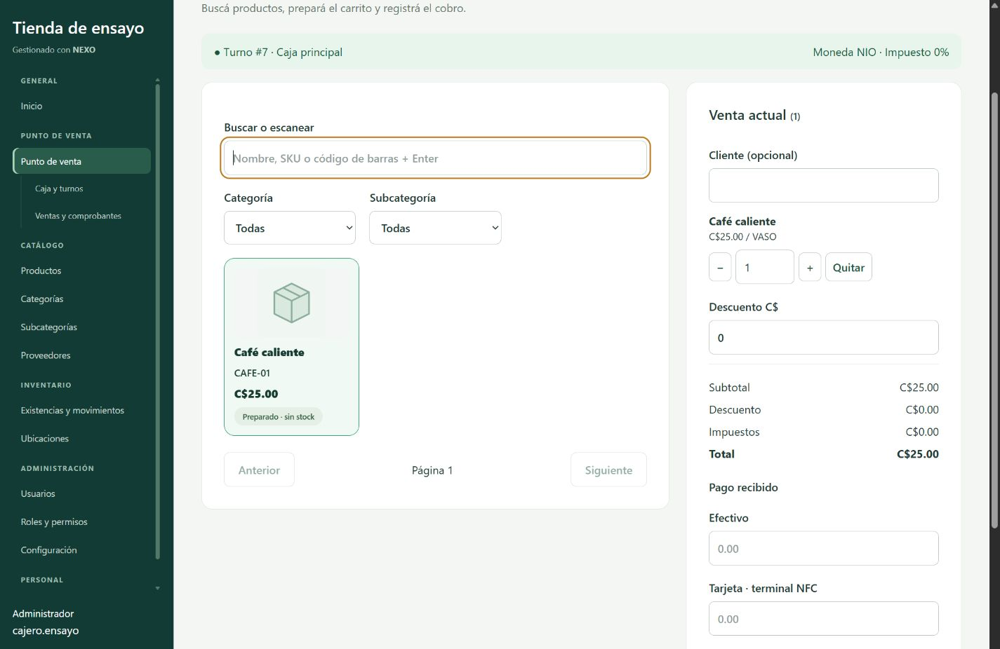
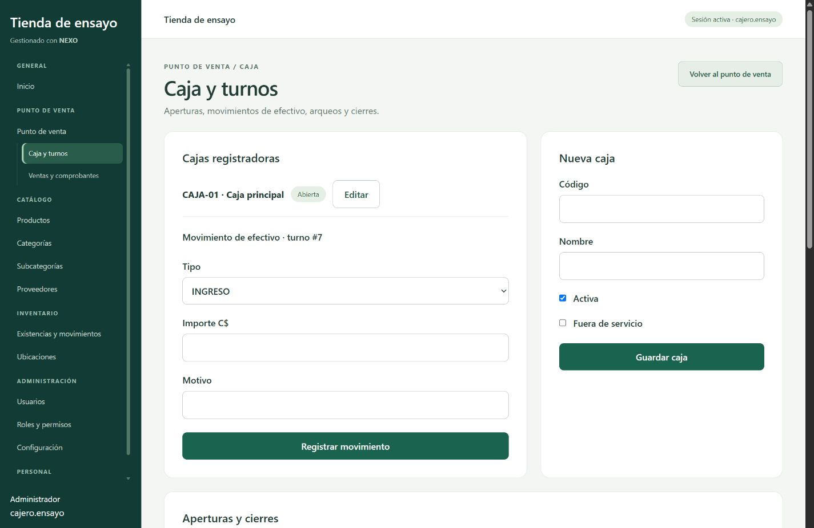

# Navegación por secciones

Ampliación de [[Fase 7]], [[Manual POS y caja]] y [[Referencias de pagos]].

## Objetivo

Separar la atención de ventas de la gestión de caja y organizar las opciones del sistema por tarea. Sustituye la pantalla única con pestañas de POS, caja e historial.

## Pantallas y permisos

|Ruta|Pantalla|Permiso de acceso|
|---|---|---|
|`/pos`|Punto de venta: productos, carrito y cobro|ventas.registrar|
|`/pos/caja`|Caja y turnos: administración, apertura, movimientos, arqueo y cierre|cajas.leer; cada operación conserva sus permisos específicos|
|`/pos/ventas`|Ventas y comprobantes: consulta, detalle, reimpresión y anulación autorizada|ventas.leer|

Caja e historial se derivan de Punto de venta en la navegación y tienen pantallas propias. El POS ofrece «Gestionar caja» y «Ver ventas»; las pantallas derivadas permiten volver al POS cuando el usuario tiene permiso de venta. La ruta de caja no muestra el catálogo ni el carrito como parte de su pantalla.

La separación es de interfaz, no cambia la regla de negocio: para confirmar ventas sigue siendo obligatorio un turno propio abierto. La apertura o el cierre actualiza el turno consultado al navegar. No se modifican endpoints, permisos del backend, transacciones, esquema ni datos.

## Menú principal

- **General:** Inicio.
- **Punto de venta:** Punto de venta, con Caja y turnos y Ventas y comprobantes como opciones derivadas.
- **Catálogo:** Productos, Categorías, Subcategorías y Proveedores.
- **Inventario:** Existencias (con Alertas); Operaciones desplegable (Entradas de mercancía, Salidas y mermas, Traslados); Conteos y ajustes; Historial de movimientos; Ubicaciones. Véase [[Inventario operativo]].
- **Administración:** Usuarios, Roles y permisos; Configuración.
- **Personal:** Mi cuenta.

Las opciones y grupos vacíos se filtran por permisos. Configuración mantiene además el requisito de rol Administrador. En escritorio el menú tiene desplazamiento propio y conserva el cierre de sesión accesible. En móvil se abre con «Menú del sistema» y se cierra al seleccionar una opción, evitando colocar la lista completa antes del contenido.

## Organización del frontend

|Archivo|Responsabilidad|
|---|---|
|`src/navigation.tsx`|Menú agrupado, permisos visibles y apertura/cierre móvil.|
|`src/main.tsx`|Conecta menú y rutas protegidas reales.|
|`src/sales-workspace.tsx`|Consulta el turno y contiene las rutas de la sección de ventas.|
|`src/sales-context.ts`|Comparte turno propio, historial de turnos y actualización entre pantallas.|
|`src/pos.tsx`|Solo POS, carrito y acceso al comprobante de la venta recién confirmada.|
|`src/cash.tsx`|Pantalla independiente de gestión de caja, turnos y arqueos.|
|`src/sales.tsx`|Historial y comprobantes reutilizados desde POS e historial.|
|`src/sales-shared.tsx`|Tipos, formatos, formulario de operación e impresión compartidos.|
|`src/styles.css`|Secciones, jerarquía de opciones, menú móvil y encabezados de módulos.|

Los nombres son relativos a `frontend/nexo-web/`. Se reutilizan React, React Router y Tailwind existentes; no se agregan dependencias.

`SalesWorkspace` mantiene el POS montado y oculto cuando se navega a caja o historial. Así conserva carrito, importes, referencias y cuerpo/UUID de un cobro con respuesta incierta, sin mostrar ambas pantallas juntas. Al salir de toda la sección, recargar o finalizar sesión se desmonta el borrador en memoria; ante resultado desconocido hay que consultar el historial antes de registrar otra venta.

## Etiqueta de tarjeta

La opción visible pasa a **«Tarjeta · terminal NFC»**, sin «(simulada)». La ayuda explica que el cobro se procesa en la terminal o el banco y que aquí se registra su referencia. Se conserva su obligatoriedad y no se implementa comunicación NFC ni una integración bancaria nueva. El alcance técnico de la demostración permanece documentado en [[Referencias de pagos]].

## Verificación ejecutada

- Compilación TypeScript/Vite y suite existente del cliente: consultar el resultado final en [[Verificación Fase 7]].
- Recorrido en navegador con la aplicación real (`main.tsx`, rutas, menú y guardas) y un arnés temporal que proporciona sesión/datos simulados. No accede al backend ni modifica MySQL.
- Desde `/pos`, seleccionar café, registrar C$25 de tarjeta y referencia; navegar a «Gestionar caja» y comprobar ruta `/pos/caja`, título propio y ausencia del POS visible.
- Abrir un turno simulado y volver al POS: carrito, importe y referencia conservados; se muestra el turno abierto.
- Simular pérdida de respuesta al cobrar, navegar a caja y volver: conserva el estado pendiente y «Reintentar venta». El reintento recupera una sola venta simulada y su comprobante con referencia.
- Abrir «Ver ventas»: ruta `/pos/ventas`, encabezado propio y una fila del historial simulado.
- Perfil Consulta: no ve grupos de ventas/administración y el acceso directo a `/pos/caja` muestra «Acceso restringido» mediante la guarda real de frontend.
- Revisión en escritorio 1440×1000 y móvil 390×844; sin desbordamiento horizontal observado. En móvil se comprobó abrir el menú, navegar a caja y cierre automático del menú (`aria-expanded=false`).
- Arnés, servidor y pestañas temporales retirados. Las capturas siguientes corresponden a datos simulados.

## Problemas y decisiones

- Separar rutas desmontando todo el POS perdería el carrito y la clave de un cobro pendiente. Se conserva su estado dentro de la sección, sin almacenamiento persistente en el navegador.
- Un menú completo antes del contenido ocupa demasiado alto en móvil; se añadió apertura explícita y cierre tras seleccionar.
- El primer intento de Vite dentro del sandbox falló al leer su configuración. Se repitió con permiso de ejecución; no se cambiaron permisos de la aplicación.
- La restricción visual de una ruta no sustituye autorización de servidor; las políticas backend se mantienen.

## Preguntas del jurado

**¿Separar caja permite vender sin apertura?** No. Son pantallas diferentes que comparten el turno; el servidor sigue validándolo dentro de la transacción.

**¿Por qué caja se deriva de Punto de venta?** Pertenece al flujo operativo de ventas, pero sus formularios y responsabilidades tienen una pantalla independiente.

**¿Por qué conservar el POS oculto?** Para no perder datos de un cliente ni crear otra clave al volver después de una respuesta de cobro incierta.

**¿Quitar “simulada” conecta una terminal real?** No. Es una etiqueta de interfaz; el procesamiento continúa siendo externo y las referencias se registran manualmente.

## Desplazamiento independiente del catálogo y la venta

El POS usa dos regiones enfocables con nombre: «Catálogo de productos» y «Venta actual». Cada tarjeta tiene overflow vertical propio y overscroll-behavior para contener el desplazamiento en sus límites; se retiró la posición sticky del carrito. La rueda o el teclado sobre una tarjeta desplaza su contenido sin cambiar el scroll de la otra.

En escritorio ambas tarjetas tienen la misma altura, calculada con el espacio disponible hasta el borde inferior de la ventana, con mínimo de 280 px. Checkout usa useLayoutEffect y ResizeObserver, más el evento resize; desconecta ambos al desmontarse. En móvil se apilan y cada una tiene un máximo de 75dvh, manteniendo desplazamiento interno. La página puede desplazarse para llegar a los paneles cuando están apilados o la ventana es muy baja.

Al agregar un producto, el foco vuelve al buscador con preventScroll para no llevar el catálogo al inicio. Este ajuste cambia presentación y foco, sin modificar ventas, cantidades, pagos ni stock. Archivos afectados: src/pos.tsx y src/styles.css, relativos al frontend.

## Presentación del comprobante

ReceiptView, en sales.tsx, mantiene el diálogo nativo HTML y utiliza aria-labelledby para nombrarlo. El margen automático y la posición fija en styles.css lo centran en el viewport; el reset de estilos dejaba el diálogo anterior en la esquina superior izquierda.

El encabezado incorpora una X con etiqueta accesible «Cerrar comprobante». Encabezado y pie no se contraen; solamente el cuerpo permite desplazamiento interno. El diseño conserva los datos de venta, referencias de pago, permisos de anulación y acciones de impresión térmica/A4. La presentación usa React y CSS existentes, sin dependencias nuevas ni cambios de endpoints o tablas.

**Pregunta del jurado:** ¿Por qué usar un diálogo nativo? Permite mostrar el comprobante sobre la pantalla actual con semántica modal y cierre mediante Escape; el CSS adapta sus dimensiones al espacio disponible. Resultados en [[Verificación Fase 7]].

## Operación guiada del POS y caja — 27 de octubre de 2026

**Objetivo:** reducir formularios simultáneos y orientar cada acción. React, TypeScript y los estilos existentes implementan presentación progresiva, sin nuevas dependencias.

- Pos.Checkout mantiene dos pasos: productos y cobro. Los campos de cliente y descuento son desplegables. El paso de cobro ofrece métodos individuales o combinado; cambiar de método limpia importes y referencias anteriores, precargando el total en el método individual. Volver conserva los datos.
- La cabecera del carrito y su botón principal quedan fuera de checkout-detail, que contiene el desplazamiento. Se usa un contenedor div: durante la verificación móvil el overflow directamente en fieldset permitía que sus controles se superpusieran al botón. El contenedor evita ese solapamiento.
- CashDesk empieza en Mi turno, con resumen y tarjetas de acciones; Historial y Cajas registradoras tienen vistas independientes dentro de la misma ruta. Apertura, movimiento y cierre se despliegan a demanda. El arqueo se consulta al elegirlo, no automáticamente.
- Los paneles se ocultan sin desmontar sus formularios para conservar datos al volver. OperationForm admite onPendingChange para bloquear navegación interna durante una operación ocupada o incierta. Conserva la clave y el cuerpo originales para el reintento.
- Se mantiene la comprobación de propiedad del turno y rol/permisos de administrador. La impresión y contratos de API continúan usando los mismos datos. No se modifican endpoints, tablas, reglas monetarias ni backend.

**Archivos:** pos.tsx, cash.tsx, sales-shared.tsx y styles.css. Manual actualizado en [[Manual POS y caja]]; evidencia en [[Verificación Fase 7]].

**Pregunta del jurado: ¿Ocultar los campos cambia las reglas de venta?** No. Organiza la interfaz por tareas; el servidor sigue validando propietario, descuentos, pagos y existencias. La clave de idempotencia sigue asociada a la solicitud original.

## POS integrado: catálogo y ticket en una superficie

La revisión de diseño posterior reemplaza las columnas separadas y los indicadores Productos/Cobro. Checkout mantiene un único pos-workbench con buscador y filtros superiores, catálogo de ancho completo y ticket inferior. La franja muestra total y Cobrar; Tu venta despliega las líneas de cantidades y opciones. Al agregar un producto se muestra el detalle y la tarjeta indica cuántas unidades figuran en la venta. Catálogo y detalle conservan su desplazamiento independiente dentro del mismo marco.

El cobro usa un dialog nativo centrado, abierto solo al pulsar Cobrar. Permite cerrar mediante X, Volver a la venta o Escape conservando los datos. Si hay una solicitud ocupada o incierta, esos cierres se bloquean hasta confirmar o recuperar la respuesta; Reintentar venta conserva el cuerpo y UUID originales. Antes de abrir el comprobante se cierra el diálogo de pago.

Se reutilizan ReceiptView y los estilos de diálogo existentes. El cambio se limita a pos.tsx y styles.css; la pantalla de caja y las reglas del servidor permanecen como están. Los métodos individuales, combinado, referencias y cambio mantienen sus validaciones. El manual vigente está en [[Manual POS y caja]].

**¿Por qué el ticket está abajo?** La solicitud del usuario prioriza ver el catálogo completo sin dos formularios laterales; el resumen inferior mantiene el total disponible y permite consultar el detalle solo cuando se necesita.

## Corrección de visibilidad de fotografías al agregar productos

Se retira la altura fija de pos-workbench y el cálculo con ResizeObserver/useLayoutEffect. El catálogo usa el flujo normal de la página, con overflow visible. El resumen inferior queda sticky y compacto; agregar no abre automáticamente el detalle. La combinación anterior de altura fija y ticket expandido consumía el espacio disponible y recortaba las fotografías.

Ver venta abre un dialog independiente a demanda para cantidades, descuentos y cliente; Seguir agregando vuelve al catálogo. Al quitar la última línea se cierra el detalle. Cobrar desde el detalle cierra ese diálogo antes de abrir el de pago. Los datos permanecen en Checkout; no se modifican endpoints ni reglas de venta. Se reutiliza la presentación de diálogos existente.
