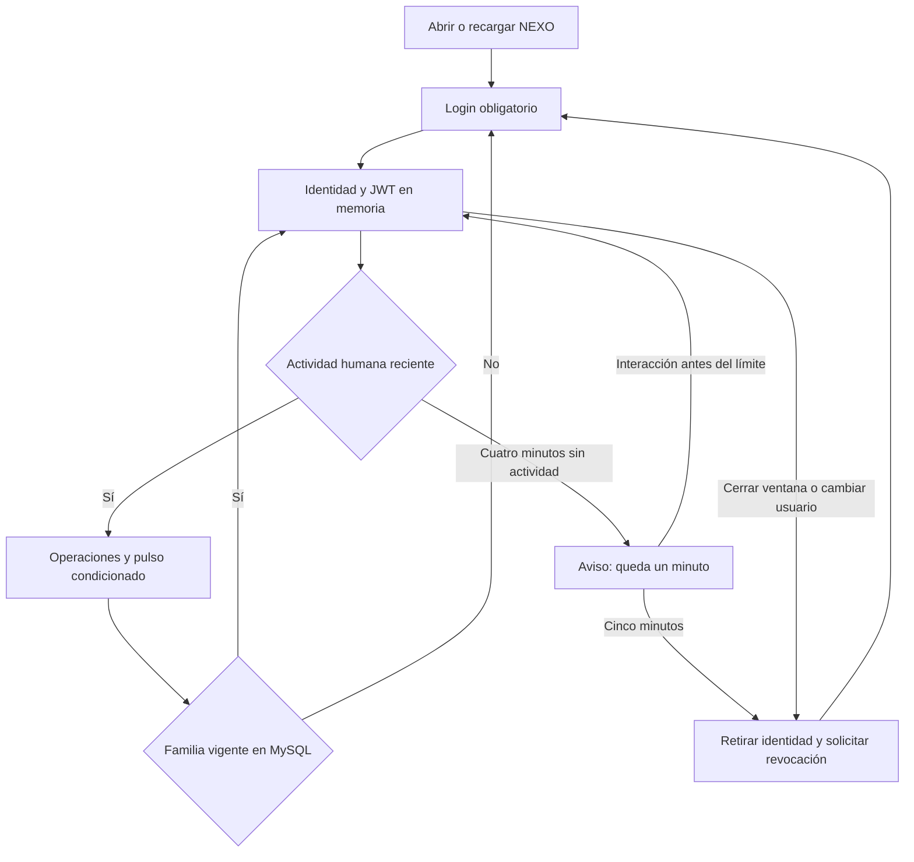

# Sesiones en terminales compartidas

16 de octubre de 2026. Política solicitada tras comprobar que NEXO recuperaba la sesión del día anterior. Relacionado: [[Fase 4]], [[Fase 5]], [[Ejecución local IDE]], [[Política de contraseñas]], [[Verificación sesiones compartidas]]. Esta nota sustituye las referencias históricas a restauración automática y refresh persistente de siete días.

## Problema y objetivo

Una terminal de caja puede ser utilizada por varias personas en distintos turnos. Si cerrar y abrir la ventana restaura la cuenta anterior, otra persona puede consultar información o registrar operaciones con una identidad equivocada. La política busca exigir identificación individual, reducir el tiempo de exposición de una terminal abandonada y conservar la trazabilidad de operaciones.

No depende de HTTPS: HTTPS protege las credenciales y datos durante el transporte, mientras que la política de sesión determina cuándo se exige volver a autenticarse. Los mismos controles se aplican a Administrador, Vendedor/Cajero y Consulta.

## Decisiones, por qué y para qué

| Decisión | Motivo y resultado |
|---|---|
| No restaurar sesión al abrir o recargar | El arranque presenta login y no llama auth/refresh. La cookie que el navegador conserve no basta para recuperar una identidad en la interfaz. También una pestaña nueva pide credenciales. Se acepta perder el contexto al recargar para priorizar el uso compartido. Navegar por rutas internas de React conserva la sesión. |
| Cookie de sesión | Se conservan HttpOnly, Secure y SameSite Strict, pero sin Expires/Max-Age al emitirla. Evita pedir al navegador que la conserve siete días. Algunos navegadores restauran incluso cookies de sesión; por eso este control acompaña la ausencia de restauración automática, no la sustituye. |
| Cinco minutos de inactividad | Impide dejar indefinidamente una cuenta operativa por descuido. Es un valor inicial del proyecto, no una obligación normativa. Un minuto antes se muestra aviso. La actividad válida es teclado, pulsación/clic, desplazamiento o toque; un mero movimiento del ratón o una respuesta HTTP no reinicia el contador. |
| Inactividad también en servidor | Cada recurso autenticado comprueba ultima_actividad en MySQL y rechaza/revoca familias inactivas por cinco minutos. Refresh tampoco revive una familia inactiva. No basta con ocultar la pantalla ni con un temporizador JavaScript que pueda suspenderse. |
| Pulso condicionado a interacción | Mientras la persona trabaja en formularios, se consulta auth/me como máximo una vez por minuto, solo si hubo interacción desde el pulso anterior y la pestaña está visible. Evita que el servidor confunda trabajo local con abandono. Un temporizador sin interacción no mantiene viva la sesión. El servidor mide actividad HTTP; un cliente alterado que produzca tráfico puede mantener actividad, igual que cualquier sesión basada en solicitudes. |
| Ocho horas como máximo absoluto | Obliga a autenticarse nuevamente aunque haya actividad continua. La rotación conserva el mismo vencimiento y no prolonga el turno indefinidamente. Es un máximo de seguridad inicial; puede exigir reingreso durante jornadas mayores. |
| Cierre local inmediato incluso sin red | Se retira la identidad y la vista protegida antes de pedir la revocación. Si falla la red, la pantalla no queda abierta; no se promete revocación remota confirmada. La familia quedará inservible por inactividad/expiración. |
| Cerrar sesión / Cambiar usuario visible | Permite entregar la terminal a otra persona con una acción clara. El nuevo login con la cookie anterior revoca esa familia antes de emitir la cookie de la nueva sesión. |
| Coordinación entre pestañas | BroadcastChannel retira la identidad de otras pestañas al salir o iniciar otra sesión. No se transmiten tokens, contraseñas ni datos de usuario por ese canal. Una renovación que recibe una identidad distinta se rechaza para evitar cambios silenciosos de operador. |
| Revocar sesiones antiguas al desplegar | La migración 004 invalida las familias creadas con la política de siete días. No elimina usuarios, permisos, ventas ni datos de negocio. Todos deben ingresar nuevamente después de aplicarla. |

## Cómo funciona el código

- `main.tsx`: App arranca directamente con las rutas y memoria vacía; Protected dirige al login. Layout monta SessionGuard y ofrece Cerrar sesión / Cambiar usuario. El logo utiliza navegación interna.
- `session-guard.tsx`: controla actividad humana, aviso final, comprobaciones cada segundo y al regresar a la pestaña, pulso condicionado y eventos pagehide/pageshow. En pagehide retira la sesión y solicita logout con keepalive como mejor esfuerzo. La restauración desde caché de navegación no debe devolver una identidad utilizable porque ya se retiró en pagehide.
- `api.ts`: conserva JWT exclusivamente en memoria, rechaza request/refresh tras inactividad o sin sesión, y no permite que respuestas tardías de login/refresh reabran una sesión retirada. La generación de sesión invalida trabajo asíncrono anterior. Renovar no cuenta como interacción humana. Web Locks sigue serializando operaciones de cookie.
- `SecurityService`: crea refresh con vencimiento absoluto de ocho horas; Refresh comprueba expiración y última actividad y revoca familias inválidas. Los JWT mantienen diez minutos, pero dependen siempre de la familia vigente en MySQL.
- `MySqlSecurityStore.FamilyActive`: bajo la transacción/bloqueo existentes, comprueba expiración absoluta, revocación e inactividad; si la familia es válida, actualiza su actividad. Si no, revoca su familia. No se implementa un proceso de limpieza periódico: la invalidez se comprueba al usar una sesión.
- `SecurityEndpoints`: emite cookie de sesión sin fecha persistente y revoca la familia de la cookie previa al completar un nuevo login. Permanecen CSRF, HTTPS, CORS y rate limit.
- `004_sesion_terminal_compartida.sql`: agrega sesiones_refresh.ultima_actividad, inicializa desde creado_en y revoca registros anteriores. Las otras tablas no cambian.

## Despliegue y uso

Detener la API, aplicar desde NEXO `pwsh -File database/Manage-Database.ps1 Migrate` y reiniciar con `dotnet run --project backend/Nexo.Api --launch-profile https`. Ejecutar frontend con npm run dev para desarrollo, o recompilar/publicar dist para producción. Migraciones anteriores no se modifican; no ejecutar Seed sobre una instalación existente.

En este equipo ya se aplicó la migración. No se necesita restablecer contraseñas: volver a entrar con la cuenta propia. Para cambiar de operador usar el botón visible. Bloquear/cerrar sesión no significa cerrar ni conciliar un turno de caja. La vinculación de cierre de turno con logout se implementará al desarrollar caja en Fase 7, en una transacción y flujo apropiados; esta entrega no registra turnos ni arqueos ficticios.

## Límites explícitos

Cerrar una ventana o terminar el proceso no garantiza que el navegador entregue pagehide/logout al servidor; no se usa ese evento como única barrera. Volver a abrir sí exige login por diseño. Si otra pestaña queda abierta, la difusión normalmente la bloquea; si el proceso muere sin notificación, sus límites de inactividad y el máximo absoluto siguen aplicando. Una persona que llega antes de cinco minutos a una ventana todavía abierta puede encontrarla activa: el personal debe cerrar sesión o bloquear el equipo al retirarse. No hay detección física de personas ni bloqueo inmediato por pérdida de foco.

Suspender el equipo puede retrasar temporizadores de pantalla; al regresar se compara el tiempo real transcurrido antes de admitir una nueva interacción. La API decide sus tiempos con el reloj del servidor/UTC. Los valores se fijan en código (TypeScript, C# y SQL); cualquier ajuste requiere cambiar y probar ambos lados. Un bloqueo puede descartar formularios sin guardar; se avisa previamente y no se conservan datos privados en almacenamiento del navegador.

## Preguntas del jurado

- ¿Por qué no basta una cookie que se borre al cerrar? Los navegadores pueden restaurarla y no garantizan avisar del cierre. El arranque sin restauración exige una nueva autenticación de todas maneras.
- ¿Por qué controles en cliente y servidor? El cliente retira información de la pantalla y avisa; el servidor rechaza solicitudes incluso si el cliente se altera o se detiene su temporizador.
- ¿Por qué ocho horas si el JWT dura diez minutos? JWT es la credencial corta; la familia refresh fija el máximo de la sesión. La comprobación de BD puede invalidar un JWT todavía no vencido.
- ¿La actividad prolonga ocho horas? No; solo actualiza el límite de inactividad. La expiración absoluta original se conserva al rotar.
- ¿Se cierran ventas o caja al bloquear? No. Sesión de seguridad y turno de negocio son conceptos distintos. El cierre formal de caja debe quedar registrado mediante el módulo correspondiente.

Referencia consultada: [OWASP Session Management Cheat Sheet](https://cheatsheetseries.owasp.org/cheatsheets/Session_Management_Cheat_Sheet.html), controles de expiración por inactividad, expiración absoluta y validación en servidor. Los cinco minutos y ocho horas son decisiones del proyecto.
