# Diagrama entidad-relación

Modelo implementado por `001_esquema.sql`. Cada flecha representa una FK real; RESTRICT/NO ACTION conserva las referencias. Las relaciones opcionales y claves compuestas se detallan en el SQL. [[Fase 2]] · [[Modelo preliminar]]

```mermaid
erDiagram
    roles {
        BIGINT id
        VARCHAR nombre
        BOOLEAN activo
    }
    permisos {
        BIGINT id
        VARCHAR codigo
        VARCHAR descripcion
    }
    usuarios {
        BIGINT id
        VARCHAR nombre_usuario
        VARCHAR nombre
        VARCHAR password_hash
        BOOLEAN activo
        INT version_sesion
        DATETIME creado_en
    }
    usuario_roles {
        BIGINT usuario_id
        BIGINT rol_id
    }
    usuarios ||--o{ usuario_roles : "usuario_id"
    roles ||--o{ usuario_roles : "rol_id"
    rol_permisos {
        BIGINT rol_id
        BIGINT permiso_id
    }
    roles ||--o{ rol_permisos : "rol_id"
    permisos ||--o{ rol_permisos : "permiso_id"
    sesiones_refresh {
        BIGINT id
        BIGINT usuario_id
        CHAR familia
        BINARY hash
        DATETIME creado_en
        DATETIME expira_en
        DATETIME revocado_en
        BIGINT reemplazo_id
    }
    usuarios ||--o{ sesiones_refresh : "usuario_id"
    sesiones_refresh ||--o{ sesiones_refresh : "reemplazo_id"
    categorias {
        BIGINT id
        VARCHAR nombre
        BOOLEAN activo
    }
    proveedores {
        BIGINT id
        VARCHAR nombre
        VARCHAR identificacion
        VARCHAR telefono
        BOOLEAN activo
    }
    productos {
        BIGINT id
        BIGINT categoria_id
        VARCHAR sku
        VARCHAR codigo_barras
        VARCHAR nombre
        DECIMAL precio
        DECIMAL stock_minimo
        BOOLEAN activo
    }
    categorias ||--o{ productos : "categoria_id"
    producto_proveedores {
        BIGINT producto_id
        BIGINT proveedor_id
    }
    productos ||--o{ producto_proveedores : "producto_id"
    proveedores ||--o{ producto_proveedores : "proveedor_id"
    existencias {
        BIGINT producto_id
        DECIMAL cantidad
    }
    productos ||--o{ existencias : "producto_id"
    cajas {
        BIGINT id
        VARCHAR codigo
        VARCHAR nombre
        BOOLEAN activo
    }
    turnos_caja {
        BIGINT id
        BIGINT caja_id
        BIGINT usuario_id
        DATETIME apertura_en
        DATETIME cierre_en
        DECIMAL fondo_inicial
        DECIMAL esperado
        DECIMAL contado
        DECIMAL diferencia
        VARCHAR estado
        BIGINT caja_abierta
    }
    cajas ||--o{ turnos_caja : "caja_id"
    usuarios ||--o{ turnos_caja : "usuario_id"
    ventas {
        BIGINT id
        BIGINT turno_id
        BIGINT caja_id
        BIGINT usuario_id
        DATETIME fecha
        VARCHAR estado
        DECIMAL subtotal
        DECIMAL descuento
        DECIMAL impuesto
        DECIMAL total
    }
    turnos_caja ||--o{ ventas : "turno_id,caja_id,usuario_id"
    detalle_ventas {
        BIGINT id
        BIGINT venta_id
        BIGINT producto_id
        VARCHAR sku_snapshot
        VARCHAR nombre_snapshot
        DECIMAL cantidad
        DECIMAL precio_unitario
        DECIMAL tasa_impuesto
        DECIMAL subtotal
        DECIMAL descuento
        DECIMAL impuesto
        DECIMAL total
    }
    ventas ||--o{ detalle_ventas : "venta_id"
    productos ||--o{ detalle_ventas : "producto_id"
    pagos {
        BIGINT id
        BIGINT venta_id
        VARCHAR metodo
        DECIMAL importe_aplicado
        DECIMAL recibido
        DECIMAL cambio
    }
    ventas ||--o{ pagos : "venta_id"
    facturas {
        BIGINT id
        BIGINT venta_id
        VARCHAR serie
        BIGINT numero
        DATETIME emitido_en
        VARCHAR tipo
        TEXT datos_emisor_snapshot
    }
    ventas ||--o{ facturas : "venta_id"
    anulaciones {
        BIGINT id
        BIGINT venta_id
        BIGINT autorizado_por
        BIGINT turno_reembolso_id
        VARCHAR motivo
        DATETIME creado_en
        DECIMAL reembolso
    }
    ventas ||--o{ anulaciones : "venta_id"
    usuarios ||--o{ anulaciones : "autorizado_por"
    turnos_caja ||--o{ anulaciones : "turno_reembolso_id"
    devoluciones {
        BIGINT id
        BIGINT venta_id
        BIGINT turno_id
        BIGINT autorizado_por
        VARCHAR motivo
        DATETIME creado_en
        DECIMAL total_reembolso
    }
    ventas ||--o{ devoluciones : "venta_id"
    turnos_caja ||--o{ devoluciones : "turno_id"
    usuarios ||--o{ devoluciones : "autorizado_por"
    detalle_devoluciones {
        BIGINT id
        BIGINT devolucion_id
        BIGINT venta_id
        BIGINT detalle_venta_id
        DECIMAL cantidad
        DECIMAL importe
        BOOLEAN reintegrar_stock
    }
    devoluciones ||--o{ detalle_devoluciones : "devolucion_id,venta_id"
    detalle_ventas ||--o{ detalle_devoluciones : "detalle_venta_id,venta_id"
    operaciones_inventario {
        BIGINT id
        VARCHAR tipo
        VARCHAR motivo
        BIGINT proveedor_id
        VARCHAR referencia
        BIGINT usuario_id
        DATETIME creado_en
    }
    proveedores ||--o{ operaciones_inventario : "proveedor_id"
    usuarios ||--o{ operaciones_inventario : "usuario_id"
    movimientos_inventario {
        BIGINT id
        BIGINT producto_id
        DECIMAL delta
        DECIMAL costo_unitario
        BIGINT operacion_id
        BIGINT detalle_venta_id
        BIGINT detalle_devolucion_id
        VARCHAR tipo
        BIGINT usuario_id
        DATETIME creado_en
    }
    productos ||--o{ movimientos_inventario : "producto_id"
    operaciones_inventario ||--o{ movimientos_inventario : "operacion_id"
    detalle_ventas ||--o{ movimientos_inventario : "detalle_venta_id,producto_id"
    detalle_devoluciones ||--o{ movimientos_inventario : "detalle_devolucion_id"
    usuarios ||--o{ movimientos_inventario : "usuario_id"
    movimientos_caja {
        BIGINT id
        BIGINT turno_id
        BIGINT usuario_id
        VARCHAR tipo
        DECIMAL importe
        VARCHAR motivo
        DATETIME creado_en
    }
    turnos_caja ||--o{ movimientos_caja : "turno_id"
    usuarios ||--o{ movimientos_caja : "usuario_id"
    operaciones_idempotentes {
        BIGINT id
        BIGINT usuario_id
        VARCHAR tipo
        VARCHAR clave
        BINARY hash_solicitud
        BIGINT recurso_id
        SMALLINT estado_http
        DATETIME creado_en
    }
    usuarios ||--o{ operaciones_idempotentes : "usuario_id"
    auditoria {
        BIGINT id
        BIGINT actor_id
        VARCHAR accion
        VARCHAR recurso_tipo
        BIGINT recurso_id
        DATETIME fecha
        VARCHAR resultado
        CHAR correlacion
        TEXT resumen
    }
    usuarios ||--o{ auditoria : "actor_id"
    respaldos {
        BIGINT id
        BIGINT solicitado_por
        VARCHAR nombre_interno
        BINARY hash_archivo
        VARCHAR estado
        DATETIME creado_en
        DATETIME finalizado_en
        VARCHAR error_saneado
    }
    usuarios ||--o{ respaldos : "solicitado_por"
```

La participación de un padre puede ser opcional cuando la FK admite NULL. Una FK no exige que existan hijos: los detalles y pagos obligatorios se validarán en la transacción del backend. `schema_migrations` es una tabla técnica independiente, con versión, checksum y fecha.

## Actualización Fase 6

Ver [[Fase 6]] para el diagrama de catálogo efectivo. Se agregaron subcategorías y ubicaciones jerárquicas; existencias_ubicacion relaciona cada producto con varias áreas/estantes. El saldo global existencias se conserva y se verifica contra el detalle. La migración 005 y sus claves compuestas son la fuente del esquema vigente.

## Extensión de inventario operativo

La migración 010 agrega conteos_inventario y detalle_conteos_inventario, motivo_codigo en operaciones y cantidades anterior/posterior en movimientos. Diagrama y reglas vigentes en [[Inventario operativo]]. Las columnas de saldo histórico son anulables para registros anteriores; no se inventan valores retrospectivos.
