# Modelo POS y caja

Vinculado con [[Fase 7]], [[Diagrama entidad-relación]], [[Requisitos POS y caja]] y [[Verificación Fase 7]].

## Reutilización y evolución

La migración `008_pos_caja.sql` amplía el esquema existente; no crea una segunda implementación de ventas. Las tablas de Fase 2 ya contemplaban caja, turno, venta, detalle, pago, factura, anulación, idempotencia y movimientos. Se mantienen PK/FK, decimales y políticas de no borrado histórico.

|Tabla|Cambios o uso en Fase 7|
|---|---|
|productos|Nueva `imagen VARCHAR(80) NULL`; solo referencia segura, nunca bytes/base64.|
|cajas|`fuera_servicio`, `version`; código único y estado activo histórico. Estado abierta/cerrada derivado del turno.|
|turnos_caja|`observaciones VARCHAR(1000)`; apertura/cierre, fondo, esperado, contado, diferencia generada y UNIQUE `caja_abierta` existentes.|
|ventas|`cliente VARCHAR(180) NULL`; número de venta derivado de PK con prefijo V-. Conserva FK compuesta al turno/caja/usuario.|
|detalle_ventas|`controla_inventario` snapshot; precios, SKU, nombre, tasa e importes históricos existentes.|
|pagos|Amplía CHECK a EFECTIVO/TARJETA/TRANSFERENCIA; no efectivo obliga cambio cero. Recibido=aplicado+cambio.|
|facturas|Serie INT, número=ID de venta, tipo ACADEMICO; datos_emisor_snapshot JSON como texto. UNIQUE por venta y serie/número.|
|anulaciones|`estado`, `pendiente_no_efectivo`; `reembolso` existente se usa solo para efectivo entregado; UNIQUE venta.|
|movimientos_inventario|Tipo VENTA negativo o ANULACION positivo, detalle de venta y ubicación originales; solo INSERT.|
|movimientos_caja|INGRESO/EGRESO con motivo, turno, responsable y fecha. Las devoluciones se contabilizan desde anulaciones para no restarlas dos veces.|
|configuracion_ventas|Tabla nueva singleton: tasa general inicial 0, identificación y dirección. No afirma una tasa legal.|
|operaciones_idempotentes|Tipos TURNO_ABRIR, TURNO_CERRAR, CAJA_MOVIMIENTO, VENTA y VENTA_ANULAR, con actor/clave/hash/recurso.|
|auditoria|Operaciones confirmadas en la misma transacción; recurso detallado en las tablas del negocio.|
|existencias / existencias_ubicacion|Saldo global y por ubicación actualizados junto con cada movimiento de venta/anulación.|

El script encuentra el CHECK histórico de pagos mediante `information_schema` para no asumir el nombre automático. Se mantienen las demás restricciones. No se modifican migraciones 001–007 ya aplicadas. La semilla 001 ahora especifica columnas de ventas/detalles para funcionar antes y después de añadir columnas.

```mermaid
erDiagram
 cajas ||--o{ turnos_caja : contiene
 usuarios ||--o{ turnos_caja : abre
 turnos_caja ||--o{ ventas : registra
 usuarios ||--o{ ventas : vende
 ventas ||--|{ detalle_ventas : contiene
 productos ||--o{ detalle_ventas : snapshot
 ventas ||--|{ pagos : recibe
 ventas ||--|| facturas : comprobante_interno
 ventas ||--o| anulaciones : conserva
 turnos_caja ||--o{ anulaciones : entrega_efectivo
 turnos_caja ||--o{ movimientos_caja : registra
 detalle_ventas ||--o{ movimientos_inventario : genera
 ubicaciones ||--o{ movimientos_inventario : localiza
 productos ||--o{ existencias_ubicacion : saldo
 usuarios ||--o{ operaciones_idempotentes : solicita
```

## Invariantes auditables

1. `SUM(detalle_ventas.total)=ventas.total`.
2. `SUM(pagos.importe_aplicado)=ventas.total`, también para anuladas: se conservan cobros originales.
3. Por pago: recibido=aplicado+cambio; cambio=0 si no es efectivo.
4. `existencias.cantidad=SUM(existencias_ubicacion.cantidad)=SUM(movimientos_inventario.delta)` por producto.
5. Cada saldo de ubicación coincide con el libro de esa ubicación.
6. Una venta tiene como máximo una anulación. Su devolución se suma al turno reembolsante, no se borra del turno original.
7. Una caja tiene a lo sumo un turno ABIERTO. Cierre exige campos completos y fecha no anterior a apertura.
8. Toda escritura de stock del sistema comparte `catalogo_bloqueo` antes de validar y actualizar saldos.

La base de ensayo se crea con un nombre aleatorio `nexo_f7_test_<UUID>`; aplica 001–008 y semillas. `Test-Phase7.ps1` la elimina al finalizar salvo `-KeepDatabase`. No reescribe la instalación `nexo`. Los usuarios demo inactivos sirven como FK de fixtures; el flujo HTTP de ensayo usa autenticación explícitamente simulada. Las pruebas de permisos separadas usan JWT y el almacén de seguridad de prueba.

## Migración 009: referencias

pagos.referencia es texto nullable de hasta 100 caracteres; los pagos históricos conservan NULL. EFECTIVO exige NULL mediante CHECK. El servicio exige referencia para pagos no efectivos nuevos. No hay unicidad global sin ámbito de proveedor/terminal. Véase [[Referencias de pagos]].
