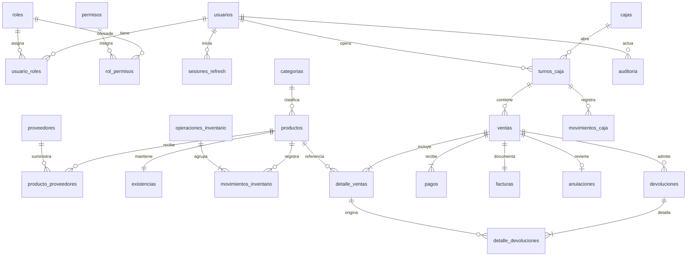

# Modelo preliminar

Diseño original de Fase 1. Actualización: el DDL y las tablas se implementaron en Fase 2; consultar [[Fase 2]], [[Diagrama entidad-relación]] y [[Verificación Fase 2]] para el estado real. Las propuestas pendientes de esta nota no son reglas aprobadas. Enlaces: [[Arquitectura]], [[API REST]], [[Decisiones pendientes]].

## Convenciones

MySQL 8.4, InnoDB y utf8mb4. PK `BIGINT UNSIGNED`, FK del mismo tipo. Fechas `DATETIME(6)` UTC. Importes `DECIMAL(18,2)`, precio/costo unitario `DECIMAL(18,4)`, cantidad `DECIMAL(18,3)`, tasa `DECIMAL(7,4)`; nunca float. Escalas y redondeo pendientes de aprobación. Campos obligatorios NOT NULL salvo opcionales indicados. CHECK para cantidades/importes válidos y estados permitidos. Identificadores normalizados, collation explícita para unicidad y comparación binaria para hashes/claves.

## Tablas previstas

Cada tabla tiene `id` PK salvo las claves compuestas indicadas. Las referencias indicadas son FK con ON DELETE RESTRICT para preservar historia.

|Tabla|Campos y restricciones principales|
|---|---|
|usuarios|nombre_usuario VARCHAR(80) UNIQUE, nombre VARCHAR(160), password_hash VARCHAR(512), activo BOOL, version_sesion INT, creado_en.|
|roles|nombre VARCHAR(60) UNIQUE, activo.|
|permisos|codigo VARCHAR(100) UNIQUE, descripcion VARCHAR(255). Catálogo técnico estable.|
|usuario_roles|usuario_id, rol_id; FK y PK compuesta.|
|rol_permisos|rol_id, permiso_id; FK y PK compuesta.|
|sesiones_refresh|usuario_id FK, familia CHAR(36), hash BINARY(32) UNIQUE, creado_en, expira_en, revocado_en opcional, reemplazo_id FK opcional.|
|categorias|nombre VARCHAR(100) UNIQUE, activo.|
|productos|categoria_id FK, sku VARCHAR(50) UNIQUE, codigo_barras VARCHAR(64) opcional UNIQUE, nombre VARCHAR(180), precio, stock_minimo, activo.|
|proveedores|nombre VARCHAR(180), identificacion VARCHAR(50) opcional UNIQUE, telefono VARCHAR(40) opcional, activo.|
|producto_proveedores|producto_id, proveedor_id; FK y PK compuesta. Permite varios proveedores.|
|existencias|producto_id PK/FK, cantidad CHECK >=0. Saldo operativo.|
|operaciones_inventario|tipo VARCHAR(24), motivo VARCHAR(500), proveedor_id FK opcional, referencia VARCHAR(100) opcional, usuario_id FK, creado_en. Agrupa entradas/salidas/ajustes manuales.|
|movimientos_inventario|producto_id FK, delta distinto de cero, costo_unitario opcional, operacion_id FK opcional, detalle_venta_id FK opcional, detalle_devolucion_id FK opcional, tipo, usuario_id FK, creado_en. Exactamente una fuente según tipo; anulación referencia el detalle original.|
|cajas|codigo VARCHAR(30) UNIQUE, nombre VARCHAR(100), activo.|
|turnos_caja|caja_id y usuario_id FK, apertura_en, cierre_en opcional, fondo_inicial, esperado/contado/diferencia opcionales hasta cerrar, estado.|
|ventas|turno_id, caja_id, usuario_id, fecha, estado, subtotal, descuento, impuesto, total. FK compuesta al turno asegura usuario/caja coherentes.|
|detalle_ventas|venta_id y producto_id FK, sku_snapshot, nombre_snapshot, cantidad, precio_unitario, tasa_impuesto, subtotal, descuento, impuesto, total. Conserva datos históricos.|
|pagos|venta_id FK, metodo VARCHAR(30), importe_aplicado, recibido, cambio; suma aplicada igual al total.|
|facturas|venta_id FK UNIQUE, serie VARCHAR(20), numero BIGINT, emitido_en, tipo, datos_emisor_snapshot TEXT; UNIQUE(serie,numero). Nombre heredado del alcance; comprobante inicialmente académico.|
|anulaciones|venta_id FK UNIQUE, autorizado_por FK usuarios, turno_reembolso_id FK, motivo, creado_en, reembolso.|
|devoluciones|venta_id FK, turno_id FK, autorizado_por FK usuarios, motivo, creado_en, total_reembolso.|
|detalle_devoluciones|devolucion_id y detalle_venta_id FK, cantidad >0, importe, reintegrar_stock BOOL. Verificar pertenencia a venta y cantidad acumulada.|
|movimientos_caja|turno_id y usuario_id FK, tipo INGRESO/EGRESO, importe >0, motivo, creado_en. Solo movimientos manuales; no duplicar pagos/reembolsos.|
|operaciones_idempotentes|usuario_id FK, tipo, clave VARCHAR(100), hash_solicitud BINARY(32), recurso_id BIGINT, estado_http, creado_en; UNIQUE(usuario_id,tipo,clave). Se confirma con el negocio.|
|auditoria|actor_id FK opcional para intentos anónimos, accion, recurso_tipo, recurso_id opcional, fecha, resultado, correlacion CHAR(36), resumen TEXT saneado. Solo inserciones desde aplicación.|
|respaldos|solicitado_por FK, nombre_interno UNIQUE, hash_archivo, estado, creado_en, finalizado_en y error_saneado opcionales. Sin rutas del cliente ni credenciales.|

Los estados/tipos tendrán CHECK con valores permitidos. Reglas entre filas, como suma de pagos o devoluciones acumuladas, se verifican dentro de transacciones; un CHECK no basta.

El diagrama muestra relaciones centrales; la tabla enumera FK adicionales. Existencia de detalle/pagos/comprobante se asegura al confirmar la transacción.

## Índices e integridad

- Un turno abierto por caja: columna generada nullable que devuelve caja_id solo en estado ABIERTO, con UNIQUE. Equivalente para usuario si se aprueba un turno por cajero. Bloquear caja al abrir/cerrar. No usar UNIQUE(caja_id,estado), pues impediría múltiples turnos cerrados.
- UNIQUE(id,caja_id,usuario_id) en turnos y FK compuesta desde ventas. CHECK exige cierre_en/contado al cerrar; turno cerrado no se reabre.
- Índices: ventas(fecha,id), ventas(turno_id,fecha), detalle_ventas(venta_id), pagos(venta_id,metodo), movimientos_inventario(producto_id,creado_en,id), auditoria(fecha,id), devoluciones(venta_id), sesiones_refresh(usuario_id,familia); indexar demás FK.
- Bloquear saldos por ID ordenado y actualizar con condición de disponibilidad. Libro inmutable: saldo = suma de deltas, incluido inventario inicial como entrada. Correcciones generan nuevos movimientos.
- Bloquear venta/detalles en devolución y anulación; no permitir devolución acumulada superior a venta ni anulación íntegra después de devolución. Regla exacta pendiente.
- Usuarios, maestros y cajas se desactivan; documentos no se borran. Asignaciones en tablas puente pueden eliminarse explícitamente con auditoría. Retención de sesiones/auditoría pendiente.
- Numeración mediante contador serializado bajo bloqueo y UNIQUE; no usar MAX+1 sin bloqueo ni prometer secuencia fiscal sin huecos. Tabla de contadores se concretará tras aprobar formato.
- Migraciones SQL futuras numeradas con versión/checksum en tabla técnica; sin EF. DDL MySQL requiere respaldo/recuperación, sin asumir rollback íntegro.

No se incluyen clientes fiscales, lotes, vencimientos, múltiples almacenes, cuentas por pagar ni valoración contable sin aprobación. Los datos fiscales y su configuración se modelarán después de definir el alcance.

## Evolución Fase 6

La migración 005 añade subcategorías, ubicaciones jerárquicas y existencias por ubicación. Mantiene saldo global compatible y asigna saldos/historial anteriores a B-01. Productos incorporan costo, unidad, subcategoría, control de inventario y versión. Véanse [[Fase 6]] y su diagrama efectivo; el modelo inicial de ubicación única queda reemplazado para el módulo de catálogo.
