# Verificación Fase 7

Fecha: 18 de octubre de 2026. Véanse [[Fase 7]], [[Manual POS y caja]], [[Modelo POS y caja]], [[Requisitos POS y caja]] y [[Verificación Fase 6]].

## Resultados ejecutados

|Verificación|Resultado real|
|---|---|
|Compilación Release de solución ASP.NET Core|Correcta, cero errores/advertencias de compilación. El SDK seleccionado es 11 RC y emite aviso informativo NETSDK1057; el target sigue siendo net10.0.|
|Suite unitaria final|35 correctas, 0 fallidas, 0 omitidas.|
|Suite de integración final con MySQL real habilitado|91 correctas, 0 fallidas, 0 omitidas. Incluye pruebas HTTP/seguridad y casos de repositorios existentes.|
|Frontend `npm test`|10 correctas; suite existente del cliente de sesión, no se presenta como prueba automatizada de componentes POS.|
|Frontend `npm run build` después de los ajustes finales|TypeScript y Vite correctos; 49 módulos.|
|Instalación desde cero en BD temporal|Migraciones 001–008 y semillas 001/002 aplicadas correctamente; usuario de aplicación para ejecutar las pruebas.|
|Migración 008 en instalación local existente|Aplicada sin error mediante Manage-Database.ps1; conserva datos históricos.|
|Integridad posterior en base temporal|0 diferencias stock global/libro, 0 diferencias saldo de ubicaciones/libro, 0 ventas con pagos inconsistentes.|
|Manage-Database.ps1 Verify en instalación existente después de migrar|MySQL 8.4.11: aserciones correctas, rechazos CHECK/FK/UNIQUE y permisos restringidos correctos.|
|Sintaxis Compose opcional API|`docker compose -f compose.yaml -f compose.api.yaml config --quiet` correcto con variables ficticias; no inicia servicios.|
|Persistencia Docker de PNG|SHA-256 idéntico antes/después de reiniciar y recrear un contenedor de prueba montando el mismo volumen. Recursos temporales retirados.|
|Revisión visual de POS|Recorrido con arnés temporal, datos simulados, sin credenciales ni acceso MySQL; escritorio 1280×900 y móvil 390×844.|
|Git diff --check|Sin errores de espacios. Git informa normalización LF/CRLF de archivos de texto.|

Los resultados TRX quedan en `tests/Nexo.UnitTests/TestResults/fase7.trx` y `tests/Nexo.IntegrationTests/TestResults/fase7.trx`, excluidos de Git. Total de la ejecución backend final: **126 pruebas aprobadas**. La ejecución frontend añade 10 pruebas de su cliente existente.

## Casos de servicios y MySQL

`MySqlPosTests` ejecuta:

- Venta normal con cobro C$50 para total C$25 y cambio C$25.
- Pago exacto con tarjeta y con transferencia.
- Venta con varios productos, uno preparado sin inventario, descuento autorizado y pago combinado efectivo/tarjeta.
- Rechazo del mismo descuento sin permiso de aplicación.
- Reintento idéntico devuelve el mismo ID; clave repetida con cliente distinto devuelve conflicto.
- Comprobante con serie INT y declaración de ausencia de validez fiscal.
- Anulación con restitución de stock, retorno de efectivo y C$20 no efectivos pendientes. Reintento idéntico no repite; clave nueva para la venta ya anulada se rechaza.
- Entradas y salidas autorizadas; arqueo esperado C$130, tarjeta C$45, transferencia C$25 y efectivo devuelto C$50 en el escenario combinado.
- Cierre contado C$135 con sobrante C$5; otro turno contado C$90 sobre fondo C$100 con faltante C$10.
- Rechazo de venta tras cierre y rechazo de segundo cierre con nueva clave; reintento del cierre original recupera el resultado.
- Stock insuficiente en la segunda línea de una venta después de procesar la primera: no queda venta parcial ni disminuye la primera existencia.
- Excepción inyectada después de completar todas las escrituras de confirmación pero antes de COMMIT: conserva saldo y no deja venta; repetir luego la solicitud confirma una única venta.
- Dos usuarios intentan abrir simultáneamente la misma caja: una apertura confirma.
- Dos cajeros en cajas y turnos diferentes venden simultáneamente la última unidad: una venta confirma y la otra devuelve `insufficient_stock`; saldo cero.
- Dos reintentos concurrentes de una venta ya confirmada devuelven el mismo ID sin descontar stock.
- Dos solicitudes simultáneas de una venta nueva con el mismo UUID producen un solo ID y una sola venta de preparado.
- Dos anulaciones concurrentes con claves diferentes de la misma venta: una confirma y el stock se devuelve una sola vez.
- Dos cierres concurrentes con claves distintas: uno confirma.

La prueba de muestra registró en su salida TRX: **«Muestra: 13 productos, 13 categorías, 11 subcategorías»**. Selecciona un representante por categoría y por subcategoría presente, priorizando existencia disponible, y prueba la venta del seleccionado o su rechazo si estuviera agotado. No vende todos los productos de la BD. La muestra incluye categorías de la semilla previa y las 11 categorías/subcategorías de demostración de Fase 6.

Los escenarios secuenciales y de muestra se revierten deliberadamente al terminar. Los de concurrencia confirman operaciones reales dentro de la BD temporal; la base completa se elimina al finalizar. No se cargaron ventas de prueba ni fixtures en la instalación `nexo` existente.

## Pruebas unitarias de pagos

`PosRulesTests` ejecuta efectivo, tarjeta y transferencia exactos; combinado de los tres métodos con cambio únicamente en efectivo; insuficiencia; exceso no efectivo; métodos desconocidos; duplicación de método; montos negativos y precisión de dos decimales. Comprueba redondeo `18.125 → 18.13`.

La tasa de la base MySQL de ensayo es cero. Se ejecutó además una prueba unitaria sobre `CalculateLine`, utilizada por la confirmación real: precio 18.125 × 3 = subtotal 54.38, descuento 4.38, base 50, tasa ficticia 0.10 → impuesto 5 y total 55. También rechaza descuento superior al subtotal y tasa fuera de rango. Esta tasa es únicamente un dato aritmético de prueba; no certifica tasas legales. Antes de activar una tasa en operación debe aprobarse el tratamiento tributario del negocio.

## Imágenes

`ProductImageTests` usa el servicio, MySQL y archivos reales:

- Subir PNG válido; referencia aleatoria `.png` sin ruta absoluta en BD.
- Leer bytes y reabrir almacenamiento desde otra instancia de servicio.
- Reemplazar con un nombre distinto.
- Rechazar una versión obsoleta.
- Rechazar `../evil.exe` como referencia interna.
- Rechazar contenido ejecutable con MIME PNG, SVG y archivo que supera el límite.
- Retirar imagen; lectura posterior sin fotografía.

Los casos existentes `BusinessIconTests` también ejecutaron validación de dimensiones, CRC corrupto, truncamiento, estructura inválida y datos insuficientes. Se reutiliza ese validador binario en imágenes de productos.

`PosApiTests` ejercita PUT/GET de imagen real, contenido `image/png`, cabecera `nosniff` y retirada con 404 posterior, además del flujo HTTP completo de caja → turno → venta idempotente → comprobante → ingreso → arqueo → anulación → cierre → rechazo de nueva venta.

`Test-ImagePersistence.ps1` crea un volumen y un contenedor efímeros sin red usando la imagen local ya existente, escribe un PNG en `/data/product-images`, verifica hash, reinicia, vuelve a verificar, elimina/recrea el contenedor sobre el mismo volumen y verifica otra vez. No construye ni reinicia la API completa; comprueba la persistencia del mecanismo de volumen usado en `compose.api.yaml`. El volumen y contenedor de prueba se retiran.

## Autorización HTTP

Se añadieron a `SecurityTests` verificaciones de 401 anónimo y 403 sin permiso para lecturas de cajas, turnos, arqueo, ventas, comprobantes, imagen y configuración POS. También para POST de cajas, apertura, cierre, movimientos, venta y anulación; PUT de cajas e imágenes exige permiso específico. Se ejecutaron junto con los casos existentes de JWT, expiración, permisos vigentes y revocación.

El flujo HTTP autorizado `PosApiTests` usa un esquema de autenticación de prueba que otorga permisos y un actor exclusivo para verificar contratos y persistencia. No representa un login de navegador ni sustituye los casos separados de seguridad con JWT.

## Recorrido visual realmente realizado

Se creó un arnés temporal Vite que importa el componente POS real y sustituye únicamente `api.request` por respuestas simuladas. Se identificaba en pantalla como «DATOS SIMULADOS · SIN ACCESO A MYSQL».

Se comprobó:

1. Tarjetas con recurso predeterminado, precio y disponibilidad; preparados visibles sin stock.
2. Agregar agua al carrito y agregar café mediante código de barras escrito en el buscador más Enter.
3. Cambiar a Caja y turnos y regresar conservando ambas líneas.
4. Total C$45, efectivo C$100, cambio C$55 y botón de cobro habilitado.
5. Confirmación simulada y comprobante con ambas líneas, métodos, efectivo aplicado, recibido y cambio; botones térmica/A4 visibles.
6. Añadir hot dog preparado y observar distribución de catálogo/carrito en escritorio.
7. Filtrar categoría Preparados y subcategoría Café: queda el café y desaparece el agua.
8. Revisar disposición en móvil, filtros y tarjetas sin desbordamiento horizontal observado.
9. Abrir arqueo, ingresar contado C$120 sobre esperado C$125 y observar diferencia −C$5.
10. Cierre simulado: la caja aparece cerrada/disponible, historial CERRADO y formulario de apertura vuelve a estar disponible.

El arnés se eliminó, el servidor temporal se detuvo y se restableció el viewport del navegador. La captura siguiente es evidencia visual **simulada**, no una venta real:

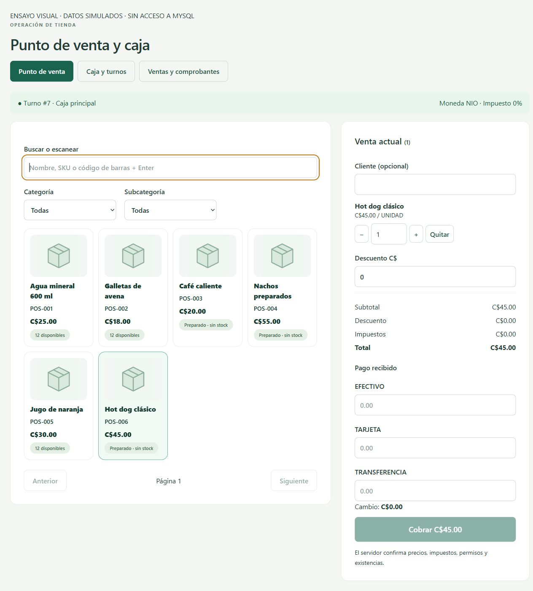

## Incidencias encontradas y resueltas

- Compilación: expresión de colección sin tipo destino en materialización dinámica de producto; sustituida por `Array.Empty<long>()`.
- El comando `python` no está disponible en PATH; se realizaron los cambios de texto con PowerShell, sin instalar runtimes.
- Docker y Vite/Vitest no pudieron acceder a recursos fuera del sandbox en el primer intento. Se repitieron con permiso de ejecución; las ejecuciones finales pasaron.
- La primera suite temporal tuvo **1 fallo de 90 casos de integración**: el preparador no concedía DELETE en `usuario_roles`/`rol_permisos`, necesario para una prueba existente de seguridad. Se corrigió únicamente el entorno temporal y se repitió. La suite final tiene 91 casos porque se añadió el flujo HTTP completo; no se oculta el fallo inicial como si hubiera sido aprobado.
- La semilla original insertaba ventas/detalles sin lista de columnas y habría fallado con el esquema ampliado. Se explicitó la lista y se verificó instalación desde cero.
- Se ajustaron los botones de cantidad para conservar tres decimales y el precio unitario de POS/comprobante para mostrar hasta cuatro decimales. La versión final pasó TypeScript/Vite.
- Se corrigió la pérdida del carrito al cambiar de pestaña manteniendo los componentes montados; el recorrido visual confirmó su conservación.
- Se conservan archivos huérfanos de imágenes ante errores de transacción o reemplazos: evita borrar una imagen cuyo COMMIT pudo haberse confirmado sin respuesta. No se implementó recolección física automática.

## Cómo repetir

```powershell
# Desde la raíz NEXO, con Docker MySQL local disponible:
pwsh -NoProfile -File database/Test-Phase7.ps1
pwsh -NoProfile -File database/Test-ImagePersistence.ps1
npm --prefix frontend/nexo-web test
npm --prefix frontend/nexo-web run build
pwsh -NoProfile -File database/Manage-Database.ps1 Verify
```

`Test-Phase7.ps1` toma credencial del contenedor sin imprimirla y la conserva solo en memoria para la ejecución. Puede usarse `-KeepDatabase` para investigar fallos, dejando explícitamente una base de ensayo. La opción normal retira la base aleatoria al terminar, también si falla una prueba. Sin `NEXO_TEST_MYSQL`, ejecutar `dotnet test` directamente omite los casos MySqlFact: no contarlos como aprobados.

## Pendientes y límites de la verificación

- Impresoras térmicas/A4 físicas, corte de papel, cajón y lector físico: no se probaron. Se verificó teclado+Enter y presencia de opciones de impresión, sin enviar papel a una impresora.
- Prueba entre varias terminales LAN y medición de rendimiento: no se ejecutaron. Las pruebas concurrentes sí usan conexiones MySQL distintas.
- No se construyó/desplegó la imagen Docker de API ni se recorrió el frontend con login contra esa API contenedorizada. Se verificaron compilación, HTTP en TestServer/MySQL y persistencia en volumen Docker por separado.
- El selector de fotos pasó compilación; subida/reemplazo/retirada se probaron mediante servicio y HTTP reales, no mediante un diálogo de selección de archivo del navegador.
- No se certificó facturación fiscal ni reembolso bancario real; ambos quedan fuera del alcance implementado y se documentan técnicamente.
- Para cargar el código en la API abierta del IDE hay que reiniciar/recompilar esa instancia. No se detuvo el proceso del usuario.

## Ampliación verificada — referencias de tarjeta y transferencia

Solicitud posterior de la misma Fase 7: [[Referencias de pagos]]. Migración 009 aplicada en la instalación local; esquema instalado desde cero con 001–009 en base temporal.

- Suite backend ejecutada tras el cambio: **43 unitarias + 92 de integración**, todas aprobadas, ninguna omitida. Reemplaza los totales anteriores como ejecución más reciente; las cifras iniciales se conservan como evidencia histórica.
- TypeScript y Vite: compilación correcta, 49 módulos.
- Nuevos casos: referencia obligatoria/vacía por método, longitud y caracteres inválidos, conservación de ceros iniciales, normalización exterior, rechazo en efectivo, tres métodos combinados y cada referencia independiente.
- Persistencia real y HTTP: referencia en comprobante, conservación al anular, rechazo HTTP 400 sin referencia e idempotencia de pagos combinados. El stock y los pagos no dejan operaciones parciales ante rechazo.
- Compatibilidad: se emuló una venta histórica sin referencia y su hash original; el mismo UUID recupera la venta, sin exigir cambiar el dato antiguo ni duplicar la operación. Cambiar referencia bajo un UUID confirmado produce conflicto.
- Invariantes SQL en base temporal tras las pruebas: cero diferencias stock/libro global y por ubicación; cero ventas con pagos inconsistentes. La base temporal se retiró.
- Recorrido visual con arnés temporal y datos simulados: tarjeta C$10 + transferencia C$15 para venta C$25; botón deshabilitado sin referencias y también con una sola; habilitado al completar ambas; comprobante y consulta posterior muestran NFC-00001234 y TRF-00005678. No hubo acceso a banco, terminal ni MySQL desde el arnés. Se retiraron el arnés y servidor temporal.
- No se realizó un cobro NFC real ni verificación de transferencia bancaria real. La simulación registra referencias ingresadas por el operador; no certifica aprobación bancaria.

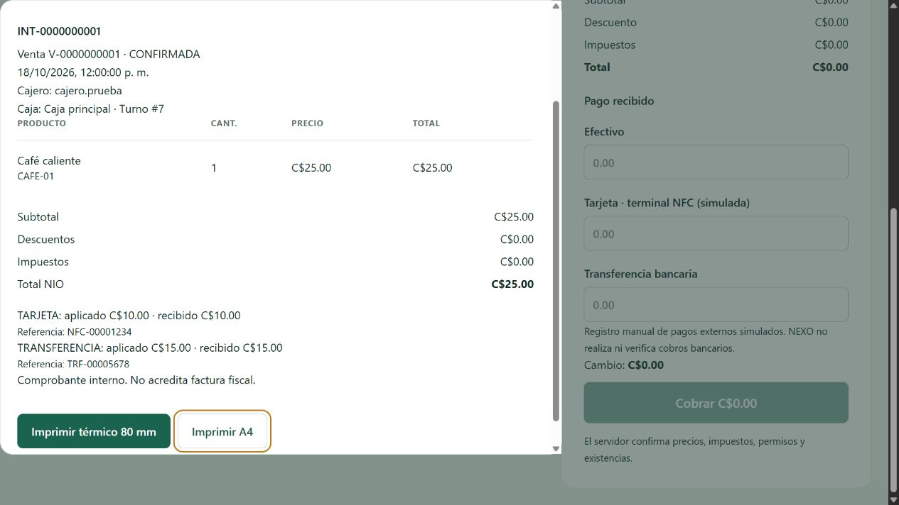

Verificaciones finales de esta ampliación: npm test **10/10** correctas (cliente de sesión existente); Manage-Database.ps1 Verify correcto en la instalación local tras 009, incluidos saldos/libro, pagos, CHECK/FK/UNIQUE y restricciones de permisos. No se presentan esas diez pruebas como pruebas automatizadas de los componentes de referencias.

## Reorganización verificada — POS independiente y menú por secciones

Véase [[Navegación por secciones]]. Cambio exclusivo de frontend/documentación; no modifica base de datos ni servicios del backend.

- Compilación final TypeScript/Vite correcta: 55 módulos, sin errores.
- Suite existente del frontend ejecutada: 10/10 pruebas aprobadas. Son pruebas del cliente de sesión; no se atribuyen a componentes nuevos.
- Recorrido de navegador con las rutas, menú, guardas y pantallas reales, usando un arnés temporal de sesión/API simuladas: POS en /pos, Caja y turnos en /pos/caja e historial en /pos/ventas; títulos y contenido independientes.
- Carrito, importe y referencia preservados al abrir caja simulada y volver. Después de simular respuesta perdida de venta, navegar a caja y regresar conserva el cuerpo pendiente y el reintento; se recupera una sola venta simulada con su comprobante.
- Cuenta Consulta: sin grupos de ventas/administración y acceso directo a /pos/caja rechazado por la guarda real del frontend. No sustituye una nueva prueba de autorización JWT/backend.
- Revisión visual en escritorio 1440×1000 y móvil 390×844: menú seccionado, selección activa, menú móvil plegable y cierre al navegar. Ancho de documento no superior al viewport en las comprobaciones realizadas.
- Etiqueta observada: «Tarjeta · terminal NFC», sin «(simulada)»; se conserva el campo de referencia obligatorio.
- Arnés y servidor temporal retirados; pestañas cerradas y viewport restablecido. No se realizaron ventas reales ni escrituras MySQL en este recorrido. No se repitió la suite de backend, porque esta reorganización no lo modifica.

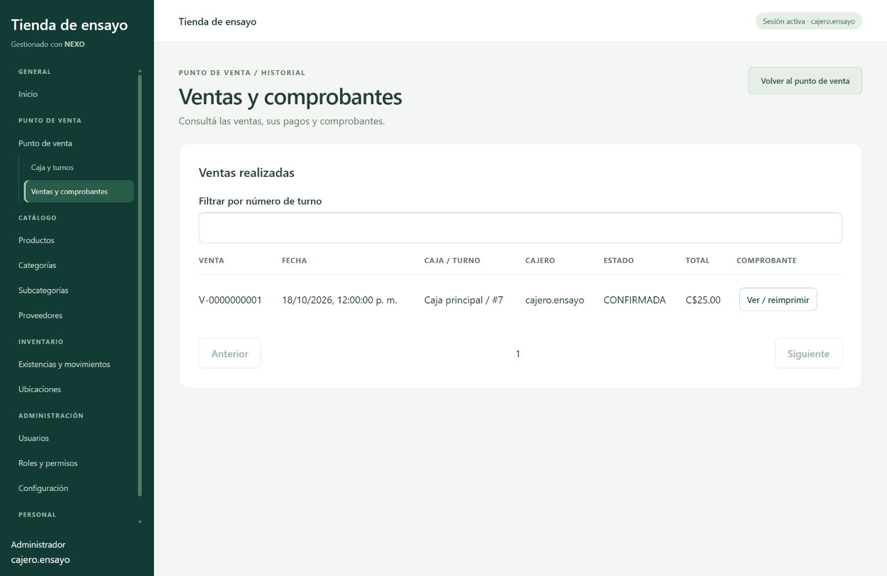

## Desplazamiento independiente — verificación visual

Se verificó la aplicación real en un arnés temporal con 24 productos ficticios y respuestas API simuladas; no se registraron ventas ni se modificó MySQL.

- En 1440×1000, ambas tarjetas tienen 672 px de alto y barras internas distintas; el catálogo contiene 2683 px de contenido y el carrito vacío 902 px.
- PageDown sobre catálogo: scroll del catálogo 0 → 588 px, venta permanece en 0.
- PageDown sobre Venta actual: su desplazamiento llega aproximadamente a 230.67 px y catálogo permanece en 588 px.
- Al agregar un producto visible más abajo, el buscador recibe el foco y el catálogo no vuelve al inicio; la venta muestra la línea añadida. El ajuste por visibilidad del elemento seleccionado y el anclaje del carrito al añadir contenido son comportamientos normales del navegador.
- Redimensionar a 1280×720 conserva alturas iguales de 463 px. En 390×844 los paneles apilados tienen un máximo observado de 632 px, overflow auto y documento de 375 px dentro del viewport de 390 px.
- No se observaron errores ni advertencias de consola durante ese recorrido.
- Se retiraron el arnés y servidor de prueba, se cerró la pestaña y se restableció el viewport. Esta comprobación es visual con datos simulados, no una prueba transaccional nueva.

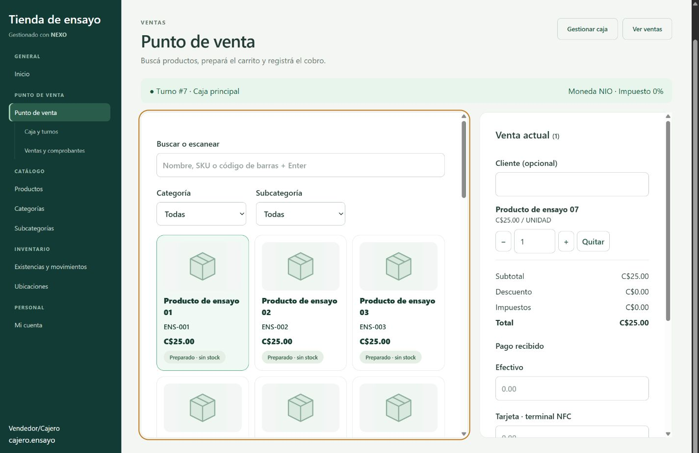

## Comprobante centrado y presentación visual

- Compilación TypeScript/Vite ejecutada: correcta, 55 módulos.
- Componente real ReceiptView probado con un arnés temporal y datos ficticios; sin ventas ni modificaciones de MySQL.
- Escritorio 1440×1000: diálogo de 760×924.17 px ubicado en (340, 37.92), centrado en ambos ejes.
- Móvil 390×844 con 18 líneas ficticias: diálogo de 370×820 px ubicado en (10, 12), sin desbordamiento horizontal del documento. El detalle tiene 1724 px de contenido dentro de una región de 675 px; encabezado, X y acciones de impresión visibles.
- Cierre con X, reapertura y cierre con Escape comprobados. No se observaron errores ni advertencias de consola.
- No se probaron impresoras físicas ni se repitieron pruebas transaccionales del backend para este cambio visual.

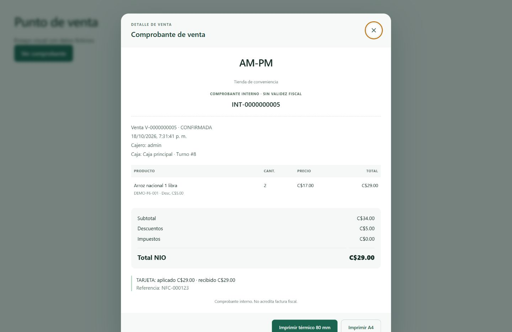

## Presentación neutral para empresa ficticia

Se retiran las leyendas fiscales del encabezado y pie del comprobante. El componente presenta «COMPROBANTE DE VENTA» también ante respuestas antiguas del servidor; impresión térmica y A4 copian el mismo artículo. El repositorio devuelve el título actualizado y se ajusta su aserción de integración.

Verificaciones ejecutadas: compilación TypeScript/Vite correcta (55 módulos); 43 pruebas unitarias backend aprobadas, cero fallos u omisiones; búsqueda de textos anteriores sin coincidencias en código fuente, semillas, pruebas y notas Markdown; git diff --check correcto. No se ejecutó la prueba de integración MySQL modificada, porque esta sesión no tiene NEXO_TEST_MYSQL configurado. Las capturas anteriores documentan el diseño previo, no la presentación textual actual.

## Privacidad de turnos y arqueos

Se agrega ShiftPrivacyApiTests con WebApplicationFactory, rutas y PosService reales; autenticación y repositorio de turnos sustituidos por fixtures en memoria. No requiere MySQL ni cambia datos reales.

Casos: cajero consulta turno propio abierto y cerrado; recibe 403 al consultar turnos ajenos abiertos/cerrados, incluso con cajas.historial; otro rol con ese permiso tampoco puede consultar arqueos ajenos; Administrador con historial y arqueo accede a turnos de otros cajeros; sin alguno de los permisos necesarios se rechaza la consulta ajena. La lista de turnos se limita al propietario para evitar exponer importes de cierres.

La primera ejecución en Debug no llegó a ejecutar pruebas porque los DLL de la API estaban bloqueados por el servidor abierto. Se compiló y probó en Release sin detener ese servidor. El frontend pasó npm run build (TypeScript y Vite, 55 módulos). No se realizó un recorrido visual nuevo ni una prueba JWT/MySQL real en esta revisión. Es necesario cargar la nueva compilación de la API para aplicar esta autorización en una instancia que ya estaba ejecutándose.

Resultado final ejecutado: 17/17 pruebas HTTP de privacidad aprobadas, cero fallos y cero omitidas. Comando: dotnet test tests/Nexo.IntegrationTests/Nexo.IntegrationTests.csproj --no-restore -c Release --filter FullyQualifiedName~ShiftPrivacyApiTests. Compilación del backend incluida en esa ejecución, sin errores.


## Fotografías ajustadas al recuadro del POS

Se cambió únicamente el ajuste CSS de las fotografías del POS a cover centrado. Verificaciones ejecutadas: npm run build correcto (TypeScript y Vite, 55 módulos) y git diff --check sin errores. No se ejecutó una nueva revisión visual en navegador ni pruebas de backend para este ajuste de presentación.

## Diseño por tareas — 27 de octubre de 2026

### Verificaciones ejecutadas

- npm run build: TypeScript/Vite correctos, 59 módulos.
- npm test: 11/11 pruebas existentes aprobadas; corresponden al cliente de sesión, no son pruebas unitarias de los nuevos pasos.
- Recorrido en navegador con Cash, Pos, OperationForm y menú reales; sesión y API sustituidas por un arnés temporal con productos y turnos ficticios, sin escrituras MySQL ni cobros bancarios.
- En 1440×1000, Mi turno muestra resumen y acciones sin formularios expandidos. Apertura y movimiento se abren al elegirlos; apertura enviada a la API ficticia y vuelta al resumen verificadas. Nueva caja se abre desde Cajas registradoras y Cancelar la oculta. No se probó guardar una caja en este recorrido.
- Un importe de movimiento y su motivo se conservan al cambiar a Historial y volver. Ante respuesta perdida simulada se bloquean navegación y accesos de sección; Reintentar misma operación conserva exactamente cuerpo y UUID.
- Carrito → cobro → carrito conserva producto, cliente y descuento. Una búsqueda exacta por código más Enter agrega un café preparado. Un descuento ficticio de C$5 sobre C$35 muestra total C$30.
- Para total C$17, efectivo C$20 muestra cambio C$3; tarjeta sin referencia bloquea el cobro; al llenar referencia se habilita. Pago combinado de C$5 efectivo y C$12 transferencia con referencia habilita el cobro. Cambiar de método retira los valores previos.
- Venta con tarjeta ante pérdida de respuesta simulada: Reintentar venta conserva cuerpo y UUID; al recuperar la respuesta se abre el comprobante y el carrito vuelve vacío al paso Productos. No es una nueva prueba transaccional MySQL.
- Perfil de cajero con permiso de historial: otro cajero no aparece en la lista y no existe botón Nueva caja. Su arqueo muestra diferencia −C$5 al contar C$665 sobre esperado C$670; ese conteo se conserva al volver al resumen y entrar de nuevo. No se ejecutó cierre real.
- Móvil 390×844: caja y POS sin desbordamiento horizontal (documento de 375 px). El detalle del cobro desplaza 546 px dentro de 391 px; el botón comienza a 715.91 px y queda separado del detalle, que termina a 701.91 px. Importe exacto habilita el cobro. Se corrigió un solapamiento inicial al trasladar el scroll de fieldset a un div.
- No se observaron errores ni advertencias de consola al final del recorrido. No se repitieron pruebas de backend ni impresión física para este cambio de interfaz.

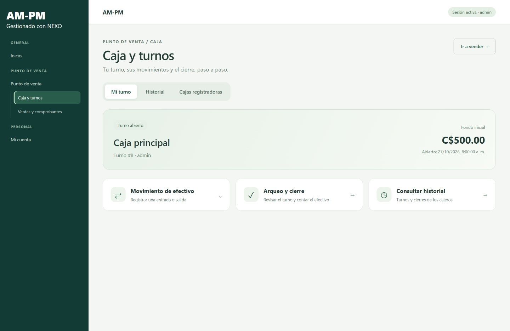
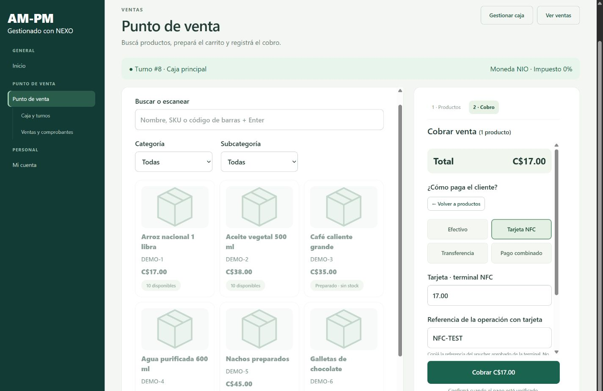
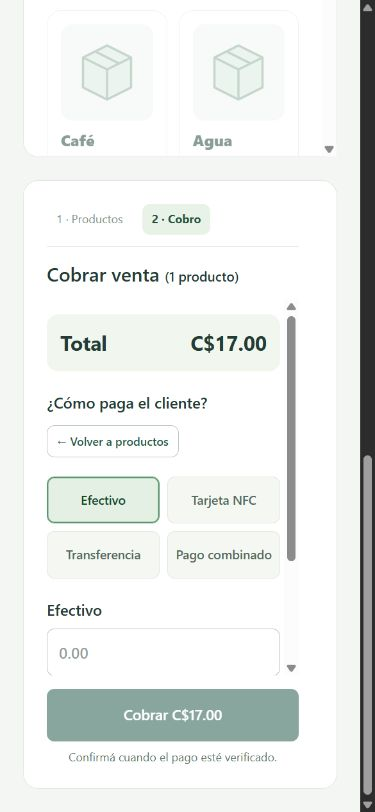

## POS integrado — revisión posterior del 27 de octubre de 2026

- Compilación npm run build ejecutada correctamente: TypeScript y Vite, 59 módulos.
- Navegador con Pos, ProductImage y ReceiptView reales, y arnés temporal con sesión/API ficticias. No se modificó MySQL ni se cobraron pagos reales.
- Escritorio 1440×1000: un marco único con catálogo completo y ticket inferior. Dos productos (arroz y café preparado) muestran total C$52, distintivos de cantidad y líneas de detalle. El detalle puede plegarse y el total permanece visible.
- Efectivo recibido C$60 sobre total C$52: cambio C$8. Volver a la venta y abrir nuevamente conserva ese importe. Tarjeta sin referencia bloquea confirmar.
- Respuesta perdida simulada al confirmar tarjeta: el modal permanece abierto ante Escape y ofrece Reintentar venta. El reintento conserva exactamente el cuerpo/UUID original; al recuperar la respuesta se abre el comprobante y el ticket vuelve vacío.
- Móvil 390×844: sin desbordamiento horizontal (documento 375 px). Código de barras más Enter añade café preparado; aumentar cantidad a 2 da total C$70. Plegar el ticket conserva el total y el acceso a Cobrar.
- Pago combinado C$20 efectivo + C$50 transferencia con referencia habilita la confirmación. El diálogo móvil mide 358×820 px y queda centrado en (16,12), con acciones visibles. Escape cierra normalmente cuando no existe solicitud pendiente.
- Sin errores ni advertencias de consola observados. No se repitieron pruebas transaccionales de backend, autorización JWT real ni impresión física para esta revisión visual.

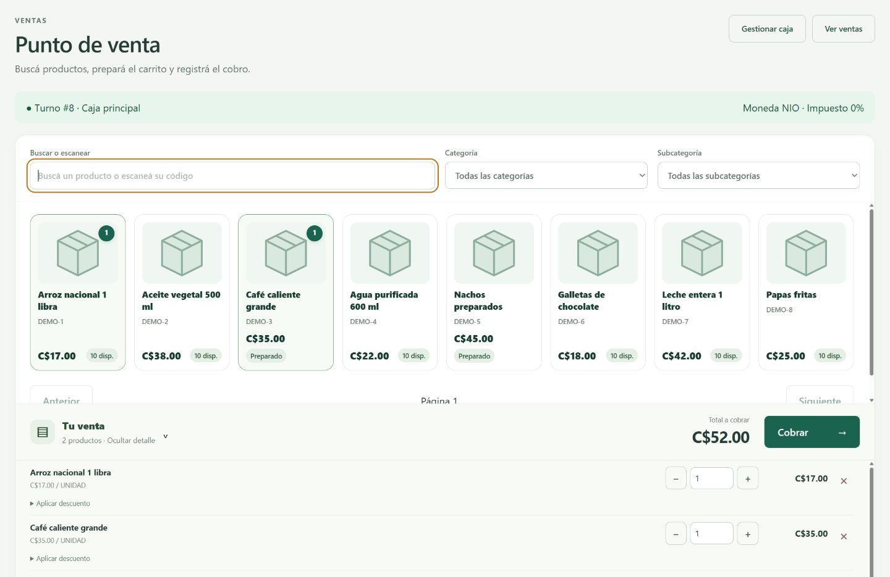
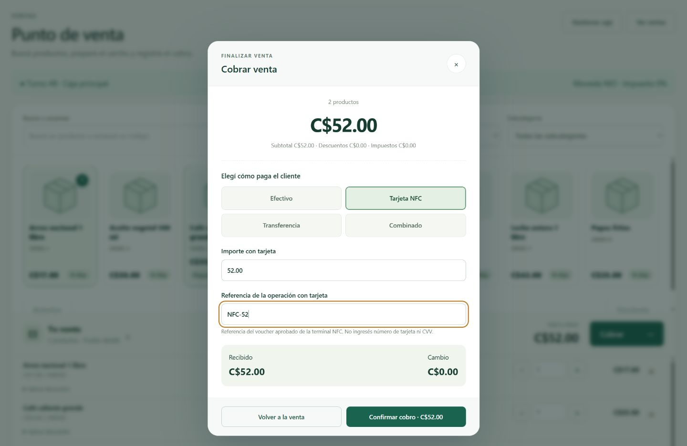
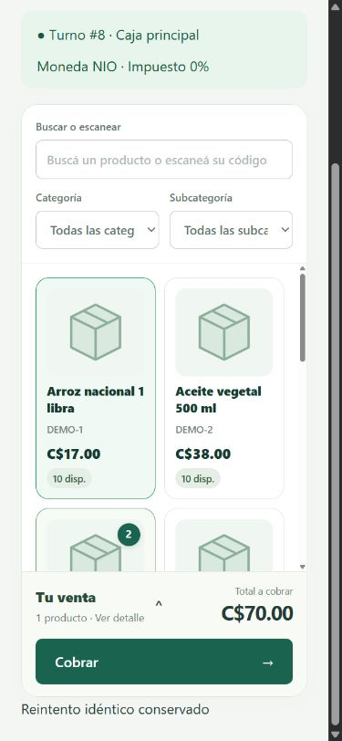

Suite ejecutada tras esta revisión: npm test, 11/11 pruebas existentes del cliente de sesión aprobadas. Arnés temporal retirado al finalizar.

## Catálogo libre y fotografías visibles al agregar

- npm run build ejecutado: TypeScript/Vite correctos, 59 módulos.
- Revisión con Pos real y sesión/API ficticias; sin operaciones MySQL ni confirmación de ventas.
- Escritorio 1440×800, 18 productos ficticios: imagen de 100 px antes y después de agregar tres productos; catálogo de 761 px con overflow visible y cero diálogos abiertos automáticamente. Barra inferior de 84.04 px, ubicada entre y=703.96 e y=788.
- Ver venta abre el detalle; aumentar una cantidad y Seguir agregando conserva total C$100. Abrir/cerrar el pago con Escape conserva efectivo C$100. Cobrar desde el detalle abre el pago sin superponer ambos diálogos.
- Móvil 390×844: documento de 375 px, sin desbordamiento horizontal. Catálogo con overflow visible; barra de 81.75 px entre y=750.25 e y=832, sin panel expandido que reduzca fotografías.
- Quitar las tres líneas cierra automáticamente el detalle y devuelve total C$0. Sin errores ni advertencias de consola observados.
- No se repitieron suites de backend ni pruebas de impresión o cobros reales para este ajuste visual. Arnés temporal retirado después de la revisión.

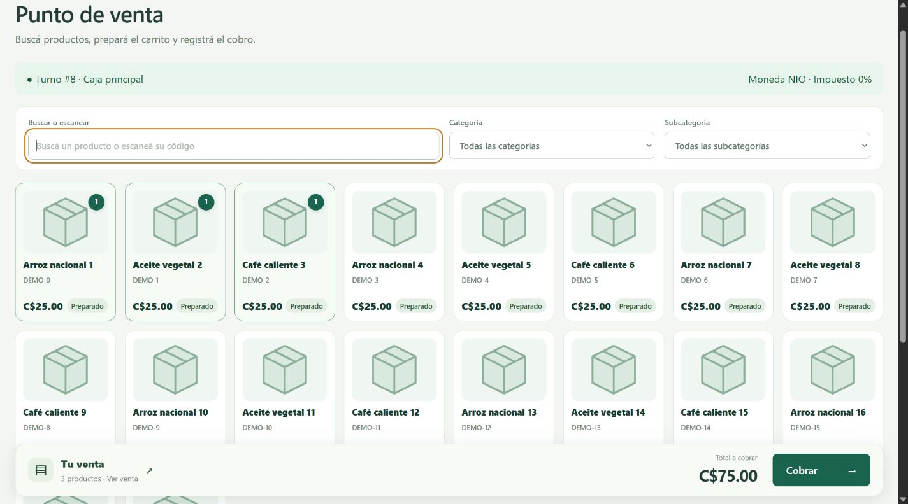
