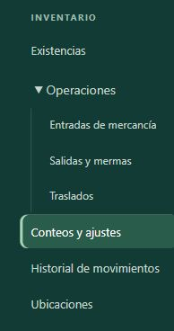
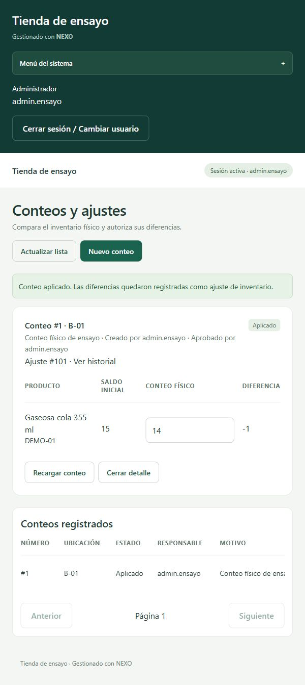
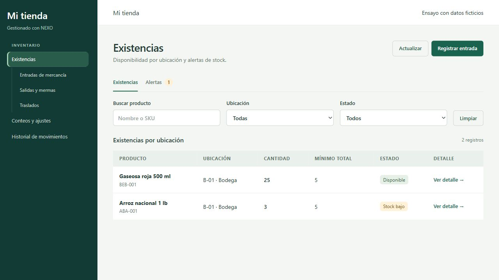
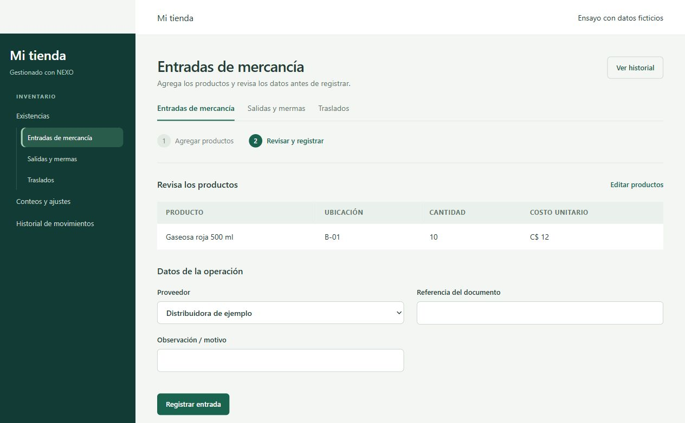

# Verificación inventario operativo

Fecha: 27 de octubre de 2026. Alcance: [[Inventario operativo]], ampliación de [[Fase 6]] compatible con POS de [[Fase 7]].

## Resultados ejecutados

- Backend Release: compilación satisfactoria, sin errores ni advertencias de compilación. El SDK instalado es preliminar y emite su aviso informativo.
- Suite completa sobre MySQL local aislado: **52 pruebas unitarias y 122 de integración aprobadas**, ninguna fallida ni omitida. Ejecutada con database/Test-InventoryOperations.ps1, que crea una base temporal con migraciones y semillas y la elimina al terminar.
- Frontend: TypeScript y Vite aprobados (58 módulos); Vitest: **10 pruebas aprobadas**.
- Migración 010 aplicada correctamente en la base local nexo. No se insertaron operaciones de demostración de esta ampliación en esa base.

La suite cubre recepción multilínea, reintento idempotente, conflicto de clave, rollback al fallar la segunda línea, traslado, salida clasificada, saldos anterior/posterior, proveedor/referencia/costo, conteos incompletos, versión desactualizada, bloqueo de pendientes, aprobación concurrente sin duplicación, cancelación, rechazo ante movimientos compensados, conteo sin diferencias y salidas concurrentes. Incluye rutas HTTP de conteos, validación de entradas, autorización y regresión de catálogo/POS/caja.

Consultas SQL posteriores: **0 diferencias** entre stock global y libro; **0 diferencias** por ubicación; **0 movimientos** con saldos anterior/posterior inconsistentes; **0 conteos aplicados** sin operación; **0 ventas** con pagos inconsistentes. El usuario de ensayos utiliza permisos sobre la base temporal; este recorrido no certifica privilegios de una instalación de producción.

Se retiró un InlineData duplicado detectado por xUnit en autorización. La ejecución final filtrada por SecurityTests aprobó 74 casos; omitió un caso MySQL por no proporcionar conexión en esa repetición. Ese caso sí se ejecutó en la suite completa aislada descrita arriba. No reapareció la advertencia de datos duplicados.

## Recorrido de interfaz

Se ejecutó la aplicación real (main.tsx, rutas, menú y guardas) en navegador con sesión y API simuladas mediante un arnés temporal. Este recorrido no accede al backend ni sustituye las pruebas MySQL anteriores.

1. Menú con Existencias, Operaciones desplegable, Conteos y ajustes, Historial de movimientos y Ubicaciones.
2. Recepción de dos productos con proveedor, referencia y costo. Se simuló confirmación seguida de pérdida de respuesta.
3. Navegar al historial y regresar conserva el cuerpo pendiente. Reintentar recupera una sola operación; el conteo posterior confirma saldo 15 y ausencia de duplicación.
4. Crear conteo, registrar 14 frente a 15, guardar, enviar y aprobar: estado APLICADO, diferencia -1 y operación asociada. Campos de cantidad pasan a lectura.
5. Apertura del menú compacto y jerarquía de opciones visibles.
6. Cuenta Consulta: no muestra Operaciones; acceso directo a entradas muestra Acceso restringido. Conteos permite listar sin mostrar creación ni aprobación.

## Límites y pendientes

- Pendiente recorrido integral con sesión real desde varias terminales LAN; el navegador de este ensayo utilizó datos simulados.
- No se certifican impresoras, dispositivos físicos ni tamaños de pantalla adicionales por esta revisión.
- El conteo no detiene operaciones durante el recuento físico; si cambian los movimientos, exige cancelar y repetir con referencia nueva.
- Lotes, fechas de caducidad por lote y conversiones caja/unidad no pertenecen a esta ampliación. Merma por vencimiento es una clasificación manual.
- Los saldos históricos previos a la migración no se reconstruyen: aparecen como desconocidos.
- Reiniciar y recompilar la API local que estaba abierta para cargar los endpoints nuevos; recargar e iniciar sesión para renovar permisos.

Comandos reproducibles y contrato completo en [[Inventario operativo]].

El arnés, la pestaña y el servidor temporal de interfaz se retiraron al concluir las verificaciones.

## Revisión del diseño simplificado

La revisión posterior eliminó tarjetas exteriores, redujo botones con borde, separó captura/revisión de operaciones y evitó mostrar simultáneamente lista y formularios de conteos. Los filtros de historial se abren inicialmente.

Recorrido en navegador con componentes reales y un arnés temporal con datos ficticios: agregar producto, continuar, volver a editar conservando líneas, revisar, simular respuesta perdida, consultar historial, regresar y reintentar; confirmación recuperada. Conteos: abrir lista, iniciar/ocultar creación, abrir detalle, capturar 24 frente a 25 y guardar; se muestra diferencia -1 y Enviar a aprobación sustituye Guardar cantidades. Existencias y Alertas muestran estados y filas correspondientes. No se utilizaron datos reales ni se ejecutó aprobación en MySQL en este recorrido visual.

Las capturas siguientes corresponden al arnés de revisión; la navegación lateral es una envoltura de ensayo. No sustituyen las evidencias del servidor. Compilación final TypeScript/Vite correcta (58 módulos) y 10 pruebas Vitest aprobadas. El arnés, servidor y pestaña temporales se retiraron después de la revisión. El primer intento de Vite fue bloqueado por lectura del sandbox; se repitió con el permiso de ejecución correspondiente.

No se repitió la suite del backend porque esta revisión cambia presentación y navegación de los formularios. La prueba de varias terminales LAN sigue pendiente.

## Incidencia: API antigua durante el registro de entradas

El 27 de octubre se diagnosticó el mensaje genérico al registrar una recepción. El proceso Debug activo había arrancado a las 20:45 con un binario anterior: su OpenAPI publicaba únicamente las rutas individuales originales y no /api/v1/inventario/recepciones. La captura correspondía al cliente actualizado, que ya usaba esa ruta.

Se detuvo únicamente ese proceso de esta instalación, se recompiló Debug (cero advertencias y errores) y se inició de nuevo con el perfil https. Verificación real: OpenAPI ahora publica recepciones y conteos; POST sin sesión a recepciones devuelve 401, en lugar de una ruta ausente. Se confirmó schema_migrations con 010_inventario_operativo. No se registró la entrada del usuario durante el diagnóstico.

El cliente ahora explica las respuestas HTTP 404 sin código de negocio e indica recompilar/reiniciar tras una actualización. Una prueba simula el 404 sin cuerpo y comprueba el mensaje, una sola solicitud y conservación de sesión: 11 pruebas Vitest aprobadas. Compilación TypeScript/Vite correcta. Queda por reintentar la recepción desde la sesión real del usuario.

El recorrido posterior del buscador único, Catálogo y permisos de consulta está en [[Diseño del catálogo y búsqueda de productos]]. Sus capturas y datos de navegador son simulados; no se modificó MySQL en esa revisión.
